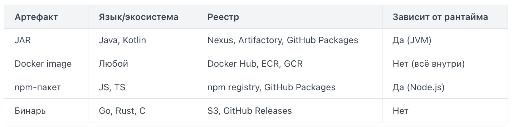

Разные артефакты требуют разных реестров для хранения, разных инструментов для публикации и разных механизмов доставки на сервер. Сравнение по ключевым характеристикам:



Docker image занимает особое место: он инкапсулирует и само приложение, и его окружение. Это делает образ самодостаточным — один и тот же образ одинаково работает на ноутбуке разработчика и в продакшен-кластере.

Типичная схема выглядит так: CI-система собирает артефакт, присваивает ему версию, загружает в реестр. Следующие стадии — тестирование, деплой на staging, деплой на production — берут артефакт из реестра по версии, а не пересобирают его заново. Это гарантирует, что на всех стадиях используется один и тот же файл.

Когда CI/CD-пайплайн собирает артефакт нужно куда-то положить — так, чтобы его могли забрать другие пайплайны, команды и окружения. Для этого существуют реестры артефактов (artifact registries) — специализированные хранилища, которые умеют принимать, версионировать, индексировать и выдавать артефакты по запросу.

Реестр — это не просто папка на сервере. Он знает, какой артефакт какой версии лежит, кто его загрузил, когда и из какого пайплайна. Это делает его надёжной точкой истины для всей цепочки доставки.

Sonatype Nexus Repository — один из самых распространённых реестров в корпоративной среде. Поддерживает Maven, npm, PyPI, Docker, NuGet, Helm и другие форматы в рамках одной установки. Существует в двух редакциях: бесплатная OSS и платная Pro. Nexus умеет работать как прокси-репозиторий (proxy repository): если артефакт не найден локально, он скачивает его из внешнего источника (например, Maven Central) и кэширует. Это ускоряет сборки и защищает от недоступности внешних репозиториев.

JFrog Artifactory — более функциональная коммерческая платформа, де-факто стандарт в крупных компаниях. Поддерживает более 30 форматов пакетов. Ключевая концепция — виртуальный репозиторий (virtual repository): единый URL, за которым скрываются несколько реальных хранилищ. Разработчик обращается к одному адресу, а Artifactory сам решает, откуда взять артефакт. Artifactory тесно интегрируется с инструментами безопасности и предоставляет метаданные сборки (build info) — полную трассировку от коммита до артефакта.

GitHub Packages — встроенный реестр платформы GitHub. Поддерживает Docker, npm, Maven, NuGet, RubyGems. Главное преимущество — нулевая настройка, если вы уже используете GitHub Actions: токен `GITHUB_TOKEN` даёт доступ к реестру без дополнительной конфигурации.

Пример публикации Docker-образа в GitHub Packages из GitHub Actions:
```
- name: Log in to GitHub Container Registry
  run: echo "${{ secrets.GITHUB_TOKEN }}" | docker login ghcr.io -u ${{ github.actor }} --password-stdin

- name: Build and push
  run: |
    docker build -t ghcr.io/myorg/myapp:1.4.2 .
    docker push ghcr.io/myorg/myapp:1.4.2
```

Для небольших команд, работающих на GitHub, Packages закрывает большинство потребностей без дополнительной инфраструктуры. Для крупных организаций с требованиями к безопасности и поддержкой множества форматов выбор обычно падает на Artifactory или Nexus Pro.

После выполнения этих шагов образ появится в реестре по адресу `ghcr.io/myorg/myapp` и будет доступен для скачивания в любом окружении с правильными правами доступа.

Когда CI/CD-пайплайн собирает артефакт, его нужно как-то назвать. Семантическое версионирование (Semantic Versioning, SemVer) — это соглашение, которое превращает номер версии в читаемое сообщение о том, что именно изменилось.

SemVer допускает расширения через дефис и плюс:

```
1.0.0-alpha.1
1.0.0-beta.3
1.0.0-rc.1
1.0.0+build.20240601
```

Суффикс `-alpha`, `-beta`, `-rc` (release candidate) сигнализирует, что версия нестабильна. В реестрах артефактов такие версии часто хранятся отдельно от стабильных релизов — в snapshot- или pre-release-репозиториях.

Без правил хранения реестр артефактов быстро заполняется тысячами версий, большинство из которых никто никогда не запустит в продакшене. Политики хранения решают эту проблему системно, без ручного вмешательства.

Retention-политика — это набор правил, определяющих, какие артефакты оставить, а какие удалить автоматически. Правила формулируются по нескольким осям:
- возраст: удалять артефакты старше 90 дней
- количество версий: хранить последние 10 версий каждого пакета
- тег: не удалять версии с тегом release
- частота загрузок: удалять версии, не скачанные за 30 дней

Cleanup — это непосредственное удаление артефактов, которые попали под действие retention-политики. Важно разделять два этапа: сначала политика маркирует кандидатов на удаление, затем задача cleanup их физически удаляет. В GitLab Container Registry cleanup можно настроить через файл .gitlab-ci.yml или через интерфейс проекта:

```
cleanup:
  image: registry.gitlab.com/gitlab-org/cli
  script:
    - glab container cleanup --keep-n 5 --older-than 30d
```

Это оставит пять последних тегов и удалит всё старше 30 дней.

Неизменяемые теги (immutable tags) — механизм, запрещающий перезапись уже опубликованного артефакта под тем же именем. Если тег v1.2.3 уже существует в реестре, любая попытка запушить под ним новый образ завершится ошибкой. Без immutable tags разработчик может случайно перезаписать релизный образ, и все, кто тянет v1.2.3, получат другой код — без предупреждения. Это прямой путь к непредсказуемому поведению в продакшене. Практическое правило: теги вида latest и dev оставляйте изменяемыми — они по природе своей указывают на «текущее состояние». Теги с конкретными версиями по SemVer всегда делайте immutable.