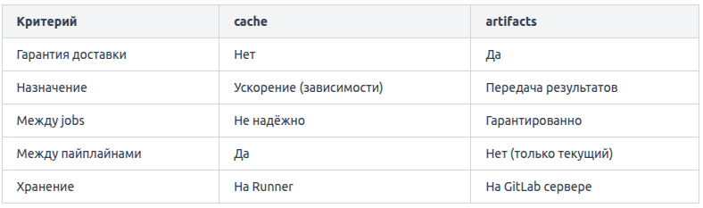

В GitLab CI есть два механизма сохранения файлов между задачами пайплайна — `cache` и `artifacts`.

**cache: ускорение повторных запусков**
Кэш предназначен для хранения данных, повторное использование которых между запусками экономит время. Классический пример — зависимости проекта: папка node_modules, .venv, .m2/repository.

Кэш не гарантирует доставку файлов между jobs. Он может быть недоступен, устаревшим или вовсе отсутствовать — и пайплайн всё равно должен работать корректно. Кэш — это оптимизация, а не механизм передачи данных.

```
build:
  stage: build
  cache:
    key: "$CI_COMMIT_REF_SLUG"
    paths:
      - node_modules/
  script:
    - npm install
    - npm run build
```

Ключ key определяет, когда кэш считается «своим». Здесь используется имя ветки: разные ветки получат разные кэши. Если key не задан, кэш общий для всех jobs.

**artifacts: передача файлов между jobs**
Артефакты (artifacts) — это файлы, которые job сохраняет и передаёт следующим jobs в пайплайне. GitLab гарантирует их доставку. Типичный сценарий: job build компилирует бинарник, job test его запускает, job deploy публикует.

```
build:
  stage: build
  script:
    - npm run build
  artifacts:
    paths:
      - dist/
    expire_in: 1 week

test:
  stage: test
  script:
    - npm run test -- --coverage
  artifacts:
    reports:
      coverage_report:
        coverage_format: cobertura
        path: coverage/cobertura-coverage.xml
```

Здесь `dist/` автоматически станет доступна в job `test` без каких-либо дополнительных настроек. Параметр `expire_in` задаёт срок хранения — без него артефакты хранятся по умолчанию 30 дней (зависит от настроек инстанса).

Подтип `artifacts: reports` — специальный: GitLab умеет парсить такие файлы и отображать результаты прямо в интерфейсе Merge Request (покрытие, тесты, уязвимости).

