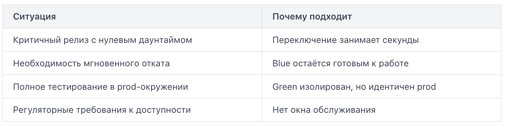

**Rolling Update (скользящее обновление)** — стратегия развёртывания, при которой инстансы (экземпляры) приложения заменяются новой версией поочерёдно, небольшими группами, а не все сразу. В каждый момент времени часть инстансов работает на старой версии, часть — уже на новой. Приложение остаётся доступным на протяжении всего процесса.

Представьте, что у вас запущено 4 инстанса приложения версии `v1`. Вы хотите обновить до `v2`.

При Rolling Update процесс выглядит так:

1. Балансировщик нагрузки (load balancer) выводит один инстанс из ротации.
2. На нём останавливается `v1` и запускается `v2`.
3. Инстанс проходит проверку готовности (health check) и возвращается в ротацию.
4. Шаги 1–3 повторяются для следующего инстанса.

Параметр batch size (размер пакета) определяет, сколько инстансов обновляется одновременно. Если batch size = 1, замена идёт по одному; если batch size = 2 — по два за раз.

Ограничения:
- Медленный rollback. Если обнаружена ошибка в v2, откат выполняется тем же скользящим способом — инстансы снова заменяются по одному, только теперь в обратном направлении. Это занимает время.
- Зависание обновления. Если новый инстанс не проходит health check, Kubernetes остановит обновление на этом шаге. Часть инстансов будет на v1, часть — на v2, часть — в состоянии ошибки.

**Blue-Green Deployment** — это стратегия развёртывания, при которой одновременно существуют два полностью идентичных производственных окружения: Blue и Green. В каждый момент времени только одно из них принимает реальный трафик пользователей, второе находится в резерве или используется для подготовки новой версии.

Представьте светофор на перекрёстке. Пока горит синий свет — весь поток машин едет через синий маршрут. Зелёный маршрут в это время свободен: там можно проводить ремонт, тестировать новое покрытие, не мешая движению. Когда всё готово — переключаете свет, и весь поток уходит на зелёный.

В терминах инфраструктуры схема выглядит так:

1. Blue — текущая стабильная версия приложения, принимает 100% трафика.
2. Green — новая версия, развёртывается и тестируется в изоляции.
3. После успешной проверки балансировщик нагрузки (load balancer) переключает трафик с Blue на Green.
4. Blue остаётся живым ещё некоторое время — на случай, если нужно быстро откатиться.

Что важно учитывать:
- Состояние базы данных — самая частая сложность. Оба окружения могут обращаться к одной БД, поэтому миграции схемы нужно делать обратно совместимыми: новые колонки добавляются как nullable, старые не удаляются сразу.
- Стоимость инфраструктуры удваивается в период, когда оба окружения активны. Для небольших команд это может быть существенным ограничением.
- Прогрев кэшей — Green-окружение после переключения начинает с холодного кэша, что может дать кратковременный всплеск нагрузки на БД.

Когда Blue-Green особенно полезен:

Главная ценность стратегии — атомарность переключения: пользователи в любой момент работают только с одной версией приложения, никогда не попадая в состояние, когда часть запросов обслуживается старым кодом, а часть — новым.

**Canary Deployment (канареечное развёртывание)** — стратегия, при которой новая версия приложения получает лишь небольшую долю реального трафика, пока старая версия продолжает обслуживать остальных пользователей.

Развёртывание происходит поэтапно. Сначала небольшой процент пользователей — обычно 1–5% — начинает получать ответы от новой версии. Остальные по-прежнему работают со старой. Команда наблюдает за метриками: частота ошибок, время ответа, бизнес-показатели. Если всё в порядке, процент постепенно увеличивают. Если метрики ухудшились — трафик мгновенно возвращают на старую версию.

Canary-развёртывание имеет смысл только при наличии метрик, на которые вы реально смотрите.

Canary без автоматического rollback при превышении порогов — просто ручное развёртывание с дополнительными шагами. Инструменты вроде Argo Rollouts или Flagger позволяют задать условия остановки декларативно, и система сама откатит изменения без участия человека.

На первый взгляд A/B тестирование и Canary Deployment похожи: в обоих случаях часть пользователей получает одну версию приложения, а часть — другую. Но цели у этих подходов принципиально разные.

Canary Deployment: цель — снизить риск. Canary — это стратегия постепенного выкатывания (progressive delivery). Её задача — убедиться, что новая версия кода стабильна в продакшене, прежде чем она получит 100% трафика.

A/B Testing: цель — проверить гипотезу о продукте. A/B тестирование — это метод проверки продуктовых гипотез. Две группы пользователей намеренно получают разный пользовательский опыт, чтобы измерить, какой вариант лучше достигает бизнес-цели.