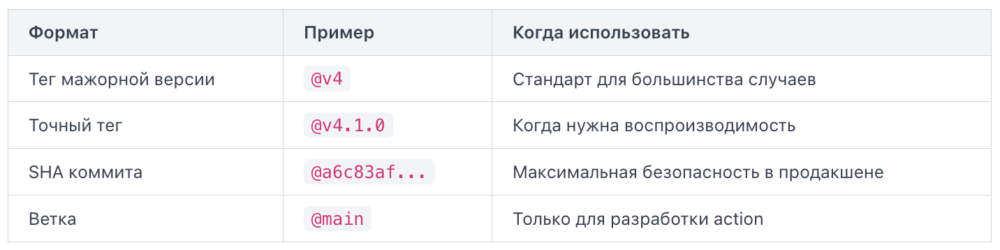

Workflow (рабочий процесс) в GitHub Actions — это автоматизированный сценарий, описанный в YAML-файле. Файл хранится в репозитории по пути .github/workflows/ и запускается при наступлении определённых событий.

Минимальный рабочий workflow выглядит так:
```
name: CI

on:
  push:
    branches:
      - main

jobs:
  build:
    runs-on: ubuntu-latest
    steps:
      - name: Проверить код
        run: echo "Сборка запущена"
```

`name`: название workflow, которое выводится в GitHub.

`on` определяет, при каком событии GitHub запустит workflow. В примере выше это `push` в ветку `main`. Можно указать несколько событий сразу:

```
on:
  push:
    branches:
      - main
      - develop
  pull_request:
```

без `on` workflow не запустится никогда.

`jobs` — это набор независимых единиц работы. Каждое задание выполняется на отдельной виртуальной машине. По умолчанию все задания запускаются параллельно. Если нужна последовательность, используется ключ needs. Имя задания (build в примере) — произвольное, латиницей без пробелов. Оно используется в логах и при настройке зависимостей между заданиями.

`runs-on` задаёт операционную систему раннера (runner) — виртуальной машины, на которой выполняется задание. GitHub предоставляет несколько стандартных вариантов: ubuntu-latest, windows-latest, macos-latest.

`steps` — это список шагов внутри задания. Шаги выполняются строго последовательно сверху вниз. Если один шаг завершился с ошибкой, последующие не запускаются (если не настроено иначе). Каждый шаг может содержать:
- `name` — человекочитаемое название в логах (необязательно, но полезно);
- `run` — команда оболочки, которую нужно выполнить;
- `uses` — ссылка на готовое действие из Marketplace

Типичная ошибка начинающих — писать несколько команд в одну строку `run` через `&&`. Это работает, но затрудняет отладку: в логах вы не увидите, какая именно команда упала. Лучше разбивать на отдельные шаги или использовать многострочный синтаксис:

```
- name: Сборка и тест
  run: |
    npm install
    npm run build
    npm test
```

Символ `|` в YAML означает многострочную строку — каждая строка выполняется как отдельная команда в одной сессии оболочки.

`push`: cамый распространённый триггер. Workflow запускается при отправке коммитов в репозиторий.

```
on:
  push:
    branches:
      - main
      - develop
    paths:
      - 'src/**'
```

Фильтр `branches` ограничивает запуск конкретными ветками. Фильтр `paths` запускает workflow только если изменились файлы по указанному шаблону.

`pull_request`: Запускается при открытии, обновлении или слиянии pull request. По умолчанию реагирует на события `opened`, `synchronize` и `reopened`.

```
on:
  pull_request:
    branches:
      - main
    types:
      - opened
      - synchronize
```

Ключ `types` позволяет точнее контролировать момент запуска. Например, `closed` с дополнительной проверкой `merged` используют для автоматического деплоя после слияния. Важная деталь: в pull request от форков `secrets` недоступны по умолчанию — это ограничение безопасности GitHub.

schedule: Запускает workflow по расписанию в формате cron.

```
on:
  schedule:
    - cron: '0 3 * * 1-5'
```

Запись `0 3 * * 1-5` означает «каждый будний день в 03:00 UTC». Время всегда указывается в UTC. Минимальный интервал — 5 минут; если репозиторий неактивен более 60 дней, GitHub автоматически отключает scheduled workflows.

workflow_dispatch: Позволяет запускать workflow вручную через интерфейс GitHub или через API.

```
on:
  workflow_dispatch:
    inputs:
      environment:
        description: 'Target environment'
        required: true
        default: 'staging'
        type: choice
        options:
          - staging
          - production
```

Блок `inputs` описывает параметры, которые пользователь заполняет перед запуском. Значения доступны внутри шагов через `${{ github.event.inputs.environment }}`. Тип `choice` ограничивает ввод заранее заданными вариантами — это снижает риск опечаток при ручном деплое.

Один workflow может реагировать сразу на несколько событий.

GitHub Actions позволяет не писать каждый шаг с нуля. Вместо этого можно подключить готовое действие (action) — переиспользуемый блок логики, опубликованный на GitHub. Тысячи таких действий доступны в Actions Marketplace

Чтобы подключить и запустить action в шаге, используют ключ `uses`. Его значение — это путь к репозиторию с action и тег версии:

```
steps:
  - name: Checkout code
    uses: actions/checkout@v4

  - name: Set up Node.js
    uses: actions/setup-node@v4
    with:
      node-version: '20'
```

Здесь `actions/checkout` — официальный action от GitHub, который клонирует репозиторий в раннер. Без него большинство шагов не имеют доступа к вашему коду. `actions/setup-node` устанавливает нужную версию Node.js. Параметры передаются через ключ `with`.

Формат значения `uses` выглядит так: `{владелец}/{репозиторий}@{версия}`.

Часть `@v4` после имени — это ссылка на версию (ref). Она обязательна всегда и может быть трёх видов:



Использовать `@main` или `@master` в рабочих пайплайнах — плохая практика: автор action может сделать несовместимые изменения в любой момент, и ваш workflow сломается без предупреждения.

Тег `@v4` — это плавающий тег (floating tag). Авторы action двигают его вперёд при патч-обновлениях, сохраняя обратную совместимость. Вы получаете исправления безопасности автоматически, но без риска сломать интерфейс.

Многие actions принимают входные параметры. Их документация доступна прямо в репозитории action в файле `action.yml`. Если передать неизвестный параметр, action его молча проигнорирует — GitHub не выдаст ошибку, но нужный эффект не сработает.

В реальных пайплайнах workflow почти всегда работает с чувствительными данными. GitHub предлагает два механизма для разделения конфигурации и секретов: секреты и переменные.

При каждом запуске workflow GitHub автоматически создаёт временный токен `GITHUB_TOKEN`. Он доступен без какой-либо настройки через контекст `secrets.GITHUB_TOKEN` и живёт ровно столько, сколько выполняется workflow. Токен позволяет взаимодействовать с API репозитория: создавать релизы, комментировать pull request, публиковать пакеты в GitHub Packages, пушить изменения обратно в репозиторий. Права токена ограничены текущим репозиторием — он не даёт доступа к другим репозиториям организации.

```
jobs:
  release:
    runs-on: ubuntu-latest
    steps:
      - name: Create GitHub Release
        uses: actions/create-release@v1
        env:
          GITHUB_TOKEN: ${{ secrets.GITHUB_TOKEN }}
        with:
          tag_name: v1.0.0
          release_name: "Release v1.0.0"
```

Можно указать env на уровне job-a, чтобы секрен был доступен всем steps внутри job. Уровень прав токена можно ограничить явно через ключ `permissions` на уровне job или всего workflow. Это принцип минимальных привилегий: если job только читает код, незачем давать ей право на запись.

```
permissions:
  contents: read
  pull-requests: write
```

Для внешних сервисов создают пользовательские секреты. Они задаются в настройках репозитория: Settings → Secrets and variables → Actions. В workflow секрет передаётся через контекст `secrets`:

```
steps:
  - name: Login to DockerHub
    run: echo "${{ secrets.DOCKER_PASSWORD }}" | docker login -u "${{ secrets.DOCKER_USERNAME }}" --password-stdin
```

Важное поведение: GitHub маскирует значения секретов в логах — вместо реального значения в выводе появится `***`. Но если вы закодируете секрет в base64 и выведете результат, маскировка не сработает. Никогда не выводите секреты в `echo` намеренно.

Переменные — это несекретные настройки, которые удобно вынести из кода: имя окружения, регион облака, URL сервиса. Они хранятся открыто и видны в логах. Задаются там же: Settings → Secrets and variables → Actions → вкладка Variables.

```
steps:
  - name: Deploy to region
    run: ./deploy.sh --region ${{ vars.AWS_REGION }} --env ${{ vars.DEPLOY_ENV }}
```

