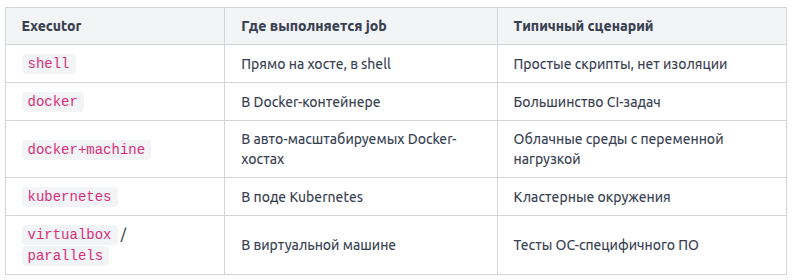

Весь пайплайн GitLab CI/CD описывается в одном файле — .gitlab-ci.yml. Он лежит в корне репозитория, и GitLab читает его автоматически при каждом пуше.

Stages (стадии) — это именованные этапы пайплайна, которые выполняются последовательно. Пока все задачи одной стадии не завершатся успешно, следующая не начнётся.

Job (задача) — минимальная единица работы. Каждый job принадлежит какой-либо стадии и содержит команды для выполнения.

Script — список shell-команд внутри job. Именно они запускаются на раннере (runner).

Базовая структура файла
```
stages:
  - build
  - test
  - deploy

build-app:
  stage: build
  script:
    - echo "Сборка приложения"
    - npm install
    - npm run build

run-tests:
  stage: test
  script:
    - echo "Запуск тестов"
    - npm test

deploy-prod:
  stage: deploy
  script:
    - echo "Деплой на сервер"
    - ./deploy.sh
```

Ключ stages задаёт глобальный порядок стадий. Каждый job ссылается на свою стадию через ключ stage. Если несколько jobs принадлежат одной стадии — они выполняются параллельно.

GitLab читает файл и строит граф выполнения. Сначала запускаются все jobs стадии build. Если хотя бы один из них упал — стадия test не начнётся, и пайплайн получит статус failed. Это поведение защищает от деплоя сломанного кода.

Кроме stage и script, job поддерживает несколько важных ключей:
- image: Docker-образ, в котором запускается job
- before_script: Команды перед основным script
- after_script: Команды после script (выполняются даже при ошибке)
- variables: Переменные окружения для конкретного job
- tags: Выбор раннера по метке

Если в script указана команда, которой нет в образе или окружении раннера, job упадёт с ошибкой command not found. Всегда проверяйте, что нужные утилиты доступны в выбранном image или установлены в before_script.

Когда GitLab получает событие — например, пуш в ветку — он не выполняет задания сам. Он передаёт их агенту, который называется GitLab Runner (runner). Runner — это отдельный процесс, установленный на сервере, виртуальной машине или в контейнере. Именно он запускает команды из script каждого job.

По области видимости runners делятся на два типа:
- Shared runner (общий runner) доступен всем проектам в GitLab-инстансе. Его регистрирует администратор один раз, и любой проект может использовать его без дополнительной настройки. Это удобно для небольших команд, где нет смысла держать отдельный агент под каждый репозиторий.
- Specific runner (специфичный runner) привязан к конкретному проекту или группе. Его регистрируют через Settings → CI/CD → Runners в интерфейсе проекта. Такой runner используют, когда job требует особого окружения: специального железа, лицензионного ПО или изолированной сети.

Чтобы job попал именно на нужный runner, используют теги (tags). Runner при регистрации получает список тегов. Job в .gitlab-ci.yml указывает, какие теги ему нужны — и GitLab направит его только на runner, у которого есть все перечисленные теги.

```
build-firmware:
  stage: build
  tags:
    - embedded
    - arm
  script:
    - make firmware
```

Если ни один runner не имеет тегов embedded и arm одновременно, job зависнет в статусе pending. Это частая причина застрявших пайплайнов.

Executor (исполнитель) определяет, в какой среде runner запускает job. Выбор executor-а задаётся при регистрации runner-а, а не в .gitlab-ci.yml.



Самый распространённый выбор — docker. При нём каждый job получает чистый контейнер, что исключает конфликты между заданиями. Executor shell проще в настройке, но job-ы могут влиять друг на друга через файловую систему хоста. Когда runner зарегистрирован с executor docker, в job можно указать конкретный образ через ключевое слово image.

