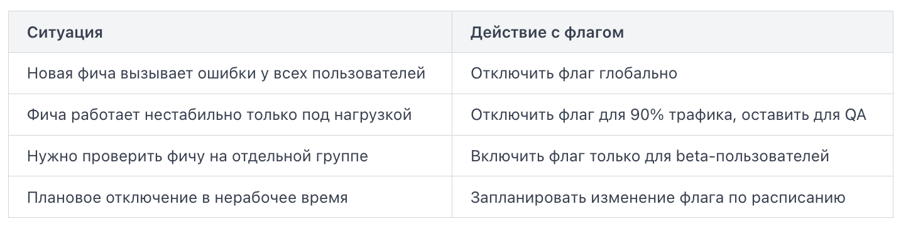

При автоматеческом rollback система сама обнаруживает, что деплой пошёл не так, и откатывается без участия человека.

В основе автоматического отката лежат два понятия:
- Health check (проверка работоспособности) — это периодический запрос к приложению, который подтверждает, что оно живо и готово обрабатывать трафик. Обычно это HTTP-эндпоинт /health или /readiness, возвращающий статус 200 OK.
- Failure threshold (порог отказов) — количество или доля неудачных проверок, после которых система считает деплой провальным и инициирует откат.

Помимо Kubernetes, порог отказов можно задать прямо в pipeline. Например, после деплоя скрипт опрашивает метрики в течение нескольких минут:
```
#!/bin/bash
ERROR_RATE=$(curl -s "https://metrics.internal/error_rate?app=my-app")
THRESHOLD=5  # допустимо не более 5% ошибок

if (( $(echo "$ERROR_RATE > $THRESHOLD" | bc -l) )); then
  echo "Error rate $ERROR_RATE% exceeds threshold. Rolling back..."
  kubectl rollout undo deployment/my-app
  exit 1
fi
```

Скрипт получает текущий процент ошибок из системы мониторинга. Если он превышает порог — вызывается kubectl rollout undo, который возвращает предыдущую версию деплоя.

Ручной rollback — это контролируемое возвращение к предыдущей рабочей версии приложения. В отличие от автоматического отката, здесь инженер сам оценивает ситуацию и запускает процедуру.

Каждый успешный запуск pipeline должен сохранять артефакт с уникальным идентификатором версии — обычно это тег, номер сборки или хеш коммита. Именно наличие сохранённых артефактов делает откат возможным. Если предыдущая версия не сохранена — откатываться не к чему, придётся пересобирать с нуля, что занимает время.

Типичная схема тегирования Docker-образов:

```
myapp:1.4.2   # стабильная версия, работала до деплоя
myapp:1.5.0   # текущая сломанная версия
myapp:latest  # псевдоним, сейчас указывает на 1.5.0
```

Ручной rollback состоит из трёх действий: определить рабочую версию, развернуть её, убедиться что всё работает:
1. Найти последнюю рабочую версию. Смотрим историю деплоев в CI/CD системе или реестре артефактов. В GitLab CI это журнал pipeline. Нужен номер сборки или тег, который работал до инцидента.
2. Перезапустить pipeline с указанием старой версии. Большинство CI/CD систем позволяют запустить pipeline вручную с параметром. Пример в GitLab CI — кнопка «Run pipeline» с переменной:
```
IMAGE_TAG=1.4.2
```

Или напрямую через API:

```
curl --request POST \
  --form "token=<trigger_token>" \
  --form "ref=main" \
  --form "variables[IMAGE_TAG]=1.4.2" \
  "https://gitlab.example.com/api/v4/projects/42/trigger/pipeline"
```

3. Проверить результат. После деплоя убеждаемся, что сервис отвечает, метрики вернулись в норму, ошибки исчезли.

Иногда быстрее не запускать pipeline, а переключить окружение напрямую. Если используется Kubernetes, достаточно одной команды.

Откат кода — операция предсказуемая: достаточно переключить образ контейнера или артефакт на предыдущую версию. С базой данных всё сложнее. Если новая версия приложения успела изменить схему — добавила колонку, переименовала таблицу, удалила индекс — просто «вернуть» приложение назад недостаточно. Старый код может не понять новую схему, и сервис упадёт.

Именно поэтому стратегия миграций базы данных (database migrations) — это отдельное архитектурное решение, которое принимается до деплоя, а не в момент инцидента.

Два подхода к миграциям:
- Forward-only миграции (только вперёд) — самый распространённый подход. Каждое изменение схемы описывается как шаг вперёд, а шага назад не существует. Откат приложения при этом не затрагивает схему: база остаётся в «новом» состоянии, а старый код должен уметь с ней работать.

- Reversible миграции (обратимые) — каждый шаг вперёд имеет парный шаг назад (up / down). При откате инструмент миграций применяет down-скрипт и возвращает схему к предыдущему состоянию.

Reversible-миграции выглядят удобно, но у них есть критичный изъян: down-скрипт может уничтожить данные. Если за время работы новой версии пользователи заполнили колонку email, DROP COLUMN сотрёт всё это безвозвратно.

Поэтому в продакшене чаще применяют expand-contract паттерн в рамках forward-only подхода:
1. Expand — добавить новую колонку, не удаляя старую. Оба приложения (старое и новое) работают параллельно.
2. Деплой новой версии приложения, которая пишет в обе колонки.
3. Contract — отдельной миграцией удалить старую колонку, когда откат уже невозможен.

Такой подход делает откат кода тривиальным: схема совместима с обеими версиями приложения, и никакие данные не теряются. Именно эта совместимость — backward compatibility схемы — является ключевым требованием при проектировании миграций в системах с непрерывной доставкой.

Классический rollback — это откат всего деплоя целиком. Но что если проблема только в одной функции из сотни изменений? Откатывать весь релиз ради одного сломанного блока — дорого и рискованно. Именно здесь помогают флаги функциональности (feature flags, или feature toggles).

Feature flag — это условная переменная в коде, которая включает или отключает определённую функциональность без изменения и повторного деплоя приложения. Код новой фичи уже находится в продакшене, но «спрятан» за флагом. Значение флага читается из внешнего хранилища — базы данных, конфигурационного сервиса или специализированной платформы.

Простейший пример на псевдокоде:
```
if feature_enabled("new_checkout_flow"):
    show_new_checkout()
else:
    show_old_checkout()
```

Значение `feature_enabled("new_checkout_flow")` приложение получает из внешнего источника — например, из переменной окружения, Redis или сервиса вроде LaunchDarkly. Чтобы отключить фичу, достаточно изменить значение флага в этом источнике. Никакого нового коммита, никакого pipeline, никакого деплоя.



Преимущества перед полным rollback:
- Скорость реакции — изменение флага применяется за секунды, тогда как полный откат деплоя занимает минуты или десятки минут.
- Точность — откатывается только проблемная функциональность, остальные изменения релиза остаются активными.
- Безопасность для БД — как мы видели ранее, rollback с миграциями базы данных создаёт серьёзные риски. Отключение флага не затрагивает схему БД вообще.

Постепенное включение — флаг можно открывать для 1%, затем 10%, затем 100% пользователей, наблюдая за метриками на каждом шаге. Это называется процентным раскатом (percentage rollout).

Ошибки:
- Флаги накапливаются и превращаются в технический долг. Если флаг не убрать из кода после полного включения фичи, через полгода никто не будет знать, можно ли его трогать. Хорошая практика — заводить задачу на удаление флага сразу при его создании и ставить срок жизни.
- Второй риск — флаги без мониторинга. Отключить флаг легко, но нужно убедиться, что трафик действительно пошёл по старому пути. Метрики и логи должны подтвердить, что переключение сработало.