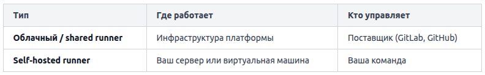

Когда pipeline запускается, возникает закономерный вопрос: на каком компьютере всё это происходит? Ответ — на раннере, или, в терминологии некоторых платформ, агенте.

Раннер — это процесс, который получает задания от CI/CD-сервера и выполняет их на конкретной машине. CI/CD-сервер (GitLab, GitHub Actions, Jenkins) управляет очередью заданий, а раннер — тот, кто их физически исполняет.

По месту размещения раннеры делятся на два типа:


Shared-раннеры удобны для старта: не нужно ничего настраивать. Self-hosted раннеры нужны, когда требуется доступ к внутренней сети компании, специфичное железо (GPU, ARM) или жёсткий контроль над окружением.

Раннер постоянно опрашивает CI/CD-сервер по принципу **long polling**: «Есть ли для меня задание?». Когда pipeline запускается, сервер ставит задания в очередь и отдаёт их свободным раннерам. Раннер выполняет шаги, пишет лог и возвращает результат серверу.

Каждое задание запускается в изолированном окружении. Раннер может использовать разные исполнители (executors):
* Shell — команды запускаются напрямую в оболочке машины. Просто, но задания могут влиять друг на друга через файловую систему.
* Docker — каждое задание получает свежий контейнер. Среда воспроизводима и изолирована.
* Kubernetes — раннер создаёт Pod под каждое задание, что удобно при большом параллелизме.

Пример конфигурации GitLab Runner с Docker-исполнителем (файл config.toml):

```
[[runners]]
  name = "my-docker-runner"
  url = "https://gitlab.com/"
  token = "TOKEN"
  executor = "docker"
  [runners.docker]
    image = "ubuntu:22.04"
```

Здесь каждое задание будет запускаться в контейнере на базе ubuntu:22.04, а после завершения контейнер удаляется.

Типичная ошибка: «работает у меня, не работает в pipeline» почти всегда означает, что окружение раннера отличается от локального. Например, на раннере нет нужной утилиты или другая версия Python. Решение — явно указывать образ с нужными зависимостями или устанавливать их в начале задания.

Если у вас несколько раннеров, задания выполняются параллельно — это сокращает общее время pipeline. Раннерам можно назначать теги (tags), а в конфигурации задания указывать, какой тег нужен:

```
build-job:
  tags:
    - linux
    - docker
```

Задание попадёт только на раннер, у которого есть оба тега linux и docker.

