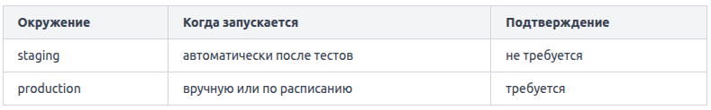
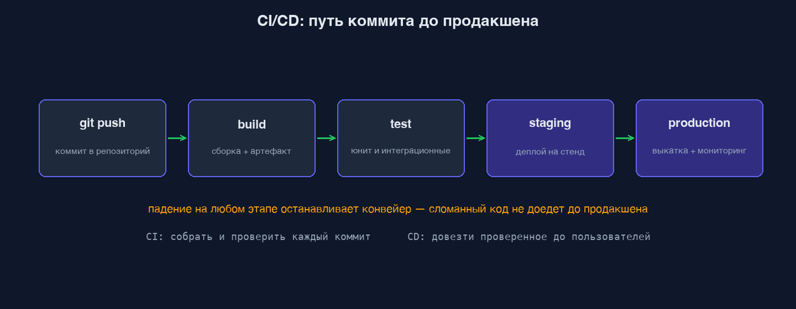

CI/CD pipeline (от англ. _pipeline_ — конвейер) — это автоматизированная последовательность шагов, которая превращает изменение в коде в работающий продукт на сервере. Представьте конвейер на заводе: каждая деталь проходит сборку, проверку качества и упаковку. Если деталь не прошла проверку, она не попадает в коробку. Код работает так же. Классический pipeline состоит из трёх основных этапов: Build (сборка), Test (тестирование) и Deploy (развёртывание). Они выполняются строго по порядку — следующий этап запускается только если предыдущий завершился успешно.

**Этап Build — сборка**
На этом этапе исходный код превращается в исполняемый артефакт (artifact): скомпилированный бинарник, Docker-образ, JAR-файл, собранный фронтенд. Здесь же устанавливаются зависимости. Результат этапа — артефакт, который передаётся дальше по конвейеру. Если сборка упала (например, ошибка компиляции), pipeline останавливается и до тестов дело не доходит.

Пример для Node.js-приложения в конфигурации GitLab CI:
```
build:
  stage: build
  script:
    - npm install
    - npm run build
  artifacts:
    paths:
      - dist/
```

**Этап Test — тестирование**
Здесь запускаются автоматические проверки: юнит-тесты (unit tests), интеграционные тесты, линтеры, проверки безопасности. Цель — убедиться, что изменение не сломало существующую функциональность. Если хотя бы один тест упал, pipeline помечается как неудачный (failed), и код не уходит в продакшен. Это и есть главная ценность CI: проблема обнаруживается сразу после коммита, а не через неделю на проде.

```
test:
  stage: test
  script:
    - npm run test
    - npm run lint
```

**Этап Deploy — развёртывание**
Прошедший проверки артефакт доставляется на целевую среду (environment). Обычно pipeline содержит несколько окружений с разными правилами запуска:



```
deploy_staging:
  stage: deploy
  script:
    - scp -r dist/ user@staging-server:/var/www/app
  environment:
    name: staging

deploy_production:
  stage: deploy
  script:
    - scp -r dist/ user@prod-server:/var/www/app
  environment:
    name: production
  when: manual
```

Ключевое свойство всей цепочки — идемпотентность: один и тот же код при повторном прогоне pipeline должен давать одинаковый результат. Это позволяет безопасно перезапускать упавшие этапы без побочных эффектов.



В CI/CD пайплайне код должен быть неизменяемым (immutable). Задача CI — не исправлять код за разработчиком, а проверить, что разработчик отправил качественный, правильно отформатированный и рабочий код.

Если job в .gitlab-ci.yml не имеет явно указанного stage, то он будет автоматически отнесён к стадии `test`