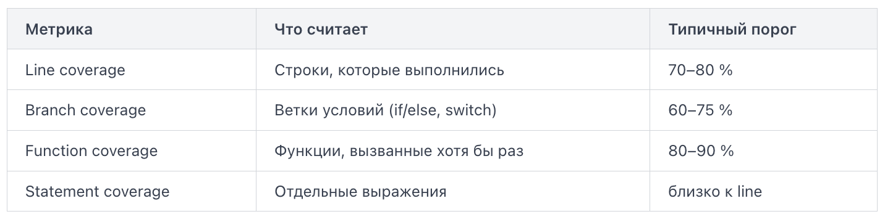

Пирамида тестирования — модель, которая делит тесты на три уровня по скорости, стоимости и охвату:
- Модульные тесты (unit tests) — основание пирамиды. Они проверяют одну функцию или класс в изоляции от всего остального: без базы данных, без сети, без файловой системы. Такой тест выполняется за миллисекунды, и их в проекте может быть тысячи. 
- Интеграционные тесты (integration tests) — средний уровень. Они проверяют взаимодействие нескольких компонентов: сервис + база данных, API + кэш, два микросервиса между собой. Такие тесты медленнее, потому что поднимают реальные зависимости или их контейнеры.
- Сквозные тесты (end-to-end tests, e2e) — вершина пирамиды. Они имитируют реального пользователя: открывают браузер, заполняют форму, нажимают кнопку и проверяют результат на экране. Один e2e-тест может занимать минуты и требует полностью развёрнутого окружения.

Соотношение количества тестов по уровням — не случайное. Чем выше уровень, тем тест дороже: дольше выполняется, сложнее поддерживается, чаще ломается по причинам, не связанным с кодом (упал контейнер, истёк токен, изменился UI).

Если пирамида «перевёрнута» — в проекте мало unit-тестов, зато много e2e — CI-pipeline будет работать 40 минут вместо 5, а каждый нестабильный тест будет блокировать команду. Это считается антипаттерном «мороженое» и техническим долгом, который замедляет CI и снижает доверие к результатам.

В типичном pipeline уровни запускаются последовательно: сначала unit-тесты (быстрая обратная связь при каждом коммите), затем интеграционные (на ветке или при открытии pull request), и только перед деплоем в staging или production — e2e. Такой порядок позволяет поймать большинство ошибок дёшево и быстро, не дожидаясь полного прогона.

Покрытие кода (code coverage) — это метрика, показывающая, какая доля исходного кода была выполнена во время тестов. Она не говорит, правильно ли работает код, но указывает на участки, которые тесты вообще не затрагивают.

Существует несколько типов метрик покрытия:


Branch coverage строже line coverage: строка if x > 0 { return x } else { return -x } считается покрытой по строкам, если выполнилась хотя бы раз, но по ветвям — только если прошли оба пути.

Инструмент покрытия запускается вместе с тестами и генерирует отчёт — обычно в формате XML или HTML. CI читает этот отчёт и сравнивает итоговый процент с заданным порогом качества (quality gate / coverage threshold). Если порог не достигнут — сборка падает.

Пример шага в GitLab CI:
```
test:
  script:
    - pytest --cov=src --cov-report=xml --cov-fail-under=80
  coverage: '/TOTAL.*\s+(\d+%)$/'
  artifacts:
    reports:
      coverage_report:
        coverage_format: cobertura
        path: coverage.xml
```

Флаг --cov-fail-under=80 завершает процесс с ненулевым кодом, если покрытие ниже 80 %. GitLab подхватывает число из вывода через регулярное выражение в поле coverage и отображает его в интерфейсе merge request.

