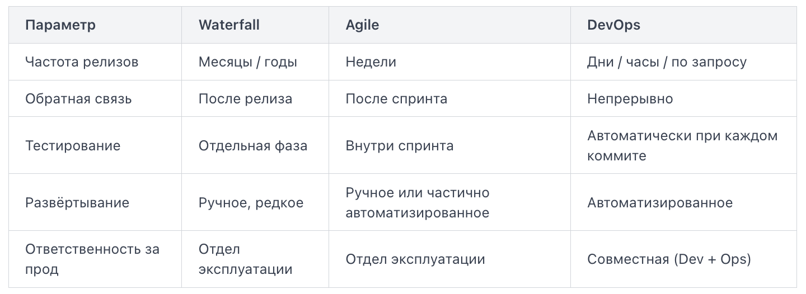

# Откуда взялась проблема
Исторически в компаниях существовали две отдельные команды. Разработчики (Developers) писали код и хотели выпускать новые функции как можно быстрее. Операционные инженеры (Operations) отвечали за стабильность продакшена и воспринимали каждое изменение как угрозу. Цели конфликтовали: чем чаще деплой — тем выше риск падения; чем реже — тем медленнее бизнес. Результат: релизы раз в квартал, долгие согласования, ручные деплои в ночь с пятницы на субботу и взаимные обвинения при авариях. DevOps — это набор практик и культура, которые устраняют этот барьер.

# Цикл DevOps
DevOps описывают через непрерывный цикл разработки, доставки и эксплуатации программного обеспечения. Цикл замкнут и повторяется: результаты каждого этапа помогают улучшать следующие итерации. Идея непрерывности лежит в основе практик Continuous Integration (CI), Continuous Delivery и Continuous Deployment.

```
Plan → Code → Build → Test → Release → Deploy → Operate → Monitor
  ↑                                                              |
  └──────────────────── Feedback loop ───────────────────────────┘
```

- Plan — планирование задач и требований.
- Code — написание кода и управление изменениями.
- Build — сборка приложения.
- Test — автоматизированное тестирование и проверки качества.
- Release — подготовка версии к выпуску.
- Deploy — развёртывание приложения в целевой среде.
- Operate — эксплуатация и обеспечение стабильной работы системы.
- Monitor — мониторинг метрик, логов, трассировок и событий.

Feedback loop (обратная связь) — результаты эксплуатации и мониторинга, а также отзывы пользователей возвращаются к команде и влияют на дальнейшее планирование, разработку и улучшение продукта.

Это упрощённая модель DevOps: в реальности этапы могут выполняться параллельно, а обратная связь поступает на разных этапах цикла.

# Что меняется на практике
Возьмём конкретный сценарий. Разработчик отправляет исправление бага в репозиторий.

Без автоматизированного CI/CD: изменение ожидает следующего релиза, проходит ручные проверки и согласования. В результате исправление может попасть в production только через несколько недель.

С автоматизированным CI/CD: коммит запускает автоматические тесты и сборку приложения. После успешных проверок артефакт развёртывается в тестовой среде. Если все необходимые проверки пройдены, изменение может автоматически попасть в production — например, через 20 минут после коммита, если настроен Continuous Deployment и не требуется дополнительное подтверждение.

После выпуска мониторинг помогает оценить состояние сервиса: изменилось ли количество ошибок, не выросла ли задержка ответа и не появились ли другие проблемы. Эти данные помогают команде подтвердить результат или быстро обнаружить необходимость отката.

Ключевой эффект DevOps — сокращение времени от изменения кода до его доставки пользователям, повышение частоты и предсказуемости выпусков, а также ускорение обнаружения и устранения проблем.

При этом результат достигается не только за счёт автоматизации деплоя, но и благодаря небольшим изменениям, автоматизированному тестированию, мониторингу и быстрой обратной связи.

# Философия DevOps и методологии
CALMS — это аббревиатура, описывающая пять ключевых измерений DevOps-трансформации. Модель помогает организациям оценить, насколько они готовы к DevOps, и понять, в каком направлении двигаться.

Первое и самое весомое измерение. Без изменения культуры все технические инструменты дают лишь косметический эффект. Культура (Culture) в DevOps означает общую ответственность за продукт: разработчики не «перебрасывают» код через стену операционной команде, а обе стороны совместно отвечают за доставку и стабильность. Практический признак здоровой культуры — команда не ищет виноватых после инцидента, а проводит blameless postmortem: разбирает, что пошло не так в процессе, и фиксирует улучшения.

Автоматизация (Automation) устраняет ручные, повторяющиеся операции: сборку, тестирование, развёртывание, проверку конфигурации. Цель — снизить вероятность человеческой ошибки и ускорить цикл обратной связи. Пример: вместо того чтобы вручную копировать артефакт на сервер, команда описывает шаги в pipeline-файле.

Бережливый подход (Lean). Его суть — устранять потери (waste): лишние согласования, ожидание, дублирование работы. В DevOps это выражается в небольших частых релизах вместо редких крупных, в визуализации потока задач через Kanban-доску, в ограничении незавершённой работы (WIP-лимиты). Чем меньше изменений в одном релизе, тем проще найти причину проблемы, если она возникнет.

Измерение (Measurement) означает принятие решений на основе данных, а не интуиции. Команды отслеживают время развёртывания, частоту сбоев, время восстановления после инцидента, покрытие тестами.

Обмен знаниями (Sharing) — последнее измерение, без которого остальные четыре деградируют. Команды документируют решения, проводят внутренние демо, публикуют runbook'и и postmortem'ы в общем пространстве. Знание перестаёт быть «собственностью» одного человека и становится активом всей организации. Типичный антипаттерн — «незаменимый» инженер, который единственный знает, как перезапустить критичный сервис. CALMS предполагает, что эта информация задокументирована и доступна всей команде.

# Waterfall vs Agile vs DevOps: ключевые отличия
Waterfall — это линейная модель разработки, где каждый этап начинается только после завершения предыдущего: сбор требований, проектирование, разработка, тестирование, развёртывание, поддержка. Главная проблема: обратная связь приходит слишком поздно. Если на этапе тестирования выясняется, что требования были поняты неверно, придётся вернуться к началу. В реальных проектах это означало релизы раз в полгода-год, а баги, обнаруженные в продакшене, копились месяцами.

Agile появился как ответ на негибкость Waterfall. Вместо одного большого релиза — короткие итерации (спринты) длиной 1–4 недели. По итогам каждого спринта команда получает работающий фрагмент продукта и обратную связь от заказчика. Agile решил проблему запоздалой обратной связи в разработке. Но у него осталось слабое место: методология описывала работу команды разработки (Dev), почти не затрагивая то, что происходит после написания кода. Разработчики могли выпускать новые версии каждые две недели, но операционная команда (Ops) всё равно разворачивала их вручную раз в месяц по регламенту.

Waterfall — сначала подробно планируем, потом последовательно выполняем; Agile — планируем, делаем небольшую часть, проверяем результат и адаптируемся.

DevOps не заменяет Agile — он расширяет его до момента, когда код оказывается у пользователя. Ключевое отличие: DevOps убирает барьер между разработкой и эксплуатацией и делает весь путь от идеи до продакшена непрерывным и автоматизированным.

Сравним три подхода по ключевым параметрам:


Реальный пример: компания Amazon в 2011 году делала развёртывания в среднем каждые 11,6 секунды. Это стало возможным именно потому, что Dev и Ops работали как единая система с автоматизированными проверками, а не передавали код «через стену» друг другу. Именно эту «стену» между командами и разрушает DevOps — через культуру совместной ответственности, автоматизацию и непрерывный поток обратной связи.

# CI, CD, CD: Continuous Integration, Delivery и Deployment
Непрерывная интеграция (Continuous Integration, CI) — практика, при которой каждый разработчик регулярно, как минимум раз в день, сливает свои изменения в общую ветку репозитория. После каждого слияния автоматически запускаются сборка и тесты. Если тесты упали — разработчик получает уведомление немедленно, пока контекст ещё свеж. Без CI разработчики работают в изолированных ветках неделями. Когда приходит время объединить код, возникает «интеграционный ад» (integration hell) — сотни конфликтов и сломанных зависимостей. CI решает проблему, делая интеграцию маленькой и частой.

Непрерывная доставка (Continuous Delivery, CD) расширяет CI: после успешной сборки и тестов артефакт автоматически доставляется в среду, максимально близкую к продакшену (staging, pre-prod). Развёртывание в продакшен при этом требует ручного подтверждения — нажатия кнопки ответственным человеком. Ключевой принцип: код всегда находится в состоянии, готовом к выпуску. Команда решает, когда выпускать, а не можно ли выпустить.

Непрерывное развёртывание (Continuous Deployment, тоже CD) идёт на шаг дальше: каждое изменение, прошедшее все автоматические проверки, автоматически уходит в продакшен без участия человека. Это требует высокого доверия к тестовому покрытию и зрелой инфраструктуре.