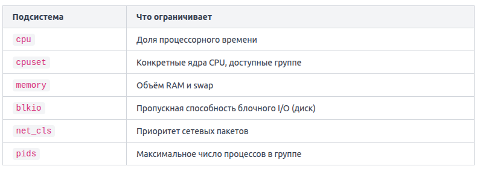

Контрольные группы (cgroups, control groups) — механизм ядра Linux, позволяющий задавать лимиты и квоты на потребление ресурсов для групп процессов.

Cgroup — это именованная группа, в которую помещаются один или несколько процессов. Ядро отслеживает суммарное потребление ресурсов всей группой и применяет заданные ограничения. Docker при запуске контейнера автоматически создаёт отдельную cgroup для каждого контейнера и прописывает туда все его процессы.

Cgroups работают через подсистемы (subsystems), каждая из которых отвечает за свой тип ресурса:

Когда вы запускаете контейнер с флагами ресурсов, Docker транслирует их в настройки cgroup. Например: `docker run --memory="256m" --cpus="0.5" nginx`.  Эта команда создаёт контейнер, которому доступно не более 256 МБ оперативной памяти и половина одного ядра CPU. Если процесс внутри попытается выделить больше памяти, ядро либо вызовет OOM-killer (Out of Memory Killer) и завершит процесс, либо начнёт использовать swap — в зависимости от настроек.

Посмотреть реальные лимиты работающего контейнера можно напрямую в файловой системе `/sys/fs/cgroup`:  `cat /sys/fs/cgroup/memory/docker/<container_id>/memory.limit_in_bytes`.

Типичная ошибка: контейнер без лимитов.

Флаг --memory-swap позволяет отдельно ограничить суммарный объём RAM + swap. Если установить его равным значению --memory, swap для контейнера будет полностью отключён: `docker run --memory="256m" --memory-swap="256m" nginx`.

Ограничение I/O задаётся через --device-read-bps и --device-write-bps — они ограничивают скорость чтения и записи на конкретное блочное устройство: `docker run --device-write-bps /dev/sda:10mb nginx`.

Cgroups работают прозрачно для приложения внутри контейнера — процесс не знает, что ограничен. Он просто получает отказ от ядра, когда пытается выйти за установленные рамки.