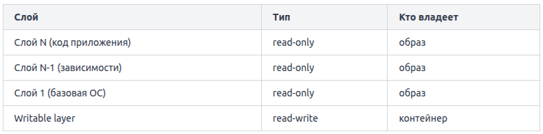
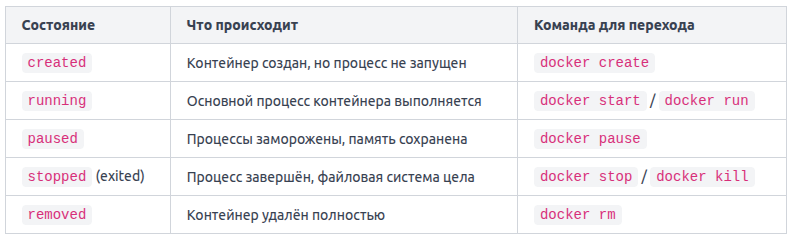

Когда вы запускаете контейнер, Docker берёт все слои образа (они остаются read-only) и добавляет поверх них тонкий записываемый слой (writable layer), который принадлежит только этому контейнеру.

Схема выглядит так:


Запустить 10 контейнеров из одного образа дёшево — каждый добавляет лишь небольшой writable layer, а сам образ не копируется.

Любые изменения внутри работающего контейнера — созданные файлы, логи, изменённые конфиги — попадают только в writable layer. Слои образа при этом не затрагиваются. Когда контейнер удаляется, его writable layer уничтожается вместе с ним. Всё, что туда записалось, теряется.

Когда процесс внутри контейнера пытается изменить файл из read-only слоя, Docker не трогает оригинал. Вместо этого он копирует файл в writable layer и уже там применяет изменения. Этот механизм называется Copy-on-Write (CoW).

# Жизненный цикл контейнера
Контейнер проходит через несколько чётко определённых состояний.



Переходы не обязательно линейны.

Created. Команда `docker create` создаёт новый контейнер из указанного образа, но не запускает процесс внутри. Docker подготавливает записываемый слой поверх образа и сохраняет конфигурацию.

Running. Основной процесс (указанный в `CMD` или `ENTRYPOINT` образа) активен. Команда `docker start` запускает основной процесс, указанный при создании.

Paused. Команда `docker pause` отправляет сигнал `SIGSTOP` всем процессам контейнера. Они замирают — не потребляют CPU, но остаются в памяти и на диске. `docker unpause` возобновляет работу с той же точки.

Stopped (exited). Команда `docker stop` сначала отправляет `SIGTERM`, даёт главному процессу 10 секунд (можно изменить флагом `-t`) на корректное завершение, затем — `SIGKILL`. `docker kill` отправляет `SIGKILL` немедленно (можно отправить другой сигнал через флаг `-s` (`--signal`)). Файловая система контейнера при этом сохраняется — данные не теряются до удаления.

Removed. `docker rm` удаляет контейнер и его writable layer. Образ остаётся нетронутым. Попытка удалить работающий контейнер без флага `-f` завершится ошибкой. Нужно сначала остановить контейнер. Удалить работающий контейнер без остановки можно принудительно: `docker rm -f`.

Проверить текущее состояние контейнера в любой момент позволяет команда: `docker inspect --format '{{.State.Status}}' lifecycle-demo`.

# docker run
Команда `docker run` -- это сокращение для целой цепочки действий. Одной строкой вы просите Docker выполнить сразу три операции:

1. docker pull -- скачать образ из реестра (если его ещё нет локально).
2. docker create -- создать контейнер на основе образа.
3. docker start -- запустить главный процесс контейнера. Как только главный процесс завершается, контейнер переходит в состояние exited. Контейнер не удаляется — он остаётся на диске, просто больше не работает.

Скачивание происходит только один раз или когда образ обновился в реестре.

Флаг `-d` (сокращение от `--detach`) запускает контейнер в в фоновом режиме. Терминал не блокируется -- Docker выводит только идентификатор контейнера и возвращает управление вам. Контейнер при этом работает "за кулисами".

Флаг `-it` — сочетание двух флагов: `-i` (interactive, держать stdin контейнера открытым) и `-t` (tty, подключить к контейнеру псевдотерминал): `docker run -it ubuntu bash`. Вместе они дают интерактивную сессию внутри контейнера. Если не указать команду может возникнуть ошибка, так как некоторые образы не имеют shell по умолчанию и нужно указывать `bash` или `sh` явно. Выход из оболочки (команда `exit` или `Ctrl+D`) остановит контейнер, потому что `bash` -- его корневой процесс.

По умолчанию Docker присваивает контейнеру случайное имя. Флаг `--name` задаёт понятное имя, по которому удобно обращаться к контейнеру в других командах. Имя должно быть уникальным -- два работающих контейнера с одним именем Docker не допустит. Если контейнер с таким именем уже существует (даже остановленный), нужно сначала удалить его или выбрать другое имя.

`-q` (`--quiet`) -- выводит только идентификаторы контейнеров, по одному на строку.

`--filter` -- фильтрует вывод по условию.

Флаг `--rm` удаляет контейнер сразу после его остановки.

Контейнер изолирован от хостовой сети. Чтобы сервис внутри контейнера был доступен снаружи, нужно пробросить порт (port binding). Синтаксис: `-p <порт_хоста>:<порт_контейнера>`: `docker run -d --name web -p 8080:80 nginx`. После этого запроса `http://localhost:8080` на хосте будет отвечать Nginx, слушающий порт 80 внутри контейнера.

Флаг `-e` и `--env` (полная форма) (environment) передаёт переменную окружения внутрь контейнера. Флаг `-e` можно указывать несколько раз — каждый раз для одной переменной.

```
docker run -d \
  --name db \
  -e POSTGRES_USER=admin \
  -e POSTGRES_PASSWORD=secret \
  -e POSTGRES_DB=myapp \
  -p 5432:5432 \
  postgres
```

Если указать имя переменной без знака `=`, Docker возьмёт её значение из вашего текущего окружения на хосте. Если переменная не задана на хосте, она просто не попадёт в контейнер — ошибки не будет.

Некоторые образы уже содержат переменные окружения, заданные инструкцией `ENV` в Dockerfile. Флаг `-e` перезаписывает их.

Docker поддерживает флаг --env-file, который загружает переменные окружения из файла. В файле одна переменная на строку в виде `КЛЮЧ=значение`. Передайте путь к файлу через флаг `--env-file`. Флаг `--env-file` можно указывать несколько раз, чтобы загрузить переменные из разных файлов. Также его можно комбинировать с флагом `-e`. Docker обрабатывает переменные в порядке их появления. Если одна и та же переменная задана и в файле, и через `-e`, приоритет получает та, что указана последней в командной строке. В отличие от shell-скриптов, Docker не интерпретирует кавычки и не раскрывает переменные вида `$HOME` внутри файла. Всё, что написано после `=`, передаётся как есть. Поэтому значения в `.env`-файле записывайте без кавычек и без ссылок на другие переменные.

Если вы хотите сразу видеть вывод контейнера в терминале, добавьте флаг `-a` (attach).

# docker ps
По умолчанию команда docker ps показывает только запущенные контейнеры. Чтобы увидеть контейнеры во всех состояниях, включая остановленные, нужен флаг `--all` (или сокращённо `-a`).

Каждая строка в таблице `docker ps` содержит семь столбцов:
- CONTAINER ID: Уникальный идентификатор контейнера (укороченный до 12 символов)
- IMAGE: Образ, из которого создан контейнер
- COMMAND: Команда, запущенная внутри контейнера
- CREATED: Когда контейнер был создан
- STATUS: Текущее состояние: `Up`, `Exited (0)`, `Created` и т.д.
- PORTS: Проброшенные или открытые порты
- NAMES: Имя контейнера (заданное через `--name` или сгенерированное автоматически)

Exited — это одно из возможных состояний, означающее, что процесс внутри контейнера завершился. Число в скобках — это код выхода. Код `0` означает успешное завершение без ошибок, любое другое число -- ошибку.

Обратите внимание: `docker ps` и `docker container ls` -- это одна и та же команда.

Удалить конкретный контейнер можно командой `docker rm` с указанием идентификатора или имени.

Разом убрать все остановленные контейнеры: `docker container prune`.

Посмотреть сколько дискового пространства занимают образы, контейнеры, тома и кэш, можно командой: `docker system df`.

# docker restart
Команда `docker restart` останавливает контейнер и тут же запускает его заново. По сути это `docker stop` + `docker start` в одном вызове. Доступны флаги `-t` и `-s` аналогично `docker stop`.

# docker wait
Команда `docker wait` блокирует терминал до тех пор, пока указанный контейнер не будет остановлен, а затем выводит его код выхода.

# docker logs
Когда контейнер работает в фоновом режиме (с флагом `-d`), вы не видите его вывод в терминале. Чтобы узнать, что происходит внутри, используется команда docker logs. Она показывает всё, что контейнер записал в свои стандартные потоки вывода: stdout и stderr.

Docker перехватывает оба потока у главного процесса контейнера и сохраняет их. Команда `docker logs` выдаёт содержимое обоих потоков вместе, в том порядке, в котором записи появлялись.

`docker logs <имя_или_id_контейнера>`

Пока контейнер не удалён командой `docker rm`, его логи сохраняются. Это удобно для диагностики: контейнер упал, но вы всё ещё можете прочитать, что он вывел перед завершением.

По умолчанию `docker logs` смешивает оба потока в один вывод. Но если перенаправить вывод в терминале, потоки разделяются. Например, чтобы увидеть только ошибки: `docker logs timer 1>/dev/null`. Обратная ситуация -- только stdout без ошибок: `docker logs timer 2>/dev/null`.

Docker записывает только то, что главный процесс контейнера (PID 1) отправляет в stdout и stderr. Если приложение пишет в файл внутри контейнера (например, в `/var/log/app.log`), эти записи в `docker logs` не попадут. Именно поэтому при контейнеризации приложения принято настраивать его так, чтобы логи шли в stdout/stderr, а не в файлы. Например, официальный образ nginx делает символические ссылки из файлов логов на `/dev/stdout` и `/dev/stderr`, чтобы всё было доступно через `docker logs`.

По умолчанию `docker logs` выводит все накопленные записи контейнера. Если контейнер работает давно, лог может быть огромным. Флаг --tail (короткая форма `-n`) ограничивает вывод последними N строками. Передавать отрицательные числа или нецелые значения нельзя -- Docker в таком случае сбросит значение на `all` и покажет всё.

Флаг --follow (короткая форма `-f`) переводит команду в режим непрерывного потока. Docker не завершает работу после вывода текущих записей, а продолжает транслировать новые строки из stdout и stderr контейнера по мере их появления. Вывод будет обновляться, пока вы не нажмёте `Ctrl+C`.

По умолчанию Docker выводит «голые» строки лога. Флаг --timestamps (короткая форма `-t`) добавляет к каждой строке временную метку в формате RFC 3339 с наносекундной точностью.

Ещё два полезных флага, о которых стоит знать: --since и --until. Они фильтруют лог по времени. Например, чтобы увидеть записи за последние 30 минут: `docker logs --since 30m my_container`. А чтобы получить записи до определённого момента: `docker logs --until 2024-06-10T15:00:00Z my_container`. Значение можно задавать как абсолютную дату (формат RFC 3339), так и относительный интервал (`42m`, `2h`, `1m30s`).

# docker exec
Контейнер работает в фоне, внутри него крутится процесс, но вам нужно заглянуть внутрь. Для этого существует команда docker exec (execute) -- она запускает новую команду внутри уже работающего контейнера, не останавливая его основной процесс.

Контейнер указывается по имени или ID. После него идёт команда, которую нужно выполнить. Простейший пример -- создать файл внутри контейнера:

`docker exec mycontainer touch /tmp/testfile`

Для составных команд с `&&` или `|` оберните их в `sh -c`.

Самый частый сценарий -- открыть интерактивную сессию внутри контейнера. Для этого нужны два флага: `-i` и `-t`.

Флаг `-e` позволяет передать переменную окружения в запускаемый процесс. Флаг -w задаёт рабочую директорию для команды. Это эквивалентно тому, чтобы сначала сделать `cd`.

Команда `docker exec` работает только с контейнерами в статусе Running. Если контейнер остановлен или поставлен на паузу, Docker вернёт ошибку.

# docker rm
Команда `docker rm` (сокращение от remove) удаляет один или несколько остановленных контейнеров. В качестве аргумента передаётся имя контейнера или его идентификатор (container ID). Можно указать сразу несколько через пробел.

Полная форма команды выглядит как `docker container rm`, но короткий алиас `docker rm` делает ровно то же самое.

Когда остановленных контейнеров много, перечислять каждый вручную неудобно. Можно скомбинировать `docker ps` с флагом `-q` (quiet -- выводит только идентификаторы) и подставить результат в `docker rm`: `docker rm $(docker ps --filter status=exited -q)`. Если остановленных контейнеров нет, команда выдаст предупреждение -- это нормально.

По умолчанию `docker rm` не трогает тома, связанные с контейнером. Если при создании контейнера были созданы анонимные тома и они больше не нужны, добавьте флаг `-v`:

`docker rm -v my_app`

Именованные тома при этом сохраняются -- удаляются только анонимные, то есть те, которые были созданы без явного имени.

# docker system prune
При запуске команды по умолчанию, Docker покажет предупреждение и спросит подтверждение. Если ответить `y`, будут удалены:
- контейнеры: все остановленные
- сети: не используемые ни одним контейнером
- образы: только висячие
- кэш сборки: неиспользуемые build cache

Обратите внимание: тома по умолчанию не удаляются. Это сделано специально, чтобы случайно не потерять данные базы или файлы приложения.

`--volumes` -- добавляет к очистке анонимные тома, не привязанные ни к одному контейнеру.

`-a` (`--all`) -- удаляет не только висячие образы, но и все образы, у которых нет ни одного связанного контейнера. Это значит, что скачанные, но неиспользуемые образы тоже будут удалены.

`-f` (`--force`) -- пропускает запрос подтверждения.

Флаг `--filter` позволяет ограничить очистку.

Данные, которые должны пережить контейнер, нужно хранить за его пределами. Именно для этого Docker предоставляет механизм томов (volumes) -- внешних хранилищ, которые не зависят от жизненного цикла контейнера. Том продолжает существовать, даже когда контейнер, который его использовал, давно удалён.