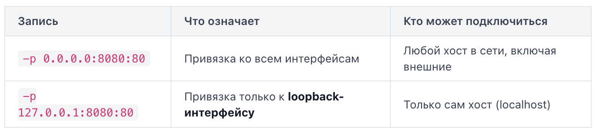
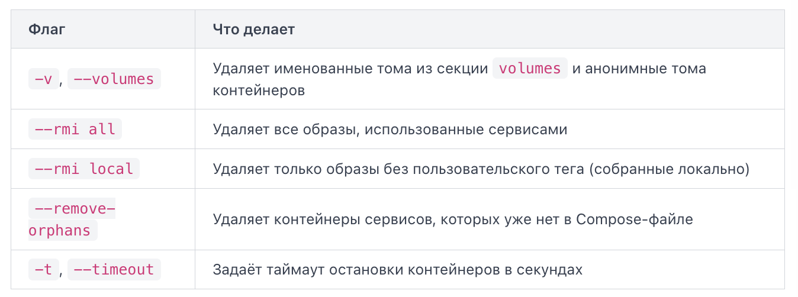
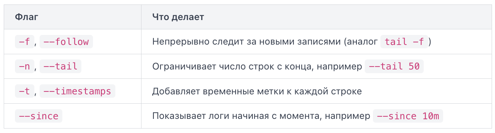

Docker Compose — инструмент для описания и запуска многоконтейнерных приложений. Вместо того чтобы запускать каждый контейнер вручную длинной командой `docker run`, вы описываете всю конфигурацию в одном файле — `docker-compose.yml`.

Раньше Compose устанавливался отдельно как `docker-compose` (через дефис). Современные версии Docker Desktop и Docker Engine включают Compose как плагин, и команда пишется через пробел: `docker compose`. Обе формы работают, но `docker compose` — актуальный вариант.

Ключ version когда-то указывал версию формата Compose-файла: 2, 2.1, 3, 3.8, 3.9 и так далее. Так было устроено первое поколение файлов Compose, где формат менялся между версиями и от значения ключа зависело, какие возможности синтаксиса доступны.

С переходом на единую спецификацию Compose, на которую опирается Docker Compose v2 и совместимые инструменты, деление на пронумерованные версии исчезло: все ключи спецификации доступны независимо от того, что написано в файле. Ключ `version` в неё не входит, и при запуске Compose v2 выводит предупреждение об устаревшем (obsolete) атрибуте. При использовании Docker Compose v1 поведение зависит от версии программы: до версии 1.27.0 отсутствие ключа `version` приводит к интерпретации файла в формате версии 1. Начиная с версии 1.27.0 поддерживается единая Compose Specification, позволяющая использовать современный формат файла без ключа `version`.

Вместо `version` в современных файлах используют ключ `name` -- он задаёт имя проекта (project name). Если `name` не указан, Compose берёт имя из названия папки, в которой лежит файл.

Ключ services — главный и обязательный раздел файла. Каждый дочерний ключ внутри него описывает один контейнер. Имя сервиса становится его DNS-именем внутри сети Compose.

```
services:
  web:
    image: nginx:alpine
  db:
    image: postgres:15
```

Здесь объявлены два сервиса: `web` и `db`.

По умолчанию Compose создаёт одну общую сеть для всех сервисов файла, и они могут обращаться друг к другу по имени сервиса. Если нужна более тонкая изоляция — например, чтобы `frontend` не имел прямого доступа к `db` — сети объявляют явно.

```
networks:
  backend:
  frontend:
```

Сервисы подключаются к нужным сетям через ключ `networks` внутри описания сервиса. Сеть без дополнительных параметров создаётся с драйвером `bridge` — стандартный вариант для локальной разработки.

Ключ `volumes` на верхнем уровне объявляет именованные тома, которыми Docker управляет самостоятельно: данные хранятся вне файловой системы контейнера и переживают его перезапуск.

```
volumes:
  postgres_data:
  redis_cache:
```

Объявление тома здесь — это регистрация его имени. Чтобы том реально использовался, его нужно подключить внутри сервиса через ключ `volumes` уже на уровне сервиса. Типичная ошибка начинающих — указать том в сервисе, но забыть объявить его на верхнем уровне: Compose выдаст ошибку `service "db" refers to undefined volume`. Двоеточие и пустое значение означает настройки по умолчанию.

Каждый сервис в `docker-compose.yml` — это отдельный контейнер со своими параметрами запуска. Все эти параметры задаются в виде ключей под именем сервиса.

Ключ `image` указывает готовый образ из реестра. Compose скачает его при первом запуске:

```
services:
  db:
    image: postgres:15
```

Также можно использовать локальный образ.

Ключ `build` говорит Compose собрать образ из Dockerfile в указанной директории. 

```
services:
  api:
    build: ./api
```

Можно уточнить путь к `Dockerfile` явно через вложенный ключ `context` и `dockerfile`, но для большинства случаев достаточно указать директорию строкой. `image` и `build` можно комбинировать — тогда собранный образ получит имя из `image`.

Ключ `ports` пробрасывает порт (port mapping) из контейнера на хост-машину. Формат: `"хост:контейнер"`. Если указать только контейнерный порт, Docker сам назначит свободный порт на хосте.

```
services:
  web:
    image: nginx:alpine
    ports:
      - "8080:80"
```

После этого `http://localhost:8080` будет отвечать из контейнера на порту 80. Docker создаёт правило проброса: всё, что приходит на хост-порт, перенаправляется на контейнер-порт. Если протокол не указан, Docker использует TCP. Чтобы пробросить UDP-порт, добавьте суффикс `/udp`. Для контейнера, который слушает несколько портов, просто повторите флаг `-p`. Запись `-p 8080:80` пробрасывает порт контейнера на хост. Но есть важный нюанс: на какой именно сетевой интерфейс хоста привязывается этот порт. Разница между "доступен только мне" и "доступен всему интернету" определяется одним коротким фрагментом в команде. Флаг `-p` принимает расширенную форму: `-p [адрес_хоста:]порт_хоста:порт_контейнера`. Часть `адрес_хоста` -- это IP-адрес сетевого интерфейса (bind address), к которому привязывается проброшенный порт. Если адрес не указан, Docker по умолчанию использует `0.0.0.0`, то есть все интерфейсы.



Loopback-интерфейс -- это виртуальный сетевой интерфейс с адресом `127.0.0.1`. Трафик на нём никогда не покидает машину. Важно понимать: когда вы пишете просто `-p 8080:80` без указания адреса, Docker подставляет `0.0.0.0`. Документация Docker прямо говорит: "when a container's ports are mapped without any specific host address, the Docker daemon publishes ports to all host addresses". Это значит, что `-p 8080:80` и `-p 0.0.0.0:8080:80` -- одно и то же.

Если вы хотите, чтобы Docker по умолчанию привязывал порты только к localhost, добавьте в файл `/etc/docker/daemon.json`:

```
{
  "ip": "127.0.0.1"
}
```

После этого перезапустите демон Docker. Теперь команда `-p 8080:80` будет привязывать порт к `127.0.0.1`, а не к `0.0.0.0`. Это полезная мера безопасности на серверах, где вы не хотите случайно выставить сервис наружу.

Иногда вам не важно, какой именно порт на хосте будет занят, -- вы просто хотите быстро получить доступ ко всему, что контейнер готов отдать наружу. Для этого существует флаг `-P` (или `--publish-all`).

Каждый Docker-образ может содержать инструкцию EXPOSE в своём Dockerfile. Она объявляет, на каких портах приложение внутри контейнера принимает соединения. Сама по себе инструкция EXPOSE ничего не пробрасывает -- она лишь документирует намерение. Флаг `-P` берёт все порты, перечисленные через EXPOSE, и публикует каждый из них на случайный свободный порт хоста из эфемерного диапазона, обычно это порты выше 32767. Команда `docker port <имя_или_id_контейнера>` выведет все активные маппинги.

Ключ `environment` передаёт переменные окружения внутрь контейнера. Это стандартный способ конфигурировать приложения без изменения образа:

```
services:
  db:
    image: postgres:15
    environment:
      POSTGRES_USER: admin
      POSTGRES_PASSWORD: secret
      POSTGRES_DB: appdb
```

Значения можно задавать как `КЛЮЧ: значение` (словарь) или как список строк `КЛЮЧ=значение` — оба формата корректны. Хранить пароли прямо в `docker-compose.yml` допустимо только для локальной разработки; для продакшена используют `.env`-файлы и секреты.

Ключ `depends_on` указывает, какие сервисы должны быть запущены раньше текущего:

```
services:
  api:
    build: ./api
    depends_on:
      - db
  db:
    image: postgres:15
```

Здесь `api` не стартует, пока контейнер `db` не перейдёт в состояние running. Важный нюанс: `depends_on` контролирует только порядок запуска контейнеров, но не ждёт готовности приложения внутри. PostgreSQL может ещё инициализироваться, когда `api` уже пытается подключиться. Для ожидания реальной готовности сервиса используют скрипты типа `wait-for-it` или расширенную форму `depends_on` с условием `condition: service_healthy` — это требует настроенного `healthcheck` у зависимого сервиса.

Когда файл `docker-compose.yml` описывает несколько сервисов, нужен инструмент, который запускает, останавливает и наблюдает за всем стеком одной командой.

Команда `up` запускает все сервисы, описанные в `docker-compose.yml` в текущей директории. Если образов нет локально — они скачиваются; если описан `build` — образ собирается. Необязательно поднимать всё сразу. Можно указать имена нужных сервисов. Однако если у сервиса есть зависимости, объявленные через `depends_on`, они тоже будут запущены. Чтобы этого избежать, добавьте флаг `--no-deps`

По умолчанию команда занимает терминал и выводит логи всех сервисов вперемешку. Для фонового запуска используют флаг `-d`.

Если вы изменили `docker-compose.yml` (например, добавили переменную окружения или поменяли образ) и снова выполнили `docker compose up`, Compose сравнит текущую конфигурацию с уже запущенными контейнерами. Контейнеры, чья конфигурация изменилась, будут остановлены и пересозданы. Контейнеры без изменений останутся работать как есть. При этом данные в именованных томах (named volumes) сохраняются между пересозданиями.

Compose автоматически присваивает проекту имя, совпадающее с именем папки, в которой лежит файл. Это имя используется как префикс для контейнеров, сетей и томов. Если папка называется `myapp`, контейнеры получат имена вроде `myapp-web-1`, `myapp-db-1`. Переопределить имя проекта можно флагом `-p`:

Флаг `--build` принудительно пересобирает образы перед запуском, даже если они уже существуют.

Compose умеет определять, изменилась ли конфигурация сервиса (порты, переменные окружения, тома и т.д.) с момента последнего запуска. Если изменений нет, он переиспользует существующий контейнер. Флаг `--force-recreate` отключает эту оптимизацию: Compose остановит и удалит старые контейнеры, а затем создаст новые — даже если конфигурация не менялась.

Обратите внимание на противоположный флаг `--no-recreate`: он запрещает пересоздавать контейнеры, даже если конфигурация изменилась. Использовать `--force-recreate` и `--no-recreate` одновременно нельзя — Compose выдаст ошибку, потому что они противоречат друг другу.

Команда `down` останавливает и удаляет контейнеры, сети, созданные Compose. Данные в именованных томах по умолчанию сохраняются. Если нужно удалить и тома, добавьте флаг `--volumes`. Сети и тома, помеченные как `external`, не удаляются никогда — Compose считает, что ими управляет кто-то другой.



Команда `down` принимает имена сервисов. Если указать конкретный сервис, будут остановлены и удалены только его контейнеры (и зависимые от него сервисы). Сеть при этом удаляется только тогда, когда больше не остаётся ни одного работающего контейнера проекта.

Анонимные тома — тома, которые создаются без явного имени (например, через директиву `VOLUME` в Dockerfile). По умолчанию `down` их не трогает, но и при следующем `up` они не подключатся заново, потому что у них нет стабильного имени. Флаг `--volumes` удаляет и их тоже, помогая не копить мусор на диске.

Команда `stop` только останавливает контейнеры, не удаляя их. После `stop` можно сделать `docker compose start` и продолжить работу с теми же контейнерами. После `down` контейнеры исчезают, а сеть Compose разбирается. Флаг `-v` дополнительно удаляет именованные тома.

Команда `ps` показывает состояние контейнеров текущего стека: имя, команду, статус и проброшенные порты. По умолчанию отображаются только работающие контейнеры. Чтобы увидеть и остановленные, добавьте флаг `--all`. Можно отфильтровать контейнеры по статусу.

Команда `logs` выводит стандартный поток вывода контейнеров. Без аргументов — логи всех сервисов.



Чтобы смотреть логи конкретного сервиса, укажите его имя из `docker-compose.yml`.

Флаг `--tail` ограничивает количество последних строк: `docker compose logs --tail=50 db`.

Хранить пароли, имена баз данных и API-ключи прямо в `docker-compose.yml` — плохая практика: файл попадает в репозиторий, и секреты становятся видны всем. Решение — вынести значения в отдельный файл переменных окружения (`.env file`) и ссылаться на них через подстановку.

Docker Compose автоматически читает файл `.env` из той же директории, где лежит `docker-compose.yml`. Формат простой: одна переменная на строку.

Строки, начинающиеся с `#`, считаются комментариями. Пробелы вокруг `=` не допускаются — `KEY = value` не сработает, только `KEY=value`.

После того как `.env` прочитан, Compose подставляет значения везде, где встречается синтаксис `${VARIABLE}` или `$VARIABLE`. Первый вариант предпочтительнее: он явный и не конфликтует с другими символами.

Если переменная не задана в `.env` и не экспортирована в окружение хоста, Compose подставит пустую строку — контейнер может запуститься с неожиданным поведением. Чтобы этого избежать, используйте синтаксис значения по умолчанию: `image: postgres:${PG_VERSION:-15}`. Здесь `:-15` означает: «если `PG_VERSION` не задана или пуста — использовать `15`». Это страховка от случайного запуска без `.env`.

Помимо подстановки в YAML, переменные можно передать прямо внутрь контейнера через ключ `env_file`. Тогда содержимое файла становится окружением процесса внутри контейнера, а не только значениями для самого YAML.

```
services:
  app:
    image: myapp:latest
    env_file:
      - .env
      - .env.production
```

Разница важная: `${VAR}` в YAML — это подстановка на уровне Compose при разборе файла. `env_file` — это передача переменных в сам контейнер во время запуска. Оба механизма можно использовать одновременно.

Полезная мелочь: в `environment:` можно указать переменную БЕЗ значения (просто `- MY_VAR`) — тогда Compose пробросит её текущее значение из окружения хоста в контейнер.

Команда `docker compose exec` запускает произвольную команду внутри уже работающего контейнера сервиса. Это аналог `docker exec`, но вместо имени контейнера вы указываете имя сервиса из `docker-compose.yml`. По умолчанию Compose выделяет интерактивный терминал (TTY), поэтому вы сразу получите интерактивную сессию. Флаг `-T` (или `--no-tty`) убирает выделение псевдотерминала, что позволяет корректно перенаправить вывод в файл. Попытка вызвать `exec` для остановленного сервиса приведёт к ошибке. Сначала убедитесь через `docker compose ps`, что контейнер в статусе `Up`, и только потом выполняйте `exec`.