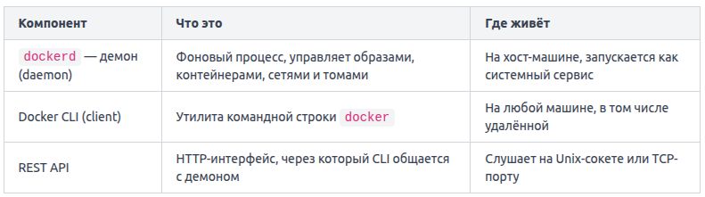

Когда вы вводите docker run nginx в терминале, кажется, что Docker — это одна монолитная программа. На самом деле за этой командой стоит трёхзвенная архитектура: CLI-клиент (docker CLI), демон (dockerd) и REST API между ними.

Docker Engine — это совокупность трёх взаимодействующих компонентов.

Когда вы выполняете любую команду docker, происходит следующее:
1. CLI принимает вашу команду и формирует HTTP-запрос.
2. Запрос уходит на REST API демона — по умолчанию через Unix-сокет `/var/run/docker.sock`.
3. Демон `dockerd` выполняет реальную работу: скачивает образ, создаёт контейнер, настраивает сеть.
4. Результат возвращается обратно через API, CLI выводит его в терминал.

Это означает, что CLI и демон не обязаны находиться на одной машине. Переменная окружения `DOCKER_HOST` позволяет направить CLI на удалённый демон.

dockerd запускается как системный сервис и стартует вместе с ОС. Проверить его статус можно так: `systemctl status docker`.

Сокет `/var/run/docker.sock` — это файл, через который CLI отправляет запросы демону. Именно поэтому, когда вы монтируете этот сокет внутрь контейнера, контейнер получает полный доступ к Docker-демону хоста.

Поскольку API — обычный HTTP, с ним можно работать напрямую через `curl`, минуя CLI: `curl --unix-socket /var/run/docker.sock http://localhost/containers/json`.  Эта команда вернёт JSON со списком запущенных контейнеров — то же самое, что docker ps. Именно на этом API построены все сторонние инструменты, которые управляют Docker программно.

На Linux Docker Engine можно установить отдельно, без Desktop — через пакетный менеджер. На macOS и Windows самый простой путь — именно Docker Desktop, потому что он берёт на себя создание виртуальной среды.