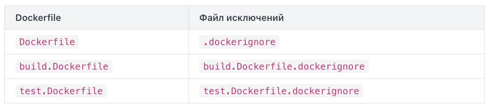
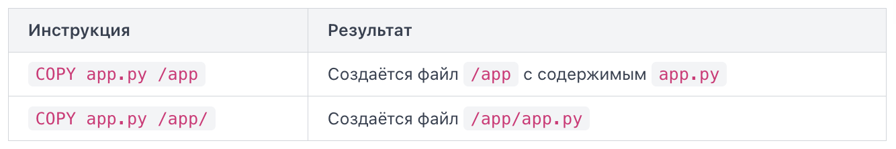

Dockerfile — это текстовый сценарий, по которому Docker собирает образ. Каждая строка в нём содержит инструкцию и её аргументы. Каждая инструкция создаёт промежуточный результат, который становится основой для следующей.

Если файл называется иначе или лежит не в корне контекста сборки, используйте флаг `-f`: `docker build -f docker/build.Dockerfile .`. Здесь Docker возьмёт инструкции из файла `docker/build.Dockerfile`, а контекстом сборки останется текущая директория (`.`). Контекст сборки — это набор файлов и папок, к которым Docker получает доступ во время сборки. Вы задаёте его последним аргументом команды `docker build`. Инструкции в Dockerfile могут обращаться только к файлам внутри контекста (иначе ошибка). Типичная ошибка новичков — запускать `docker build` из домашней директории. Docker попытается отправить все ваши файлы (гигабайты фотографий, загрузок, проектов) на сборку, и процесс зависнет. Всегда запускайте сборку из папки проекта или указывайте путь к ней явно. Файл `.dockerignore` работает как `.gitignore`: он перечисляет файлы и папки, которые нужно исключить из контекста сборки. Docker ищет его в корне контекста.

Базовая форма команды выглядит так: `docker build [ОПЦИИ] ПУТЬ`. `ПУТЬ` -- это обязательный аргумент. Он указывает, откуда Docker возьмёт файлы для сборки. Минимальная рабочая команда: `docker build .` соберёт образ из Dockerfile, лежащего в текущей папке, но не присвоит ему читаемое имя -- только длинный идентификатор. Флаг -t (полная форма --tag) задаёт имя образа в формате `имя:тег`. Тег обычно обозначает версию. Если тег не указать, Docker автоматически подставит `latest`. Можно указать `-t` несколько раз, чтобы присвоить образу сразу два имени. Имя образа может включать путь к реестру (registry), например `myregistry.io/team/myapp:v1`, но на начальном этапе достаточно простых имён. По умолчанию Docker ищет файл с именем `Dockerfile` в корне контекста сборки (context). Флаг -f (полная форма --file) позволяет указать другой файл. Это полезно, когда в проекте несколько Dockerfile для разных целей. Файл может лежать и вне контекста. Флаг --no-cache заставляет Docker выполнить каждую инструкцию заново. В выводе вы не увидите ни одной пометки `CACHED` — все шаги пройдут с нуля.

Чтение вывода сборки:
Каждая инструкция Dockerfile (FROM, COPY, RUN и т.д.) превращается в отдельный шаг сборки. Docker нумерует их в формате `Step X/N`, где N -- общее количество инструкций.

после каждого шага появляется строка вида `---> a1b2c3d4e5f6`. Это идентификатор слоя (layer ID) -- уникальный хэш промежуточного образа, который Docker создал на этом шаге. Строка `Running in ...` означает, что Docker запустил временный контейнер для выполнения команды (например, RUN).

Пометка Using cache (или CACHED в новом формате вывода BuildKit) означает, что Docker не выполнял этот шаг заново, а взял готовый слой из кэша.

Самое важное -- две последние строки:
- Successfully built f6a7b8c9d0e1 -- финальный ID образа (image ID). Это хэш готового образа. По нему можно запустить контейнер: `docker run f6a7b8c9d0e1`.
- Successfully tagged myapp:latest -- подтверждение, что образу присвоен тег, указанный через флаг `-t`.

Если в проекте несколько Dockerfile, каждому можно назначить свой файл исключений. Для этого добавьте `.dockerignore` к имени Dockerfile:



Специфичный файл исключений имеет приоритет над общим `.dockerignore` в корне контекста.

FROM — обязательная первая инструкция (исключение ARG, объявляющие переменные сборки). Она задаёт базовый образ (base image), поверх которого строится всё остальное: `FROM ubuntu:22.04`. Если написать имя образа с опечаткой или указать несуществующий тег, Docker выдаст ошибку. Хорошая практика — указывать конкретный тег версии, а не `latest`. Образ с тегом `latest` может обновиться в любой момент и сломать воспроизводимость сборки.

RUN выполняет команду внутри образа во время сборки и фиксирует результат в новом слое:

```
RUN apt-get update && apt-get install -y curl \
    && rm -rf /var/lib/apt/lists/*
```

Несколько команд объединяют через `&&` в одну инструкцию `RUN` — это уменьшает количество слоёв. Очистка кэша пакетного менеджера в той же строке обязательна: если вынести `rm` в отдельный `RUN`, кэш уже будет зафиксирован в предыдущем слое и никуда не денется.

Обе инструкции копируют файлы с хост-машины в образ, но ведут себя по-разному.
- COPY: Копирует файлы и директории из контекста сборки
- ADD: То же, плюс распаковывает `.tar`-архивы и загружает файлы по URL

```
COPY requirements.txt /app/requirements.txt
COPY . /app
```

Источник -- путь относительно корня контекста. Назначение -- абсолютный или относительный путь внутри образа. Если назначение относительное, оно отсчитывается от текущей рабочей директории (задаётся через WORKDIR). Если директория в назначеении не существует, Docker создаст её автоматически. Можно указать несколько источников. В этом случае назначение должно быть директорией и заканчиваться на `/`. Если источник -- директория, копируется её содержимое (но не сама папка). ## Завершающий слэш имеет значение. Если вы хотите положить файл в директорию, всегда ставьте `/` в конце пути назначения.



Рекомендация — использовать `COPY` по умолчанию. `ADD` применяют только тогда, когда нужна автоматическая распаковка архива. Скрытое поведение `ADD` с URL и архивами делает Dockerfile менее предсказуемым.

Обе инструкции определяют, что запускается при старте контейнера, но роли у них разные.

ENTRYPOINT задаёт исполняемый файл — основной процесс контейнера. Он не перезаписывается при передаче аргументов в `docker run`.

CMD задаёт аргументы по умолчанию. Если при запуске контейнера передать другие аргументы, `CMD` будет проигнорирован. В Dockerfile допустима только одна действующая инструкция CMD. Если вы напишете несколько CMD подряд, сработает только последняя. Остальные будут проигнорированы без ошибки -- Docker не предупредит вас об этом.

```
ENTRYPOINT ["python", "app.py"]
CMD ["--port", "8080"]
```

При запуске `docker run myimage --port 9090` контейнер выполнит `python app.py --port 9090` — `CMD` заменился переданным аргументом, а `ENTRYPOINT` остался.

Если в Dockerfile только `CMD` без `ENTRYPOINT`: `CMD ["python", "app.py"]`.

Тогда `docker run myimage bash` запустит `bash` вместо приложения — вся команда заменяется целиком.

Обе инструкции поддерживают две формы записи. Exec-форма (`["python", "app.py"]`) запускает процесс напрямую и является предпочтительной. Shell-форма (`python app.py`) оборачивает команду в `/bin/sh -c`, что создаёт лишний дочерний процесс и мешает корректной обработке сигналов завершения — контейнер может не останавливаться по `SIGTERM`.

Важные правила exec-формы:
- Элементы оборачиваются только в двойные кавычки ("). Одинарные кавычки (') приведут к ошибке.
- Каждый аргумент -- отдельный элемент массива.

Если в вашем Dockerfile нет CMD (и нет ENTRYPOINT), контейнер унаследует CMD от базового образа. Например, у образа `ubuntu` по умолчанию CMD -- это `bash`. Если же ни в вашем Dockerfile, ни в базовом образе CMD не задана, контейнер не сможет запуститься без явного указания команды в `docker run`.

Docker-образ состоит из слоёв, наложенных друг на друга. Каждая инструкция в Dockerfile, которая изменяет файловую систему создаёт отдельный слой (layer) — неизменяемый снимок файловой системы или набор изменений (дельта) относительно предыдущего слоя. Docker хранит эти слои и при повторной сборке проверяет, изменилась ли инструкция или затронутые ею файлы. Если нет — слой берётся из кэша (build cache) без повторного выполнения. Это ключевой механизм, который определяет скорость пересборки.

Не все инструкции добавляют слой с файлами. Реальные слои создают инструкции, меняющие содержимое файловой системы. Инструкции вроде `CMD`, `ENV`, `EXPOSE`, `WORKDIR` записывают только метаданные образа. Они технически тоже создают промежуточные шаги сборки, но не добавляют данных в файловую систему. Команда `docker history` показывает слои готового образа. 

Docker проверяет кэш последовательно, сверху вниз. Как только одна инструкция признаётся «изменившейся», все последующие инструкции тоже выполняются заново — даже если они сами не менялись. Это называется инвалидацией кэша (cache invalidation). Для инструкций `RUN` Docker сравнивает текст команды. Для `COPY` и `ADD` — контрольные суммы копируемых файлов. Достаточно изменить один файл в директории, и весь слой `COPY` пересчитывается.

Практическое следствие из описанного выше: размещай инструкции в порядке возрастания частоты изменений. То, что меняется редко, — в начало. То, что меняется часто, — в конец.

Каждый `RUN` создаёт отдельный слой. Если разбить установку пакетов на несколько `RUN`, промежуточные слои сохраняются в образе и увеличивают его размер. Принято объединять связанные команды через `&&`

Если вы пишете `COPY . .`, Docker вычисляет контрольные суммы всех файлов в контексте сборки. Временные файлы, артефакты сборки, локальные конфиги — всё это может неожиданно инвалидировать кэш. Именно поэтому `.dockerignore` напрямую влияет на эффективность кэширования: файлы, исключённые из контекста, не участвуют в проверке.

# Multi-stage build
Классическая проблема: чтобы скомпилировать Go-приложение, нужен компилятор весом ~300 МБ. Но для запуска скомпилированного бинарника компилятор не нужен совсем. Без multi-stage build образ тащит за собой весь инструментарий сборки — компиляторы, пакетные менеджеры, заголовочные файлы. Итоговый образ раздувается до сотен мегабайт лишнего веса.

Multi-stage build позволяет описать несколько этапов в одном Dockerfile, а в финальный образ скопировать только нужные артефакты.

Ключевые элементы:
- `FROM образ AS имя`: начинает новый этап и присваивает ему псевдоним (alias).
- `COPY --from=имя`: копирует файлы из другого этапа, а не из контекста сборки.

```
FROM golang:1.26 AS builder
WORKDIR /app
COPY go.mod go.sum ./
RUN go mod download
COPY . .
RUN go build -o server .

FROM debian:bookworm-slim
WORKDIR /app
COPY --from=builder /app/server .
CMD ["./server"]
```

1. Первый этап (`builder`) использует полный образ Go, скачивает зависимости и компилирует бинарник.
2. Второй этап стартует с чистого минимального `debian:bookworm-slim` — в нём нет компилятора, нет исходников, нет кэша модулей.
3. `COPY --from=builder /app/server .` берёт только скомпилированный файл из первого этапа.

Финальный образ содержит только `debian:bookworm-slim` плюс один бинарник.

В одном Dockerfile может быть больше двух этапов. Псевдоним задаётся произвольно, но принято называть по роли: `builder`, `tester`, `deps`.

Путь в `--from` указывается относительно файловой системы того этапа, а не хост-машины. Если бинарник собирался в `/app/server`, именно этот путь указывается после `--from=builder`.

Если забыть псевдоним `AS builder` и написать `--from=0`, Docker будет использовать номер этапа (отсчёт с нуля). Это работает, но ломается при добавлении нового этапа в начало файла — лучше всегда использовать именованные псевдонимы.

# CMD vs ENTRYPOINT
Обе инструкции определяют, что запускается при старте контейнера, но делают это по-разному.

Каждая из инструкций `CMD` и `ENTRYPOINT` поддерживает два синтаксиса:
- Exec-форма (exec form) — массив JSON:
```
CMD ["nginx", "-g", "daemon off;"]
ENTRYPOINT ["python", "app.py"]
```

- Shell-форма (shell form) — строка без скобок:
```
CMD nginx -g "daemon off;"
ENTRYPOINT python app.py
```

При shell-форме Docker неявно оборачивает команду в `/bin/sh -c "..."`. Это означает, что реальным процессом с PID 1 становится `/bin/sh`, а не ваше приложение. Следствие: сигнал `SIGTERM`, который Docker посылает при `docker stop`, получает оболочка, а не процесс приложения — контейнер не завершается корректно и Docker принудительно убивает его через 10 секунд.

Exec-форма запускает процесс напрямую, без оболочки. Приложение получает PID 1 и все сигналы. Используйте exec-форму в продакшене.

ENTRYPOINT задаёт исполняемый файл контейнера — то, что всегда запускается. Переопределить его можно только флагом --entrypoint при docker run. Если написать ENTRYPOINT в shell-форме, любые CMD и аргументы `docker run` будут проигнорированы.

CMD задаёт аргументы по умолчанию. Если пользователь передаёт аргументы в docker run, они заменяют CMD целиком.

Классический паттерн — совместное использование:
```
ENTRYPOINT ["python", "manage.py"]
CMD ["runserver", "0.0.0.0:8000"]
```

Запуск без аргументов:
```
docker run myapp
# эквивалентно: python manage.py runserver 0.0.0.0:8000
```

Запуск с аргументами:
```
docker run myapp migrate
# эквивалентно: python manage.py migrate
```

`CMD` заменился на `migrate`, `ENTRYPOINT` остался.

Ошибки:
- Только `CMD` без `ENTRYPOINT`: Пользователь может случайно заменить всю команду
- Два `CMD` в одном Dockerfile: Работает только последний, остальные молча игнорируются
- Смешивание форм: `ENTRYPOINT` в exec-форме + `CMD` в shell-форме не объединяются корректно (передаётся как один аргумент в ENTRYPOINT).

Правило для запоминания: если образ — это инструмент с фиксированной точкой входа, используйте `ENTRYPOINT` в exec-форме и `CMD` для аргументов по умолчанию; если образ универсальный и команда должна легко меняться — достаточно `CMD` в exec-форме.

WORKDIR задаёт рабочую директорию для всех последующих инструкций. Если указанная директория не существует, Docker создаст её автоматически. Если указать относительный путь, он добавится к предыдущему WORKDIR.