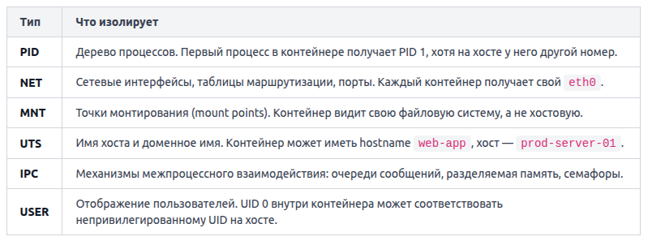

Пространство имён (namespace) — это механизм ядра Linux, который создаёт для процесса изолированное представление определённого системного ресурса. Процессы внутри одного namespace видят только то, что принадлежит этому namespace, и не могут напрямую наблюдать или влиять на ресурсы за его пределами.

Именно namespaces отвечают за то, что контейнер «думает», будто он единственный на машине: у него своя сеть, свои процессы, своя файловая система. При этом всё это работает на одном ядре хоста — ядро лишь показывает каждому процессу его собственный «срез» реальности.

Шесть основных типов namespaces:

Благодаря NET namespace два контейнера могут одновременно слушать порт 80 — каждый в своём сетевом пространстве имён. Docker создаёт виртуальную пару интерфейсов (`veth pair`): один конец уходит в namespace контейнера как `eth0`, другой остаётся на хосте и подключается к мосту `docker0`.

USER namespace позволяет запускать контейнер от имени `root` внутри, но при этом процесс на хосте будет работать от непривилегированного пользователя. Это снижает риск: даже если злоумышленник «сбежит» из контейнера, он окажется обычным пользователем на хосте, а не суперпользователем.

Посмотреть, в каких namespaces находится процесс, можно через: `ls -la /proc/<PID>/ns/`. Каждый файл в этой директории — символическая ссылка на конкретный namespace. Если два процесса ссылаются на один и тот же файл, они разделяют общий namespace.