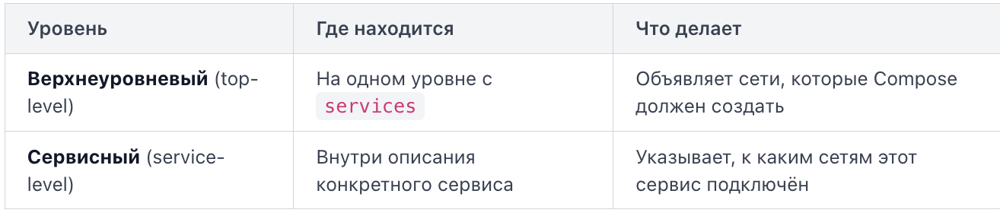

Когда вы запускаете несколько сервисов через Docker Compose, им нужно как-то общаться друг с другом. Было бы неудобно каждый раз вручную создавать сеть и подключать к ней контейнеры. Compose решает эту задачу за вас: при запуске он автоматически создаёт общую сеть и подключает к ней все сервисы из файла.

Каждый раз, когда вы выполняете `docker compose up`, Compose делает три вещи:
1. Создаёт сеть по умолчанию (default network) с именем `<имя_проекта>_default`.
2. Запускает контейнеры для каждого сервиса.
3. Подключает каждый контейнер к этой сети.

Контейнеры оказываются в одной сети и могут обращаться друг к другу. При этом вы нигде не писали ключ `networks` в файле -- Compose сделал всё сам.

Сеть по умолчанию использует драйвер bridge. Это стандартный сетевой драйвер Docker, который создаёт изолированную виртуальную сеть на вашей машине. Контейнеры внутри bridge-сети видят друг друга, но снаружи (с хоста или из интернета) к ним можно попасть только через проброшенные порты.

Получить список сетей: `docker network ls`.

Чтобы посмотреть, какие контейнеры подключены к конкретной сети: `docker network inspect myapp_default`. В секции `Containers` будут перечислены все контейнеры проекта с их IP-адресами.

Важный момент: Docker назначает контейнерам IP-адреса динамически. При каждом пересоздании контейнера (например, после `docker compose up` с изменённой конфигурацией) адрес меняется. Старый контейнер удаляется, новый получает другой IP, но подключается к сети под тем же именем сервиса. Поэтому в коде и конфигурациях никогда не используйте IP-адреса контейнеров -- только имена сервисов.

Если вам не подходит имя сети, основанное на папке, вы можете задать имя проекта явно: `docker compose --project-name shop up`. Тогда сеть будет называться `shop_default`. Того же эффекта можно добиться через переменную окружения `COMPOSE_PROJECT_NAME`.

Иногда нужно, чтобы сервис был доступен под альтернативным именем. Для этого существует ключ links:

```
services:
  web:
    build: .
    links:
      - "db:database"
  db:
    image: postgres:latest
```

Теперь из контейнера `web` база доступна и как `db`, и как `database`. При этом основное DNS-имя `db` продолжает работать для всех остальных сервисов в сети.

Каждый сервис автоматически получает DNS-имя, совпадающее с его именем в файле `docker-compose.yml`. Docker запускает внутренний DNS-сервер в каждой пользовательской сети (включая ту, что Compose создаёт по умолчанию). Этот сервер знает имена всех контейнеров в сети. Когда контейнер `web` пытается обратиться к `db`, происходит следующее:
1. Контейнер `web` спрашивает встроенный DNS: "Какой IP у `db`?"
2. DNS-сервер возвращает текущий IP-адрес контейнера `db`.
3. `web` устанавливает соединение по полученному адресу.

Ключевое правило: имя, которое вы указали в `docker-compose.yml` слева от двоеточия, становится hostname контейнера внутри сети. Внутри сети контейнеры общаются напрямую, проброс портов (`ports`) для этого не нужен.

Ключ `networks` в файле `docker-compose.yml` позволяет создавать собственные сети и точно контролировать, какие сервисы могут общаться друг с другом.

В Compose-файле `networks` встречается в двух местах:


Оба уровня работают в паре: сначала вы объявляете сети наверху, затем подключаете к ним нужные сервисы.

По умолчанию пользовательские сети используют драйвер `bridge`.

Compose по умолчанию формирует имя сети по шаблону `<имя_проекта>_<имя_сети>`. Если проект лежит в папке `myapp`, сеть `backend` из примера выше получит имя `myapp_backend`. Чтобы задать произвольное имя, используйте ключ `name`:

```
networks:
  backend:
    name: my_custom_backend
```

Иногда сеть создана заранее командой `docker network create`. Чтобы Compose не пытался создать её заново, а подключился к существующей, добавьте `external: true`:

```
networks:
  shared:
    name: my-pre-existing-network
    external: true
```

Если сеть с таким именем не найдена на момент запуска, Compose завершится с ошибкой "Network not found".

Когда вы запускаете проект с пользовательскими сетями, Compose выполняет три действия: создаёт все сети, перечисленные в верхнеуровневом `networks` (кроме `external`), запускает контейнеры и подключает каждый контейнер к тем сетям, которые указаны в его сервисном `networks`. Сеть по умолчанию при этом не создаётся, если хотя бы один сервис явно указал свои сети. Контейнер, у которого `networks` не задан, попадёт в сеть `default`, которую Compose создаст автоматически, если она нужна хотя бы одному сервису.

Когда Docker запускает контейнер, он подключает его к виртуальной сети через один из встроенных сетевых драйверов. Драйвер определяет, как контейнер видит другие контейнеры, хост-машину и внешний мир.

Bridge-сеть — изолированная виртуальная сеть внутри хоста. Docker создаёт виртуальный коммутатор `docker0`, и каждый контейнер в этом подсети получает собственный сетевой интерфейс, собственный IP-адрес, шлюз и таблицу маршрутизации -- он ведёт себя как отдельная машина внутри вашего компьютера. Контейнеры одной bridge-сети могут общаться между собой, а наружу трафик идёт через NAT.

Контейнер в сети default bridge может свободно отправлять запросы наружу: скачивать пакеты из интернета, обращаться к внешним API. Контейнер имеет доступ в интернет через механизм маскарадинга (masquerading): исходящий трафик контейнера подменяет свой адрес на адрес хоста. Но в обратную сторону всё иначе. Если внутри контейнера работает веб-сервер на порту 80, вы не сможете открыть его с хоста через `http://localhost:80`. Порты контейнера по умолчанию не доступны снаружи -- ни с хоста, ни из внешней сети. Именно из-за этой изоляции для доступа к сервису контейнера извне нужен явный проброс портов -- флаги `-p` и `-P`

Существует два вида bridge-сетей: дефолтная (`bridge`) и пользовательская (созданная командой `docker network create`).

Пример: запустить два контейнера в одной пользовательской сети:

```
docker network create my-net
docker run -d --name app --network my-net nginx
docker run -d --name db  --network my-net postgres
```

Контейнер `app` сможет обратиться к `db` по имени `db` — без указания IP.

Host-сеть убирает сетевую изоляцию: контейнер использует сетевой стек хоста напрямую. Если приложение слушает порт 8080, он сразу доступен на хосте — без публикации через `-p`.

`docker run --network host nginx`

Это даёт минимальную задержку и упрощает конфигурацию, но контейнер видит все интерфейсы хоста. Режим работает только на Linux; на macOS и Windows Docker Desktop эмулирует его с ограничениями.

None-сеть полностью отключает сетевой стек. Контейнер не имеет ни IP-адреса, ни интерфейсов, кроме loopback. Используется для изолированных задач обработки данных, где сетевой доступ не нужен и нежелателен с точки зрения безопасности.

```
docker run --network none alpine ping 8.8.8.8
# PING 8.8.8.8: Network unreachable
```

Overlay-сеть создаёт виртуальную сеть поверх нескольких физических хостов. Контейнеры на разных машинах видят друг друга так, будто находятся в одной локальной сети. Это основной драйвер для Docker Swarm и мультихостовых сценариев.

Overlay требует инициализации кластера:

```
docker swarm init
docker network create --driver overlay my-overlay
```

Без активного Swarm или внешнего key-value хранилища overlay-сеть создать не получится — Docker вернёт ошибку.

Когда несколько контейнеров работают в одной пользовательской bridge-сети, им нужно находить друг друга по сети. Жёстко прописывать IP-адреса нельзя: Docker назначает их динамически, и после перезапуска контейнера адрес может измениться. Именно здесь в игру вступает DNS-резолвинг — механизм, который позволяет обращаться к контейнеру по имени, а не по адресу.

В пользовательских bridge-сетях Docker запускает собственный встроенный DNS-сервер, доступный по адресу 127.0.0.11. Каждый контейнер в такой сети автоматически настроен использовать этот сервер для разрешения имён.

Принцип работы прост: когда контейнер `app` обращается к имени `db`, запрос уходит на `127.0.0.11`, тот смотрит в свою таблицу и возвращает IP-адрес контейнера с именем `db` в той же сети.

Важно: это работает только в пользовательских сетях. В сети `bridge` по умолчанию встроенный DNS не работает, и контейнеры не находят друг друга по именам.

Docker регистрирует контейнер в DNS по двум идентификаторам:
- Имя контейнера: флаг `--name` при запуске
- Сетевой псевдоним: флаг `--network-alias`

Если имя не задано явно, Docker генерирует случайное — вроде `tender_hopper`.

Иногда нужно, чтобы несколько контейнеров отвечали на одно имя — например, два инстанса одного сервиса. Для этого используют `--network-alias`:

```
docker run -d --network my-net --network-alias backend app-image:v1
docker run -d --network my-net --network-alias backend app-image:v2
```

Теперь DNS будет возвращать оба IP-адреса при запросе имени `backend`, а клиент сам выберет, к какому подключиться. Это базовый механизм балансировки нагрузки на уровне DNS внутри Docker-сети.

В Docker Compose имена сервисов автоматически становятся DNS-именами в общей сети — поэтому сервис `web` может обращаться к `db:5432` без какой-либо дополнительной настройки.