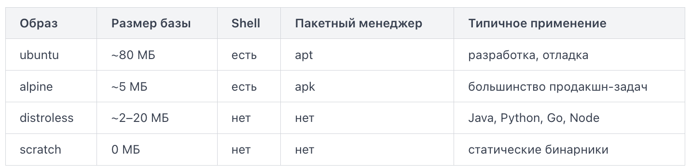
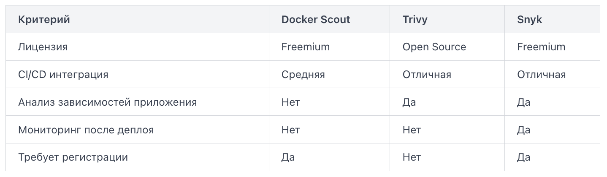

Размер базового образа напрямую влияет на три вещи: скорость сборки и доставки, потребление дискового пространства и поверхность атаки (attack surface). Чем меньше пакетов и инструментов внутри образа, тем меньше уязвимостей может в нём скрываться. Именно поэтому в продакшене редко используют `ubuntu` или `debian` как базу — вместо них берут специализированные минимальные образы.

Alpine — это дистрибутив Linux, построенный на musl libc и BusyBox. Его размер в базовой конфигурации составляет около 5 МБ против 80+ МБ у `debian:slim`. Alpine имеет собственный пакетный менеджер `apk`, поэтому установка зависимостей выглядит привычно:

```
FROM alpine:3.19

RUN apk add --no-cache curl ca-certificates

COPY app /usr/local/bin/app

CMD ["app"]
```

Флаг `--no-cache` важен: он запрещает сохранять индекс пакетов внутри слоя, что дополнительно уменьшает размер образа. Alpine подходит для большинства сценариев, но иногда возникают проблемы совместимости с библиотеками, скомпилированными под glibc — в таком случае переходят к следующему варианту.

Distroless-образы (проект Google) содержат только рантайм приложения и его прямые зависимости — без пакетного менеджера, без shell, без утилит вроде `ls` или `cat`. Это делает их значительно безопаснее: даже если злоумышленник получит доступ к контейнеру, он не сможет запустить интерактивную сессию или установить дополнительные инструменты. Типичный паттерн — многоэтапная сборка:

```
FROM golang:1.26 AS builder

WORKDIR /app
COPY . .
RUN go build -o server .

FROM gcr.io/distroless/static-debian12

COPY --from=builder /app/server /server

CMD ["/server"]
```

Здесь первый этап компилирует бинарник, второй — упаковывает только его в distroless-образ. Итоговый образ не содержит компилятора, исходников и shell.

Scratch — это пустой псевдообраз (pseudo-image), встроенный в Docker. В нём нет абсолютно ничего: ни файловой системы, ни libc, ни shell. Единственное, что туда можно положить, — статически скомпилированный бинарник.

```
FROM scratch

COPY server /server

EXPOSE 8080
CMD ["/server"]
```



Выбор образа определяется тем, что нужно приложению в рантайме. Если приложение требует интерпретатор — distroless с нужным рантаймом. Если это статический бинарник — scratch или distroless/static. Если нужна гибкость и иногда приходится заходить в контейнер для диагностики — alpine.

По умолчанию процессы внутри контейнера запускаются от имени root (суперпользователя). Это удобно при разработке, но создаёт серьёзную проблему в продакшене: если злоумышленник эксплуатирует уязвимость в приложении, он получает права root внутри контейнера. В сочетании с неправильно настроенной изоляцией это может привести к компрометации хост-системы.

Решение простое и занимает одну строку в Dockerfile — инструкция `USER`.

`USER` указывает, от имени какого пользователя (и опционально группы) будут выполняться все последующие инструкции `RUN`, `CMD` и `ENTRYPOINT`. Синтаксис:

`USER <имя_пользователя>[:<группа>]`

или через числовой идентификатор:

`USER 1001:1001`

Числовой идентификатор предпочтительнее в продакшене — он не зависит от того, существует ли пользователь с нужным именем в базовом образе.

Рассмотрим Dockerfile для Node.js-приложения:

```
FROM node:20-alpine

WORKDIR /app

COPY package*.json ./
RUN npm ci --only=production

COPY . .

RUN addgroup -S appgroup && adduser -S appuser -G appgroup

USER appuser

CMD ["node", "server.js"]
```

Разберём ключевые шаги:
1. `addgroup` и `adduser` создают системную группу и пользователя без домашней директории и без права входа в систему (флаг `-S` в Alpine-синтаксисе).
2. Все операции с файлами (`npm ci`, `COPY`) выполняются до переключения пользователя — потому что непривилегированный пользователь не сможет писать в `/app`, если права не настроены.
3. `USER appuser` переключает контекст. Всё, что идёт после — `CMD`, `ENTRYPOINT` — запускается уже без привилегий root.

Некоторые операции действительно требуют root: привязка к портам ниже 1024, монтирование файловых систем, изменение сетевых интерфейсов. Для таких случаев используют Linux capabilities — механизм тонкой настройки привилегий, который рассматривается в следующих шагах урока. Принцип тот же: давать ровно столько прав, сколько нужно, и не больше.

Даже если вы используете минимальный базовый образ, это не гарантирует отсутствие уязвимостей. Библиотеки, пакеты и зависимости приложения могут содержать известные уязвимости — задокументированные слабые места, которым присвоен идентификатор CVE (Common Vulnerabilities and Exposures). Сканеры образов автоматически проверяют содержимое контейнера по базам CVE и сообщают, что именно и насколько опасно.

Сканер анализирует слои образа: извлекает список установленных пакетов, версии библиотек, зависимости приложения — и сверяет их с публичными базами уязвимостей (NVD, GitHub Advisory, OSV и другими). На выходе вы получаете список найденных проблем с уровнем критичности: Critical, High, Medium, Low.

Docker Scout встроен в Docker Desktop и Docker CLI начиная с версии 4.17. Для базового сканирования достаточно одной команды: `docker scout cves nginx:1.25`. Вывод покажет список CVE, затронутые пакеты и рекомендованные версии для исправления. Команда `docker scout recommendations` предложит более безопасный тег того же образа. Scout удобен для быстрой проверки прямо в терминале, но в бесплатном тарифе ограничен по количеству приватных репозиториев.

Trivy — опенсорсный сканер от Aqua Security, де-факто стандарт в CI/CD. Устанавливается одной командой и не требует регистрации: `trivy image nginx:1.25`. Trivy умеет сканировать не только образы, но и файловую систему, Git-репозитории и Dockerfile. В CI-пайплайне часто используют флаг `--exit-code 1`, чтобы упасть при обнаружении критических уязвимостей: `trivy image --exit-code 1 --severity CRITICAL,HIGH myapp:latest`. Если уязвимостей с уровнем Critical или High нет — команда завершится с кодом 0, и пайплайн продолжится. Если есть — пайплайн остановится.

Snyk — коммерческий инструмент с бесплатным тарифом, который интегрируется с GitHub, GitLab и Docker Hub. Его особенность — анализ не только системных пакетов, но и зависимостей приложения (package.json, requirements.txt, go.mod).

`snyk container test nginx:1.25`.

Snyk также предлагает `snyk container monitor` — команду, которая ставит образ на постоянный мониторинг: если завтра появится новая CVE для уже задеплоенного образа, вы получите уведомление.



Trivy чаще всего выбирают для встраивания в пайплайн — он быстр, бесплатен и не требует внешних сервисов. Snyk добавляет ценность там, где важен мониторинг уже запущенных образов и анализ зависимостей на уровне кода приложения.

Запуск от непривилегированного пользователя — важный шаг, но сам по себе недостаточный. Даже непривилегированный процесс может записать вредоносный файл в контейнер, получить дополнительные права через системный вызов или использовать избыточные возможности ядра. Три механизма, описанных в этом шаге, закрывают эти векторы атаки.

Файловая система только для чтения запрещает процессу внутри контейнера изменять что-либо на диске. Если злоумышленник получил выполнение кода, он не сможет записать бэкдор, изменить конфигурацию или загрузить дополнительные инструменты.

Флаг для `docker run`: `docker run --read-only my-image`.

Большинство приложений всё же требуют места для временных файлов. Под это монтируют `tmpfs` — раздел в памяти: `docker run --read-only --tmpfs /tmp my-image`.

В Docker Compose это выглядит так:

```
services:
  app:
    image: my-image
    read_only: true
    tmpfs:
      - /tmp
```

Флаг no-new-privileges запрещает процессу и его дочерним процессам получать новые привилегии через механизмы `setuid`/`setgid`. Без этого флага бинарный файл с битом `setuid` (например, `sudo` или `ping`) мог бы повысить права процесса до root прямо внутри контейнера. `docker run --security-opt no-new-privileges:true my-image`.

Это одна строка, которая блокирует целый класс атак с повышением привилегий.

Традиционная модель Unix делит мир на root (всё разрешено) и обычного пользователя (почти ничего). Capabilities (возможности ядра) дробят права root на отдельные разрешения: `NET_BIND_SERVICE` — слушать порты ниже 1024, `SYS_PTRACE` — отлаживать процессы, `NET_RAW` — работать с сырыми сокетами и так далее.

Docker по умолчанию даёт контейнеру около 14 capabilities из возможных 40+. Это уже меньше, чем у root, но всё равно избыточно для большинства приложений.

Правильная стратегия — сначала убрать все, потом добавить только нужные:

```
docker run \
  --cap-drop ALL \
  --cap-add NET_BIND_SERVICE \
  my-image
```

Типичный веб-сервер, который слушает порт 443, не нуждается ни в чём, кроме `NET_BIND_SERVICE`. Всё остальное — потенциальная поверхность атаки.

На практике все три флага применяют вместе:

```
docker run \
  --read-only \
  --tmpfs /tmp \
  --security-opt no-new-privileges:true \
  --cap-drop ALL \
  --cap-add NET_BIND_SERVICE \
  --user 1001:1001 \
  my-image
```

