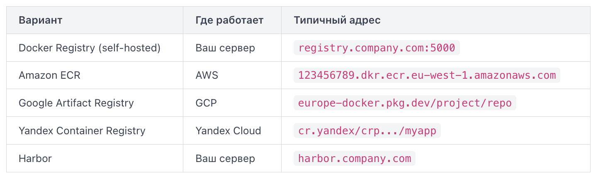
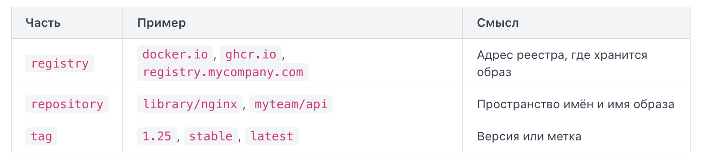

Когда вы собираете образ локально, он существует только на вашей машине. Для публикации образов существуют реестры образов — централизованные хранилища, из которых Docker умеет скачивать и куда умеет загружать образы.

Docker Hub — публичный реестр по умолчанию. Когда вы пишете `docker pull nginx`, Docker обращается именно туда. Адрес реестра — `registry-1.docker.io`, но в командах он опускается как подразумеваемый.

Структура имени образа на Docker Hub:

```
docker.io/library/nginx:latest      # официальный образ от команды Docker
docker.io/myusername/myapp:1.0      # пользовательский
```

Бесплатный план позволяет иметь один приватный репозиторий; остальные — публичные.

Главное ограничение Docker Hub для продакшена: с 2020 года введены rate limits — анонимные запросы ограничены 100 pull-запросами каждые 6 часов с одного IP. Это критично для CI/CD, где десятки агентов могут тянуть образы одновременно.

GitHub Container Registry (GHCR, `ghcr.io`) — реестр от GitHub, тесно интегрированный с GitHub Actions. Образы хранятся рядом с кодом репозитория и наследуют его права доступа.

Имя образа выглядит так: `ghcr.io/myorg/myapp:1.0`.

GHCR удобен, если ваш код уже на GitHub: не нужно настраивать отдельные секреты и учётные записи. Публичные образы доступны без аутентификации, приватные — только для участников организации. Хранилище входит в квоту GitHub Packages и бесплатно для публичных репозиториев.

Приватный реестр — это реестр, который вы разворачиваете самостоятельно или используете от облачного провайдера. Он нужен, когда образы содержат проприетарный код и не должны быть доступны публично.

Варианты:


Запустить минимальный приватный реестр локально можно одной командой: `docker run -d -p 5000:5000 --name registry registry:2`.

После этого образы публикуются по адресу `localhost:5000/myapp:1.0`. В реальных проектах поверх такого реестра настраивают TLS и аутентификацию — без этого Docker откажется работать с ним по умолчанию, считая соединение небезопасным.

Когда Docker скачивает или собирает образ, он присваивает ему идентификатор. Но числовой идентификатор неудобен для работы: его сложно запомнить и невозможно понять, что внутри. Для этого существует тег — человекочитаемая метка, которая прикрепляется к образу и однозначно указывает на конкретную его версию.

Полное имя образа в Docker состоит из трёх частей: `registry/repository:tag`.



Если реестр не указан, Docker подставляет `docker.io` по умолчанию. Если тег не указан — подставляется `latest`. Поэтому `nginx` и `docker.io/library/nginx:latest` — это одно и то же имя с точки зрения Docker.

Тег `latest` не означает «самая новая версия» автоматически — это просто строка, которую разработчик образа решил присвоить своему последнему релизу. Полагаться на `latest` в продакшене опасно: образ под этим тегом может измениться без предупреждения.

`docker tag` создаёт новое имя (псевдоним) для уже существующего образа. Сам образ при этом не копируется — оба имени указывают на одни и те же слои.

`docker tag SOURCE_IMAGE[:TAG] TARGET_IMAGE[:TAG]`

Типичный сценарий: вы собрали образ локально и хотите опубликовать его в реестр компании.

```
docker build -t myapp:build-123 .
docker tag myapp:build-123 registry.mycompany.com/backend/myapp:1.4.2
docker tag myapp:build-123 registry.mycompany.com/backend/myapp:stable
```

После этих команд один и тот же образ доступен под тремя именами. Убедиться в этом можно через `docker image ls` — все три строки будут иметь одинаковый `IMAGE ID`.

В реальных проектах теги несут смысловую нагрузку. Распространённые подходы:
- Семантическое версионирование — `1.4.2`, `2.0.0-rc1`. Позволяет точно воспроизвести окружение.
- Тег ветки или окружения — `main`, `staging`, `production`. Удобно для CI/CD: пайплайн перезаписывает тег при каждом деплое.
- Хэш коммита — `a3f8c12`. Гарантирует уникальность и трассируемость: зная тег, всегда можно найти исходный код.

Типичная ошибка — использовать только `latest` и перезаписывать его при каждой сборке. В этом случае откатиться к предыдущей версии становится невозможно, потому что старый образ теряет имя и его сложно найти среди безымянных слоёв.

Аутентификация — первый обязательный шаг перед отправкой образа в приватный или публичный реестр. Без неё `docker push` вернёт ошибку `denied: requested access to the resource is denied`.

`docker login`

По умолчанию команда обращается к Docker Hub. Вы вводите логин и пароль (или токен доступа — рекомендуется вместо пароля). Docker сохраняет учётные данные в файл `~/.docker/config.json`.

Для входа в сторонний реестр укажите его адрес явно:

`docker login registry.example.com`

Для GitHub Container Registry (ghcr.io) схема та же, но вместо пароля от аккаунта используется токен, и передают его не интерактивным вводом, а через стандартный ввод (stdin):

`echo $GITHUB_TOKEN | docker login ghcr.io -u your_github_username --password-stdin`

Флаг `--password-stdin` читает пароль или токен из стандартного ввода — это безопаснее, чем передавать его прямо в строке команды, где он попадёт в историю shell (history) и будет виден в выводе команды `ps`. Команда `echo` перед вертикальной чертой (pipe) выводит значение переменной окружения `GITHUB_TOKEN`, которое `docker login` читает из стандартного ввода, — токен не приходится записывать в промежуточный файл.

В конвейере непрерывной интеграции (CI, continuous integration) токен берут из переменной окружения, куда его подставляет секрет (secret) хранилища CI-системы, — например, в GitHub Actions это `GITHUB_TOKEN` или личный токен доступа (personal access token), сохранённый как секрет репозитория, а не как значение в файле или прямо в workflow-файле.

После аутентификации отправьте образ командой `docker push`. Образ должен быть предварительно тегирован в формате `registry/repository:tag`.

`docker push your_username/myapp:1.0`

Docker разбивает образ на слои (layers) и отправляет только те, которых ещё нет в реестре. Если слой уже загружен ранее, вы увидите `Layer already exists` — это экономит время и трафик.

Загрузка образа (pull) работает в обратном направлении — скачивает образ из реестра на локальную машину:

`docker pull your_username/myapp:1.0`

В документации Docker вы можете встретить полную форму команды -- `docker image pull`. Она работает точно так же, как короткая `docker pull`.

Если образ приватный, перед `pull` также нужен `docker login`. Для публичных образов аутентификация не требуется.

Команда `docker run` автоматически вызывает `pull`, если образа нет локально, — но явный `pull` полезен, когда нужно заранее скачать образ на сервер или обновить его до свежей версии.

Важный момент: `docker logout` завершает сессию и удаляет сохранённые учётные данные из `config.json`. Используйте его на общих или временных машинах, чтобы не оставлять доступ открытым.

После работы с реестрами на локальной машине накапливаются образы: скачанные через `pull`, собранные вручную, промежуточные слои от неудачных сборок. Три команды позволяют держать это хозяйство под контролем.

Список локальных образов — отправная точка. Команда показывает все образы, которые Docker хранит на диске:

`docker images` (она же `docker image ls` — это полный синоним).

Строки с `<none>:<none>` — это висячие образы (dangling images): образы без привязанного имени и тега. Обычно они остаются после пересборки Docker-образов, когда старый тег переходит к новой версии. Они занимают место, но не используются.

Полезные флаги:  
- `-a` — показать вообще все слои, включая промежуточные  
- `-q` — вывести только IMAGE ID (удобно для скриптов)  
- `--filter dangling=true` — показать только висячие образы

Команда `history` раскрывает историю слоёв конкретного образа — каждую инструкцию Dockerfile, которая добавила слой:

`docker image history nginx:latest`

Флаг `--no-trunc` показывает полные команды без обрезки.

Очистка образов удаляет висячие образы — те самые `<none>:<none>`: `docker image prune`.

Docker попросит подтверждение и покажет, сколько места освободилось. Чтобы пропустить вопрос в скриптах — добавьте флаг `-f`.

Если нужно удалить не только висячие, но и все образы, которые не используются ни одним запущенным или остановленным контейнером:

```
docker image prune -a
```

Будьте осторожны с `-a` на рабочей машине: команда удалит образы, которые вы не запускали давно, но планировали использовать.

Для точечного удаления конкретного образа используют:

`docker image rm nginx:latest`

`docker system prune` — удаляет все неиспользуемые объекты, включая образы.

Если образ используется контейнером, Docker откажет — сначала нужно удалить контейнер.

Разработчики часто запускают `docker image prune -a` перед деплоем, не понимая, что это удалит базовые образы. Следующий `docker build` заново скачает всё с нуля и займёт много времени. Используйте `prune` без `-a` для рутинной уборки.

Команда `docker rmi` (сокращение от remove image) удаляет образы с вашей машины.

Команда принимает один или несколько образов -- по имени, тегу или идентификатору.

Полная форма этой же команды -- `docker image rm`. Обе записи делают одно и то же, `docker rmi` просто короче.

Если у образа есть несколько тегов, удаление по тегу снимает только этот тег. Сам образ останется, пока на него указывает хотя бы один тег. Когда последний тег снят -- образ удаляется с диска вместе со всеми его слоями.

Docker не позволит удалить образ, если на его основе существует контейнер -- даже остановленный.

Это защитный механизм: контейнер хранит ссылку на образ, из которого был создан. Чтобы удалить такой образ, сначала удалите все контейнеры, которые от него зависят.

Флаг -f (или --force) заставляет Docker удалить образ, даже если на него ссылаются несколько тегов. Без `-f` Docker потребовал бы удалять теги по одному. С `-f` все теги снимаются разом, и образ удаляется.

