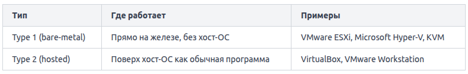

Контейнеры и виртуальные машины решают одну задачу — изолировать приложения друг от друга.

Виртуальная машина эмулирует целый компьютер. Поверх физического сервера работает специальная программа -- гипервизор. Гипервизор создаёт виртуальное "железо" и каждая виртуальная машина видит «своё» виртуальное CPU, оперативную память, сетевую карту и диск. Поверх этого виртуального железа устанавливается полноценная гостевая ОС со своим ядром, драйверами и системными библиотеками. Только поверх этой ОС запускается ваше приложение.

Гипервизоры делятся на два типа:

Контейнеры не эмулируют железо и не запускают отдельное ядро. Вместо этого они используют разделение ядра: все контейнеры на одном хосте работают поверх одного и того же ядра хост-ОС. Изоляция достигается не через эмуляцию, а через механизмы самого ядра Linux — namespaces и cgroups. Именно поэтому на macOS и Windows Docker запускает лёгкую виртуальную машину с Linux: без ядра Linux нет ни namespaces, ни cgroups, а значит, нет и контейнеров. Контейнеры содержат всё необходимое для запуска приложения, но не тащат за собой целую операционную систему.

Контейнеризация -- это не магия, а грамотное использование двух проверенных механизмов ядра: namespaces дают изоляцию, cgroups дают контроль над ресурсами, а Docker делает работу с ними простой и доступной каждому разработчику.