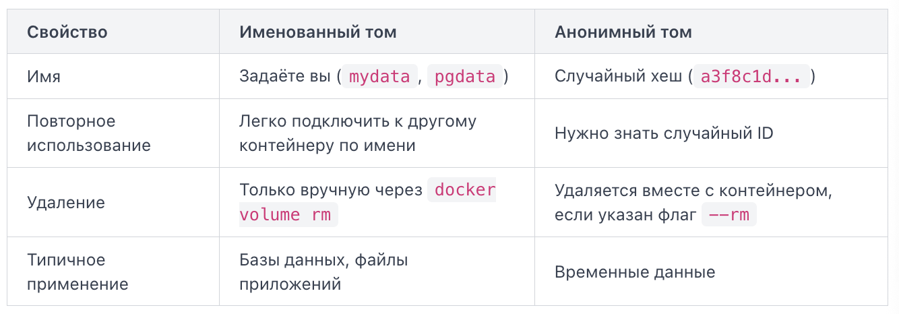

По умолчанию данные внутри контейнера живут ровно столько, сколько живёт сам контейнер. Удалил контейнер — потерял данные. Чтобы данные пережили контейнер или были доступны нескольким контейнерам одновременно, Docker предлагает три механизма хранения: тома (volumes), монтирование директорий хоста (bind mounts) и временное хранилище в памяти (tmpfs).

# Volume
Volume — это управляемое Docker хранилище, физически расположенное в директории `/var/lib/docker/volumes/` на хосте. Docker сам создаёт, отслеживает и изолирует это пространство от остальной файловой системы.

`docker create -v mydata:/app/data nginx`

Здесь `mydata` — имя тома, `/app/data` — путь внутри контейнера. Если такого пути в контейнере не существует, Docker создаст её автоматически. Если том с таким именем не существует, Docker создаст пустой том автоматически. Если имя тома опустить, Docker создаст анонимный том со случайным ID.



Если вы монтируете непустой том хоста в директорию контейнера, в которой уже есть файлы, существующие файлы контейнера затеняются (obscured). Они не удаляются, но становятся недоступны, пока действует монтирование.

Если вы монтируете пустой том хоста в директорию контейнера, в которой уже есть файлы, существующие файлы контейнера по умолчанию копируются в том.

Volumes — рекомендуемый способ хранения для большинства сценариев: базы данных, файлы приложения, артефакты сборки. Они переносимы между машинами, поддерживают резервное копирование через `docker volume` и не зависят от структуры файловой системы хоста.

# Bind mount
Bind mount монтирует конкретную директорию или файл с хоста прямо в контейнер. Путь на хосте может быть как абсолютный, так и относитльный, путь в контейнере задаётся абсолютно. Контейнер видит содержимое хостовой папки так, будто оно лежит у него внутри.

`docker create -v /home/user/config:/etc/app/config:ro nginx`

Если вы монтируете файл или директорию хоста в директорию контейнера, в которой уже есть файлы, существующие файлы контейнера затеняются (obscured). Они не удаляются, но становятся недоступны, пока действует монтирование.

Важный нюанс: если при запуске контейнера указать bind mount на несуществующую директорию хоста, Docker создаст её автоматически — но с правами `root`. Это частая причина проблем с правами доступа, особенно когда приложение внутри контейнера работает от непривилегированного пользователя.

Контейнер видит реальные файлы хоста — любое изменение внутри контейнера немедленно отражается снаружи, и наоборот.

Флаг `:ro` делает монтирование доступным только для чтения.

Bind mounts удобны для разработки: монтируете исходный код проекта в контейнер и видите изменения без пересборки образа. Но у них есть ограничение — они жёстко привязаны к структуре файловой системы конкретной машины, что усложняет переносимость.

# `-v` vs `--mount`
Флаг `--mount` длиннее, зато каждый параметр указан явно через пары «ключ=значение», разделённые запятыми:

```
docker create --name web \
  --mount type=volume,src=web-content,dst=/usr/share/nginx/html \
  nginx:latest
```

Основные ключи:
- type: Тип монтирования: volume, bind или tmpfs
- `src` (или `source`): Имя тома. Если опустить — создаётся анонимный том
- `dst` (или `destination`, `target`): Путь внутри контейнера
- `readonly` / `ro`: Монтировать только для чтения
- `volume-nocopy`: Не копировать существующие файлы контейнера в пустой том

Для повседневной работы `-v` короче и удобнее. Но `--mount` обязателен, если вам нужно:
- передать параметры драйвера тома (`volume-opt`);
- смонтировать подкаталог тома (`volume-subpath`);
- работать с сервисами Docker Swarm.

Важное отличие: если путь на хосте не существует, `-v` автоматически создаст пустую директорию, а `--mount` выдаст ошибку.

# tmpfs
tmpfs хранит данные исключительно в оперативной памяти хоста. При остановке контейнера данные исчезают безвозвратно.

`docker create --tmpfs /app/cache:size=100m nginx`

Этот тип подходит для временных данных, которые не должны попасть на диск: сессионные токены, промежуточные вычисления, кэш с чувствительной информацией. Скорость чтения/записи значительно выше, чем у дискового хранилища.

# docker volume create
`docker volume create myvolume`: команда создаёт именованный том с драйвером local по умолчанию. Том появляется в системе Docker немедленно, ещё до запуска любого контейнера — это принципиальное отличие от автосоздания при `docker create`. Docker вернёт имя созданного тома: `mydata`. Если не указать имя, Docker сгенерирует случайный хеш -- это будет анонимный том, с которым неудобно работать вручную. Имена томов уникальны в рамках драйверов. Попытка создать том с уже существующим именем на том же драйвере не вызовет ошибку -- Docker просто вернёт существующий том. Но если имя занято другим драйвером, вы получите ошибку.

Создадим именованный том и убедимся, что данные сохраняются после удаления контейнера:

```
docker volume create appdata

docker run --rm -v appdata:/data alpine sh -c "echo 'hello from container' > /data/test.txt"

docker run --rm -v appdata:/data alpine cat /data/test.txt
```

Можно задать дополнительные параметры:

```
docker volume create \
  --driver local \
  --opt type=none \
  --opt device=/srv/pgdata \
  --opt o=bind \
  pgdata
```

Здесь `--opt` передаёт параметры монтирования: тип `none` с опцией `bind` означает, что том будет указывать на конкретную директорию хоста `/srv/pgdata`. Это полезно, когда нужно точно контролировать расположение данных.

# docker volume inspect
`docker volume inspect myvolume`: просмотр деталей. Вывод — JSON с полной информацией о томе. Ключевое поле — `Mountpoint`: это реальный путь на хосте, где Docker хранит данные тома. Зная его, можно напрямую скопировать данные или сделать резервную копию средствами ОС.

Чтобы получить только путь без лишнего JSON, используют шаблон `--format`: `docker volume inspect --format '{{ .Mountpoint }}' myvolume`.

# docker volume ls
Просмотр всех томов: `docker volume ls`. Осиротевший том (dangling volume) — том, который не подключён ни к одному контейнеру. Они накапливаются после `docker rm` контейнеров и занимают место на диске.

# docker volume prune
Удалить все тома, которые не подключены ни к одному контейнеру одной командой: `docker volume prune`. Docker запросит подтверждение и покажет, сколько места освободилось. Если нужно удалить без интерактивного запроса — флаг `-f`.

# docker volume rm
Удалить конкретный том: `docker volume rm myvolume`. Если том подключён к работающему или остановленному контейнеру, Docker откажет с ошибкой `volume is in use`. Сначала нужно удалить контейнер. Можно удалить несколько томов за раз, перечислив их через пробел.

Разработчики часто удаляют контейнер командой `docker rm`, рассчитывая, что данные исчезнут вместе с ним. Но именованный том остаётся. Это защита от случайной потери данных — но и источник «мусора», если не следить за томами регулярно.