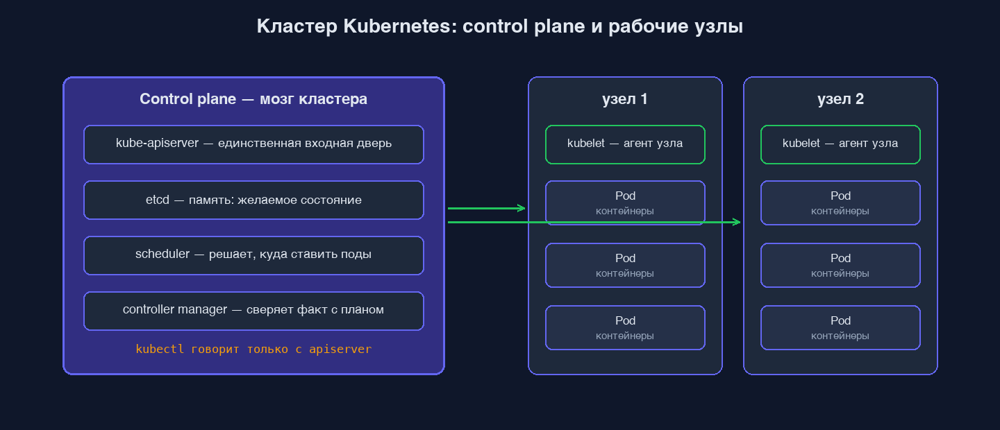

Kubernetes-кластер — это много серверов которые работают вместе. Серверы делятся на два типа: те где живёт «мозг» (Control Plane) и те где живут ваши Pod'ы (Worker Node).

# Control Plane
Control Plane состоит из 4 главных компонентов, которые управляют всем кластером.

**API Server — единая точка входа**
Всё что делает кластер, делается через API Server. Это даёт единую точку аутентификации, валидации и аудита. `kubectl apply` отправляет YAML сюда. Worker Node спрашивают у него «что мне делать?». Контроллеры тоже работают через него. Это REST API на HTTPS. Любая операция = запрос к API Server.

Аналогия: API Server — это диспетчер вокзала. Все запросы (от пассажиров, от поездов, от расписания) идут к нему. Он решает кому что отвечать.

**etcd — память кластера**
База данных где хранится всё состояние кластера: какие Pod'ы должны быть запущены, какие сейчас работают, какие конфиги, секреты, политики. Это key-value хранилище. Распределённое — обычно 3 копии для отказоустойчивости.

Аналогия: etcd — журнал диспетчера. Где он записывает «поезд А прибыл», «поезд Б отправляется в 14:30». Если диспетчер заболеет — журнал прочитает другой.

**Scheduler — расселяет Pod'ы**
Когда вы просите «запустить этот Pod» — Scheduler решает на каком Worker Node его поселить. Учитывает:  
- Свободные ресурсы на нодах.  
- Требования Pod'а (нужно 2 ГБ памяти, нужен SSD).  
- Правила affinity/anti-affinity (например «не размещать 2 реплики на одном ноде»).

Аналогия: Scheduler — рассадчик в самолёте. У него есть пассажиры (Pod'ы) и кресла (Worker Nodes). Кого где посадить — его работа.

**Controller Manager — реализует «как должно быть»**
Это процесс который смотрит «что должно быть в кластере» (из etcd) и «что есть сейчас» — и доводит реальность до желаемого. Заявлено `replicas: 3`, а Pod'ов 2? Controller Manager поднимает третий. Стало 4 (например вы создали лишний руками)? Controller Manager удаляет один.

Аналогия: Controller Manager — это бдительный кладовщик. На полке должно быть 10 коробок. Считает — 8. Идёт и приносит две. Считает — 11. Убирает одну.

Если control plane временно недоступен, уже запущенные поды продолжат работать: контейнеры выполняются на узлах под управлением kubelet. Недоступен будет только «мозг» — нельзя применить изменения, отмасштабировать или переселить поды, пока control plane не вернётся.

# Worker Node
На каждом Worker Node работают три компонента.

**kubelet — главный агент**
kubelet — это процесс который постоянно общается с API Server и говорит: «я здесь, у меня есть ресурсы, какие Pod'ы запускать?»

Когда Scheduler решил «этот Pod пойдёт на ноду Х» — kubelet на ноде Х получает задание и запускает контейнер. Дальше kubelet следит чтобы контейнер работал. Упал? Перезапустит.

kubelet ещё проверяет healthchecks. Если liveness probe вернула «не ок» — kubelet перезапускает контейнер.

Аналогия: kubelet — бригадир на складе. Получил задание от диспетчера, расставил товар, следит чтобы стояло на месте.

**kube-proxy — сетевая магия**
В Kubernetes есть Services — абстракция «обращайся к сервису по имени, не думай на каком ноде Pod». Чтобы это работало, нужно правильно перенаправлять трафик: пришёл запрос → ушёл на нужный Pod.

Этим занимается kube-proxy. Настраивает iptables (или ipvs) правила на каждой ноде.

**Container Runtime — собственно запускает контейнеры**
kubelet не запускает контейнеры сам. Он поручает container runtime запустить контейнер из такого-то образа с такими-то настройками.

Container runtime — это `containerd` (стандарт сегодня), реже `CRI-O` или раньше `Docker`. Технически — то же что у вас запускает контейнеры на ноуте.

Раньше в Kubernetes использовали Docker, но в 2022 году отказались — теперь containerd напрямую. Для вас как пользователя разницы нет: образы те же, поведение то же.

```
kubectl apply pod.yaml
       ↓
   API Server (получил, сохранил в etcd)
       ↓
   Scheduler (выбрал ноду)
       ↓
   API Server (записал «Pod на ноде X»)
       ↓
   kubelet на ноде X (увидел, скачал образ, попросил containerd)
       ↓
   containerd (запустил контейнер)
       ↓
   твой Pod работает
```

Это упрощённая схема.



# Путь запроса: от kubectl до запущенного контейнера

Вы вводите: `kubectl apply -f deployment.yaml`.

**Шаг 1. kubectl → API Server**

kubectl читает YAML, отправляет HTTPS-запрос на API Server. API Server проверяет:
- Авторизован ли пользователь (ваш kubeconfig содержит ключи).
- Валиден ли YAML.
- Разрешено ли создавать такие ресурсы (RBAC).

Если всё ок — записывает в etcd: «должен существовать Deployment X с такими настройками».

**Шаг 2. Deployment Controller заметил изменение**
Controller Manager постоянно следит за etcd. Видит — появился новый Deployment с `replicas: 3`. Идёт и создаёт ReplicaSet. Записывает в etcd.

**Шаг 3. ReplicaSet Controller заметил**
Тот же Controller Manager следит и за ReplicaSet'ами. Видит — есть ReplicaSet с `replicas: 3`, а Pod'ов 0. Создаёт 3 Pod-объекта в etcd. Пока без указания на каком ноде они должны быть.

**Шаг 4. Scheduler заметил**
Scheduler следит за Pod'ами без назначенной ноды. Видит — 3 новых Pod'а. Для каждого решает на каком ноде разместить (учитывая ресурсы). Записывает в etcd: «Pod 1 на ноде A, Pod 2 на ноде B, Pod 3 на ноде A».

**Шаг 5. kubelet увидел свою работу**
kubelet на ноде A постоянно опрашивает API Server: «есть для меня новые задания?». Видит — мне назначены Pod 1 и Pod 3. Скачивает образы (если нет локально). Просит containerd запустить контейнеры.

**Шаг 6. containerd запустил**
containerd создаёт namespaces, cgroups, монтирует слои, запускает процессы. Сообщает kubelet — «запустил». kubelet записывает в API Server — «Pod в состоянии Running».

```
kubectl apply
   → API Server (валидация, запись в etcd)
   → Deployment Controller (создал ReplicaSet)
   → ReplicaSet Controller (создал Pod-объекты)
   → Scheduler (назначил ноды)
   → kubelet на нодах (получили задания)
   → containerd (запустил контейнеры)
   → Pod'ы Running
```

Это декларативная модель. Вы не говорите «запустить Pod на ноде B». Вы говорите «должно быть 3 Pod'а с такими настройками». Кластер сам разбирается.