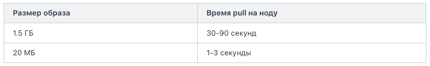

# Связь с Docker
Kubernetes управляет контейнерами. Что внутри Pod? Контейнеры. Что собирается через `kubectl apply`? Контейнеры. Как Kubernetes отличает «здоровый» сервис от «упавшего»? По состоянию контейнера.

Kubernetes тянет образы с registry, маленькие тянутся быстрее.

# Что станет с вашим текущим деплоем
Сейчас ваш сервис, скорее всего, деплоится одним из трёх способов:
- На голый сервер: `git pull && systemctl restart`. Работает, но обновления — стресс, упал процесс — никто не поднимет автоматически.
- В Docker без оркестрации: `docker compose up`. Уже лучше, но один сервер — единая точка отказа.
- Никак (новый проект, ещё думаете, как деплоить).

К концу курса ваш сервис будет жить в Kubernetes-кластере.

# cgroups в kubernetes
В Kubernetes вы будете часто видеть `resources: requests: memory: 256Mi, limits: memory: 512Mi`. Это и есть настройка cgroups для контейнеров вашего Pod'а.

# Container vs VM (почему это критично для Kubernetes)
Kubernetes-кластер обычно состоит из 5-50 серверов (нод). На каждой ноде крутятся десятки Pod'ов, а в каждом Pod'е один или несколько контейнеров. Сотни контейнеров на одной машине — это нормально.

Сделать это на VM невозможно: 100 VM × 2 ГБ = 200 ГБ памяти впустую, минута на старт каждой. Контейнеры решают: 100 контейнеров × 50 МБ = 5 ГБ, миллисекунды на старт.

# Обзор
В kubernetes используется та же модель `образ-контейнер`, что и в Docker, только Kubernetes её ещё более явно использует. В YAML-манифесте Deployment вы задаёте:

```yaml
spec:
  replicas: 3
  template:
    spec:
      containers:
      - name: web
        image: nginx:1.25     # ← рецепт
```

`image: nginx:1.25` — это образ (рецепт). `replicas: 3` говорит Kubernetes: «запустить 3 контейнера из этого образа». K8s создаст 3 Pod'а, в каждом будет один контейнер nginx. Из одного образа — три контейнера.

# Почему размер образа важен
Когда Kubernetes планирует Pod на ноду, нода должна скачать образ (если ещё нет). Это `docker pull` (точнее `containerd pull`, но суть та же).

Если у вас 50 нод и вы выкатываете новую версию сервиса, каждая нода будет тянуть образ. И если на ноде уже есть базовые слои (`python:3.11`, `golang:1.26`) — она скачает только новый слой с кодом. Несколько мегабайт, секунды.

Если базовых слоёв нет — придётся качать полный образ. На большой нагрузке (100 нод × 500 МБ) это часы. Пока тянется — Pod'ы в состоянии `ContainerCreating`, ваш rollout висит.

Поэтому в Kubernetes-проектах часто:  
- Все сервисы используют одну и ту же базу (общие слои).  
- На каждой ноде заранее предзагружают популярные образы.  
- Стараются делать образы маленькими (про это — в следующем уроке).

Когда вы деплоите сервис в K8s, образ нужно скачать на каждую ноду где Pod может оказаться. Сравните:



Если у вас кластер из 30 нод и autoscaler добавил 5 новых — каждая тянет ваш образ при первом запуске Pod'а. На 1.5 ГБ это серьёзная задержка для пользователей (новый трафик ждёт пока поднимутся Pod'ы).

Плюс место в registry. Если у вас 20 микросервисов × 1.5 ГБ × 50 версий в истории = терабайты. Маленькие образы → меньше расходы на storage.

# Какой базовый образ выбрать
`distroless` — это де-факто стандарт для production в Kubernetes. Когда Pod падает в production, вы обычно не лезете в него руками. Вы смотрите логи (`kubectl logs`) и метрики (Prometheus). Зайти в Pod — это уже плохой знак, диагностика.

Поэтому отсутствие shell в distroless — это не баг, а фича. Меньше инструментов внутри = меньше шансов что атакующий, попав в контейнер, сможет что-то навредить. Pod должен делать одну вещь — обрабатывать запросы. Не запускать nmap или wget.