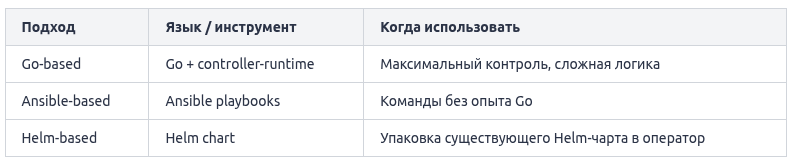

Kubernetes поставляется с набором встроенных типов ресурсов: Pod, Deployment, Service, ConfigMap и другие. Но реальные приложения часто требуют понятий, которых в стандартном API нет. Например, «база данных PostgreSQL с репликой», «сертификат TLS с автопродлением» или «очередь сообщений с тремя брокерами». Именно для таких случаев существует механизм CustomResourceDefinition (CRD).

`CustomResourceDefinition` — это объект Kubernetes, который регистрирует в API-сервере новый тип ресурса. После регистрации этот тип становится полноправным гражданином кластера. Сам экземпляр нового типа называется Custom Resource (CR). CRD — это определение типа, CR — конкретный объект этого типа.

Минимальный манифест CRD регистрирует новый тип `Database` в группе `myapp.example.com`:

```yaml
apiVersion: apiextensions.k8s.io/v1
kind: CustomResourceDefinition
metadata:
  name: databases.myapp.example.com
spec:
  group: myapp.example.com
  names:
    kind: Database
    plural: databases
    singular: database
  scope: Namespaced
  versions:
    - name: v1
      served: true
      storage: true
      schema:
        openAPIV3Schema:
          type: object
          properties:
            spec:
              type: object
              properties:
                engine:
                  type: string
                replicas:
                  type: integer
```

`spec.group` — определяет API-группу ресурса.

Поле `scope: Namespaced` означает, что ресурс привязан к конкретному namespace. Альтернатива — `scope: Cluster` для ресурсов, которые существуют на уровне всего кластера (например, узлы или StorageClass).

После применения этого манифеста (`kubectl apply -f database-crd.yaml`) можно создавать объекты типа `Database`:

```yaml
apiVersion: myapp.example.com/v1
kind: Database
metadata:
  name: my-postgres
spec:
  engine: postgres
  replicas: 3
```

Kubernetes примет и сохранит этот объект. Проверить его можно командой: `kubectl get databases`.

Вывод будет выглядеть так же, как для любого встроенного ресурса

Важно понять ключевое ограничение: CRD только хранит данные. Сам по себе объект `Database` не создаст никакой базы данных — Kubernetes не знает, что с ним делать. CRD — это декларация намерения, а не исполнение.

Чтобы объект `Database` превратился в реально работающую базу данных, нужен компонент, который будет наблюдать за такими объектами и реагировать на них. Этот компонент называется контроллером, а связка CRD + контроллер образует паттерн, который рассматривается в следующих шагах урока.

**Operator pattern**
Kubernetes умеет запускать контейнеры, следить за их состоянием и перезапускать при сбоях. Но некоторые приложения требуют более сложного управления: кластер базы данных нужно не просто запустить, а ещё инициализировать, настроить репликацию, выполнить резервное копирование по расписанию, корректно обработать масштабирование. Всё это — операционная экспертиза, которую раньше хранил человек-оператор. Operator pattern переносит эту экспертизу в код.

Operator — это комбинация двух элементов:
- CustomResourceDefinition (CRD) — расширение API Kubernetes, которое добавляет новый тип ресурса. Например, вместо стандартного `Deployment` вы описываете `PostgresCluster` с полями `replicas`, `version`, `backupSchedule`.
- Контроллер — процесс, который наблюдает за объектами этого нового типа и приводит реальное состояние кластера к желаемому.

Предположим, вы установили Operator для PostgreSQL. После этого в кластере появляется новый ресурс `PostgresCluster`. Вы создаёте манифест:

```yaml
apiVersion: postgres-operator.crunchydata.com/v1beta1
kind: PostgresCluster
metadata:
  name: my-db
spec:
  postgresVersion: 15
  instances:
    - replicas: 3
      dataVolumeClaimSpec:
        accessModes:
          - ReadWriteOnce
        resources:
          requests:
            storage: 1Gi
  backups:
    pgbackrest:
      repos:
        - name: repo1
          schedules:
            full: "0 1 * * *"
          volume:
            volumeClaimSpec:
              accessModes:
                - ReadWriteOnce
              resources:
                requests:
                  storage: 1Gi
```

Вы применяете манифест командой `kubectl apply`, и контроллер берёт работу на себя: создаёт нужные `StatefulSet`, `Service`, `ConfigMap`, инициализирует кластер, настраивает репликацию между тремя репликами и планирует ежедневный бэкап в 01:00.

Без Operator вам пришлось бы вручную описывать все эти объекты и знать внутреннюю логику PostgreSQL. Operator инкапсулирует эти знания.

Контроллер работает в цикле согласования (reconciliation loop): он постоянно сравнивает желаемое состояние (то, что записано в объекте `PostgresCluster`) с реальным состоянием кластера. Если одна из реплик упала — контроллер это замечает и восстанавливает её. Если вы изменили `replicas: 3` на `replicas: 5` — контроллер добавит два новых экземпляра. Это принципиально отличается от скрипта, который запускается один раз: контроллер работает непрерывно и реагирует на любые изменения.

Начинающие часто путают Operator с Helm-чартом. Helm — это шаблонизатор для первоначального развёртывания. Operator — это живой процесс, который управляет приложением на протяжении всего жизненного цикла: установка, обновление, масштабирование, резервное копирование, восстановление после сбоя. Многие Operators при этом используют Helm внутри себя для первоначальной установки, но это не делает их эквивалентными.

**Reconciliation loop**
Механизм Kubernetes, который постоянно сверяет описание состояния системы с реальностью и устраняет расхождения, называется reconciliation loop — петля согласования.

Разница между desired state (то, что записано в манифесте) и actual state (то, что реально происходит в кластере прямо сейчас) называется drift — отклонение. Задача reconciliation loop — обнаружить drift и привести actual state к desired state.

Оператор (Operator) реализует reconciliation loop через функцию `Reconcile`. Kubernetes вызывает её каждый раз, когда:

- создаётся или изменяется ресурс, за которым следит оператор;
- удаляется зависимый объект;
- истекает таймер периодической проверки.

Внутри функции `Reconcile` логика всегда одна и та же:
1. Прочитать desired state из CR (Custom Resource)
2. Прочитать actual state из кластера
3. Сравнить
4. Ничего не делать/Применить изменения

Если reconciliation завершился с ошибкой, контроллер повторит попытку с экспоненциальной задержкой.

Reconciliation loop вызывается многократно — иногда десятки раз в минуту. Поэтому функция `Reconcile` должна быть идемпотентной: повторный вызов с тем же состоянием не должен приводить к побочным эффектам. Если база данных уже создана — не создавать её снова. Если сертификат актуален — не перевыпускать. Нарушение идемпотентности — одна из самых частых ошибок при написании операторов.

**Operator SDK и OperatorHub**
Написать оператор с нуля — значит реализовать контроллер, который следит за CRD и запускает reconciliation loop. Делать это вручную на чистом Go долго и сложно. Operator SDK — это инструментарий (toolkit), который берёт на себя шаблонный код и позволяет сосредоточиться на бизнес-логике оператора.

SDK поддерживает три подхода к написанию операторов:



Для начинающих DevOps-инженеров Helm-based подход — самый быстрый старт: вы берёте уже написанный чарт и превращаете его в оператор буквально за несколько команд.

ЭТО НЕ ЗАКОНЧЕНО