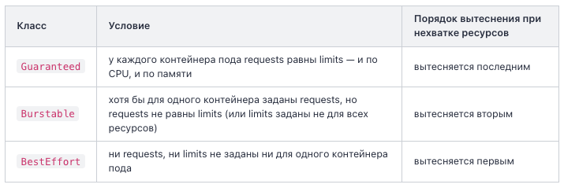

В Kubernetes нельзя запустить контейнер напрямую — только через Pod. Pod — это минимальная единица деплоя в Kubernetes, которая оборачивает один или несколько контейнеров и предоставляет им общую среду выполнения (общую сеть и хранилище).

Часто Pod = один контейнер. Это самый частый случай. Тогда зачем дополнительная обёртка вокруг? Затем что иногда двум контейнерам нужно быть рядом и делить ресурсы:
- Основное приложение + sidecar для логов.
- Приложение + прокси для авторизации.
- Веб-сервер + утилита для обновления конфига из git.

В этих случаях контейнеры должны:
- Видеть один localhost (как будто они на одном компьютере).  
- Делить один диск (один пишет файл, другой читает).  
- Жить и умирать вместе (упал один — перезапускается весь Pod).

# Хранилище
Контейнеры в Pod'е могут шарить тома:

```yaml
spec:
  volumes:
    - name: shared
      emptyDir: {}
  containers:
    - name: app
      volumeMounts:
        - name: shared
          mountPath: /data
    - name: logger
      volumeMounts:
        - name: shared
          mountPath: /var/log/app
```

Оба контейнера видят одну папку. `app` пишет в `/data`, `logger` читает из `/var/log/app` — физически это одна и та же папка.

# Жизнь Pod'а
Если Pod упал — K8s обычно не «оживляет» этот Pod, а создаёт новый. Новый Pod получает новый IP, новый ID.

# YAML-манифест Pod
Pod описывается в YAML-файле. Это «декларативное описание» того что должно быть. Минимальный пример:

```yaml
apiVersion: v1
kind: Pod
metadata:
  name: my-nginx
  labels:
    app: web
spec:
  containers:
  - name: nginx
    image: nginx:1.25
    ports:
    - containerPort: 80
```

`kind: Pod` задаёт тип объекта, здесь это манифест Pod'а. Бывают и другие: Deployment, Service, ConfigMap.

`apiVersion: v1` — указывает версию API Kubernetes, к которой относится объект. Для пода это всегда `v1` — стабильная версия ядра API. У других объектов могут быть `apps/v1` или `networking.k8s.io/v1`.

`metadata` содержит идентификационные данные объекта. Обязательное вложенное поле — `name`, уникальное имя пода внутри пространства имён. Сюда же добавляют `labels` — произвольные пары ключ-значение, по которым объекты находят друг друга (например, Service ищет под именно по меткам).

Поле `labels` в `metadata` на первый взгляд кажется необязательным, но без него под будет изолирован — ни Service, ни Deployment не смогут его обнаружить по селектору.

`spec` описывает желаемое состояние объекта. Для пода главный раздел внутри `spec` — это `containers`: список контейнеров, которые должны работать внутри пода. Каждый контейнер имеет:  
- `name` — имя контейнера внутри Pod'а (уникально в рамках одного пода).  
- `image` — какой образ запустить (та же запись что и в `docker create`).  
- `ports` — какие порты контейнер слушает (носит информационный характер, не открывает порты автоматически).
- `env` — переменные окружения.
- `resources` — запросы и лимиты для CPU и памяти

Запуск: `kubectl apply -f pod.yaml`. Проверить: `kubectl get pods`.

Системные компоненты K8s сами работают как Pod'ы в namespace `kube-system`. Получить их список: `kubectl get pods -n kube-system`.

# Requests и limits: запросы и лимиты ресурсов

```yaml
spec:
  containers:
    - name: nginx
      image: nginx:1.25
      resources:
        requests:
          cpu: "100m"
          memory: "128Mi"
        limits:
          cpu: "500m"
          memory: "256Mi"
```

**Единицы измерения.** CPU задаётся в ядрах или в миллиядрах (millicpu) с суффиксом `m`: `100m` означает 0.1 ядра, то есть десятую часть одного процессорного ядра. Память задаётся в двоичных единицах: `Mi` (мебибайт) и `Gi` (гибибайт). Они отличаются от похожих на вид десятичных единиц `M` и `G`. В манифестах Kubernetes принято указывать именно двоичные единицы `Mi`/`Gi`.

**Requests и планировщик.** Когда вы применяете манифест, планировщик (Scheduler) подбирает узел (node), на котором суммарные `requests` уже запущенных подов вместе с новым не превышают выделяемые (allocatable) ресурсы узла. То есть `requests` — это не «сколько поду разрешено использовать», а «сколько узлу нужно зарезервировать под этот под ещё до его запуска». Если ни на одном узле кластера не хватает свободных ресурсов под запрошенные `requests`, под остаётся в статусе `Pending`, а в событиях (events) появляется сообщение вида `Insufficient cpu` или `Insufficient memory`.

**Limits и что происходит при превышении.** Лимит ограничивает, сколько ресурса контейнеру разрешено использовать во время работы, и поведение при превышении различается для CPU и памяти:
- при превышении лимита CPU контейнер не завершается — операционная система лишь ограничивает выделяемое ему процессорное время, это называется троттлингом; контейнер продолжает работать, но медленнее
- при превышении лимита памяти ядро Linux принудительно завершает процесс контейнера — событие называется `OOMKilled`; Kubernetes фиксирует это в статусе контейнера и, согласно `restartPolicy`, обычно перезапускает его, увеличивая счётчик `RESTARTS`.

**Классы качества обслуживания (QoS classes).** На основании соотношения requests и limits Kubernetes присваивает поду один из трёх классов — от этого зависит порядок вытеснения (eviction) подов с узла при нехватке ресурсов.



Если поле `resources` вообще не указано, под получает класс `BestEffort` и при нехватке ресурсов на узле первым будет вытеснен — поэтому для боевых (production) нагрузок задавать хотя бы `requests` считается обязательной практикой.

# Несколько контейнеров в pod
Два главных паттерна:

**Sidecar — «помощник» рядом с основным**
Sidecar — это второй контейнер который дополняет основной. Они работают параллельно, делят ресурсы Pod'а.

Примеры:
- Лог-сборщик: основной пишет логи в файл `/var/log/app.log`, sidecar читает этот файл и отправляет в Elasticsearch.
- Service mesh proxy: основной приложение, sidecar — envoy который перехватывает весь трафик и добавляет mTLS/трейсинг.
- Локальный кэш: основной + рядом nginx-кэш для статики.

```yaml
spec:
  containers:
  - name: app
    image: my-app
  - name: log-collector
    image: fluent-bit
    volumeMounts:
    - name: logs
      mountPath: /var/log
  volumes:
  - name: logs
    emptyDir: {}
```

Оба контейнера живут вместе: запускаются вместе, умирают вместе, шарят том `logs`.

**Init containers — выполняются ДО основного**
Init container запускается перед основными контейнерами. Должен успешно завершиться, потом стартует основной.

Используется для подготовки:  
- Скачать конфиг из vault до старта приложения.  
- Дождаться готовности БД (`pg_isready`).  
- Подготовить файлы в shared volume.

```yaml
spec:
  initContainers:
  - name: wait-for-db
    image: busybox
    command: ['sh', '-c', 'until nc -z db 5432; do sleep 1; done']
  containers:
  - name: app
    image: my-app
```

K8s сначала запустит `wait-for-db`. Когда тот завершится (return code 0), стартует `app`.

Если init container упадёт — Pod в состоянии `Init:Error`, основной контейнер не запустится. Это полезно: «без подготовки не работаем».

**Когда использовать**
Один Pod = одна функциональная единица. Не пихай в один Pod веб-сервер и БД — это разные сервисы, должны быть в разных Pod'ах.

Sidecar и init container — для тесно связанных вещей которые должны жить вместе.

# Жизненный цикл Pod'а
Pod проходит через несколько состояний. Их видно в `kubectl get pods` в колонке STATUS. Разберём главные.

**Pending — ждёт**
Pod создан в etcd, но контейнеры ещё не запустились. Возможные причины:  
- Scheduler ещё не выбрал ноду.  
- kubelet скачивает образ (`ContainerCreating` это разновидность Pending).  
- Нет нод с нужными ресурсами (тогда Pod висит в Pending долго — проблема).

Долгий Pending — повод смотреть `kubectl describe pod` для понимания почему.

**Running — работает**
Все контейнеры Pod'а запущены и работают. Это «нормальное» состояние. В колонке READY показывается `1/1` или `2/2` — сколько контейнеров готовы из общего числа. `0/1` значит контейнер не прошёл readiness probe.

**Running, но не Ready**
Контейнер работает, но не проходит проверку готовности.

**Succeeded — успешно завершился**
Все контейнеры завершились с exit code 0. Это для batch-задач (Job), для долгоживущих сервисов не должно быть.

**Failed — упал**
Хотя бы один контейнер завершился с ненулевым exit code и не должен перезапускаться.

**OOMKilled**
Контейнер завершён ядром из-за нехватки памяти.

**CrashLoopBackOff — постоянно падает**
Не отдельный статус, а симптом. Контейнер запускается, падает, K8s перезапускает, опять падает. K8s начинает ждать всё дольше между попытками (10s, 20s, 40s...).

Это самая частая ошибка в начале работы с K8s. Причины:  
- Опечатка в команде запуска.  
- Не хватает переменных окружения (например `DB_HOST` не задан).  
- Конфиг кривой.

Диагностика: `kubectl logs <pod>` (логи последнего падения) + `kubectl logs <pod> --previous` (логи предыдущего падения).

**Что ещё бывает**
- Terminating — Pod удаляется (Grace period обычно 30 секунд).
- ImagePullBackOff — не получается скачать образ (опечатка в имени, нет доступа к registry).
- Init:Error — init container упал, основной не запускается.

В 90% случаев разбор начинается с одного и того же: `kubectl describe pod` показывает событие, `kubectl logs` показывает причину. Эти две команды — ваш первый рефлекс при любом «Pod не работает».