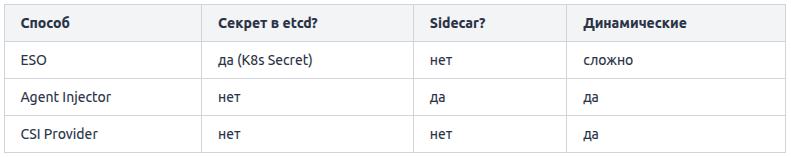

ConfigMap хранит данные в открытом виде. Для паролей, токенов, ключей это плохо. Для них есть Secret.

```yaml
apiVersion: v1
kind: Secret
metadata:
  name: db-credentials
type: Opaque
data:
  password: cGFzc3dvcmQxMjM=    # base64 от "password123"
```


**Главное заблуждение: base64 — это НЕ шифрование**
Видите `cGFzc3dvcmQxMjM=` — выглядит «зашифровано». Это обман зрения. base64 — это просто кодирование, не шифрование. Любой расшифрует за секунду:

```bash
echo "cGFzc3dvcmQxMjM=" | base64 -d
# password123
```

base64 нужен чтобы хранить бинарные данные (например TLS-сертификаты) как текст в YAML. Это не защита. Любой кто получит доступ к Secret видит пароль.

**Тогда зачем Secret, если не шифрует**
Secret даёт несколько преимуществ над ConfigMap:
1. RBAC: можно настроить права «кто видит секреты» отдельно от «кто видит конфиги». Разработчику дать конфиги, но не секреты.
2. Не светится в логах: K8s старается не выводить содержимое Secret в `kubectl describe`, в логах событий.
3. Хранится в памяти ноды (tmpfs): смонтированные секреты не пишутся на диск ноды.
4. Encryption at rest (опционально): можно настроить шифрование Secret в etcd. Про это дальше.

**Как создать правильно**
Не пишите base64 руками. Используйте `kubectl`: `kubectl create secret generic db-credentials \
  --from-literal=password=password123`

K8s сам закодирует. Или из файла: `kubectl create secret generic tls-cert \
  --from-file=cert.pem --from-file=key.pem`

**Использование**
Как env-переменная:

```yaml
env:
- name: DB_PASSWORD
  valueFrom:
    secretKeyRef:
      name: db-credentials
      key: password
```

Или как файл (volume mount) — аналогично ConfigMap.

# Типы Secret: Opaque, docker-registry, tls
У Secret есть тип. Он подсказывает K8s как использовать секрет. Три главных типа.

**Opaque — универсальный**
```yaml
apiVersion: v1
kind: Secret
metadata:
  name: app-secrets
type: Opaque
data:
  api-key: <base64>
  db-password: <base64>
```

Самый частый тип. «Произвольные данные». Используется для паролей, API-ключей, токенов. Если не уверены, берите `Opaque` — он подходит для всего кроме двух специальных случаев (registry и TLS). А эти два вы ни с чем не перепутаете: они нужны конкретно для pull образов и для HTTPS.

**kubernetes.io/dockerconfigjson — для приватных registry**
Если ваш образ лежит в приватном registry (приватный Docker Hub, ghcr.io, корпоративный Harbor), K8s нужны креды чтобы его скачать. Для этого — специальный тип:

```bash
kubectl create secret docker-registry regcred \
  --docker-server=ghcr.io \
  --docker-username=myuser \
  --docker-password=ghp_token123
```

Используется в Pod через `imagePullSecrets`:

```yaml
spec:
  imagePullSecrets:
  - name: regcred
  containers:
  - name: app
    image: ghcr.io/myorg/private-app:v1
```

Теперь K8s сможет скачать приватный образ.

**kubernetes.io/tls — для TLS-сертификатов**
Для HTTPS нужны сертификат и приватный ключ. Специальный тип:

```bash
kubectl create secret tls myapp-tls \
  --cert=tls.crt \
  --key=tls.key
```

Используется в Ingress:

```yaml
spec:
  tls:
  - hosts: [myapp.com]
    secretName: myapp-tls    # ← этот Secret
```

Обычно создаётся автоматически cert-manager'ом.

**Зачем разные типы**
K8s использует тип для валидации и поведения:  
- `dockerconfigjson` проверяет что внутри валидный docker-config.  
- `tls` проверяет что есть `tls.crt` и `tls.key`.  
- Контроллеры (Ingress) знают как использовать tls-секреты.


# Encryption at Rest
Базовые Secret по умолчанию в etcd они хранятся в base64 — то есть фактически в открытом виде. Если кто-то получил доступ к etcd — он прочитает все секреты в открытом виде. base64 не помеха.

```bash
# на мастер-ноде, имея доступ к etcd:
etcdctl get /registry/secrets/default/db-credentials
# выведет base64 → расшифровывается мгновенно
```

Решение: `Encryption at Rest`. K8s умеет шифровать Secret в etcd. Настраивается через `EncryptionConfiguration` на API Server:

```yaml
apiVersion: apiserver.config.k8s.io/v1
kind: EncryptionConfiguration
resources:
- resources:
  - secrets
  providers:
  - aescbc:
      keys:
      - name: key1
        secret: <32-байтный ключ в base64>
  - identity: {}      # fallback для старых нешифрованных
```

После настройки API Server шифрует секреты перед записью в etcd и расшифровывает при чтении. Теперь в etcd лежит зашифрованный blob, а не base64.

Ещё лучше: `KMS`. Хранить ключ шифрования в конфиге — не идеально (ключ в файле). Production использует KMS-провайдеров: ключ хранится в облачном KMS (AWS KMS, GCP KMS, Vault), API Server обращается к нему для шифрования.

```yaml
providers:
- kms:
    name: aws-kms
    endpoint: unix:///var/run/kms.sock
```

Тогда даже укравший etcd не расшифрует без доступа к KMS.

В managed-кластерах: EKS, GKE, AKS обычно уже настраивают encryption at rest (часто с KMS). Проверьте в настройках кластера — скорее всего включено. Если ставите кластер сами — настройте обязательно.

**Настройка для etcd**
Шаг 1: создать ключ шифрования:

```bash
head -c 32 /dev/urandom | base64
# выводит 32-байтный ключ, например: a1b2c3...==
```

Шаг 2: EncryptionConfiguration. Создаёте файл на мастер-ноде, например `/etc/kubernetes/enc.yaml`:

```yaml
apiVersion: apiserver.config.k8s.io/v1
kind: EncryptionConfiguration
resources:
- resources:
  - secrets               # шифруем секреты
  providers:
  - aescbc:               # алгоритм AES-CBC
      keys:
      - name: key1
        secret: <твой ключ>
  - identity: {}          # для чтения старых нешифрованных
```

Порядок providers важен:
- При записи используется первый (aescbc — шифрует).
- При чтении пробуются по очереди (если зашифровано — aescbc, если старое — identity).

Шаг 3: подключить к API Server. В манифесте API Server добавляете флаг: `--encryption-provider-config=/etc/kubernetes/enc.yaml`.

API Server перезапускается с шифрованием.

Шаг 4: зашифровать существующие секреты. Новые секреты теперь шифруются. Но старые всё ещё в base64. Пересохрани их: `kubectl get secrets --all-namespaces -o json | kubectl replace -f -`. Эта команда перезаписывает все секреты → они проходят через шифрование.

Шаг 5: проверка. 
```bash
# Прочитать напрямую из etcd:
etcdctl get /registry/secrets/default/db-credentials
# Должен быть зашифрованный blob (k8s:enc:aescbc:v1:...), не base64
```

Со временем ключ надо менять. Добавляете новый ключ первым в списке, перешифровываете, удаляете старый. K8s поддерживает несколько ключей одновременно для плавной ротации.

# Sealed Secrets: безопасное хранение секретов в git

Хочется хранить всю конфигурацию кластера в git (GitOps). Манифесты, ConfigMap — легко. Но Secret?

Решение — Sealed Secrets от Bitnami. Идея: зашифровать секрет так, что расшифровать может только ваш кластер. Зашифрованную версию безопасно коммитить в git.

**Как работает:**
1. В кластере ставится контроллер sealed-secrets со своим приватным ключом.
2. Вы берёте обычный Secret и шифруете его утилитой `kubeseal` публичным ключом кластера.
3. Получается SealedSecret — зашифрованный объект.
4. SealedSecret безопасно коммитите в git — расшифровать без приватного ключа кластера невозможно.
5. Контроллер в кластере расшифровывает SealedSecret своим приватным ключом → создаёт обычный Secret.

```
Обычный Secret
   ↓ kubeseal (публичный ключ)
SealedSecret (зашифрован) → коммитишь в git ✓
   ↓ контроллер в кластере (приватный ключ)
Обычный Secret (в кластере)
```

**На практике:**
```
# Создаёшь обычный Secret (локально, не применяешь):
kubectl create secret generic db-creds \
  --from-literal=password=secret123 \
  --dry-run=client -o yaml > secret.yaml

# Шифруешь:
kubeseal -f secret.yaml -w sealed-secret.yaml

# sealed-secret.yaml безопасно коммитишь в git
git add sealed-secret.yaml && git commit -m "add db creds"

# Применяешь:
kubectl apply -f sealed-secret.yaml
# контроллер расшифрует и создаст обычный Secret
```

**Почему это безопасно**
Шифрование асимметричное. Публичным ключом можно только зашифровать. Расшифровать — только приватным, который никогда не покидает кластер. Даже если весь git-репозиторий утёк — секреты внутри SealedSecret бесполезны без приватного ключа.

**Ограничение**
SealedSecret привязан к конкретному кластеру (его приватному ключу). Зашифрованный для кластера A не расшифруется в кластере B. Для нового кластера надо перешифровать.

# External Secrets Operator: секреты из внешних хранилищ
Sealed Secrets решает «как хранить в git». Но есть другой подход — вообще не хранить секреты в кластере, а подтягивать из специализированного хранилища (Vault, AWS Secrets Manager). Для этого — External Secrets Operator (ESO).

Секреты живут в внешнем хранилище (Vault, AWS/GCP Secrets Manager). В кластере вы пишете только ссылку — «возьми секрет X из хранилища Y». ESO периодически синхронизирует: тянет из хранилища, создаёт обычный K8s Secret.

```
AWS Secrets Manager / Vault (источник истины)
        ↓ ESO синхронизирует
Kubernetes Secret (автоматически создан)
        ↓
Pod использует как обычно
```

**Зачем?**
1. Один источник истины: секреты в одном месте (Vault), не размазаны по кластерам.
2. Ротация: поменял секрет в Vault → ESO обновил K8s Secret автоматически.
3. Аудит: Vault логирует кто и когда читал секрет.
4. Не в git: в git только ссылки (ExternalSecret), сами значения — в Vault.

Сначала описываете `SecretStore` — где брать секреты:
```yaml
apiVersion: external-secrets.io/v1beta1
kind: SecretStore
metadata:
  name: vault-store
spec:
  provider:
    vault:
      server: "https://vault.example.com"
      path: "secret"
      auth:
        kubernetes:
          role: "my-app"
```

Потом `ExternalSecret` — что взять:
```yaml
apiVersion: external-secrets.io/v1beta1
kind: ExternalSecret
metadata:
  name: db-secret
spec:
  secretStoreRef:
    name: vault-store
    kind: SecretStore
  target:
    name: db-credentials      # имя K8s Secret который создастся
  data:
  - secretKey: password
    remoteRef:
      key: database/prod
      property: password
```

ESO возьмёт `database/prod` → `password` из Vault, создаст K8s Secret `db-credentials` с ключом `password`. Pod использует как обычный Secret.

# HashiCorp Vault: динамические секреты и ротация

`Vault` — это специализированное хранилище секретов от HashiCorp. Промышленный стандарт для управления секретами. Умеет то, что обычные K8s Secret не могут.

Базово Vault хранит секреты как key-value:
```bash
vault kv put secret/database password=secret123
vault kv get secret/database
```

Это уже лучше K8s Secret: централизованно, с аудитом, с RBAC. Но это умеют многие.

Vault может генерировать секреты на лету с коротким временем жизни.

Пример: приложению нужен доступ к PostgreSQL. Вместо постоянного пароля Vault при запросе:  
1. Создаёт временного пользователя в PostgreSQL.  
2. Выдаёт его креды приложению.  
3. Через 1 час — удаляет этого пользователя.

```bash
vault read database/creds/my-role
# username: v-token-my-role-x7k2...
# password: A1b2C3...
# lease_duration: 1h
```

Преимущества:  
- Креды живут час → даже если утекли, скоро бесполезны.  
- Каждое приложение/под получает свои креды → видно кто что делал (аудит).  
- Не нужно вручную ротировать — Vault сам создаёт и удаляет.

Ротация секретов. Vault умеет автоматически менять даже статические секреты по расписанию. Раз в 30 дней меняет пароль БД, обновляет везде. Без человека.

Audit log. Vault логирует каждое обращение к секрету: кто, когда, какой секрет, с какого IP. При инциденте — точно видно что скомпрометировано.

Encryption as a Service. Vault может шифровать/расшифровывать данные не храня их (Transit engine). Приложение шлёт данные в Vault, получает зашифрованные, хранит у себя. Ключ никогда не покидает Vault.

Vault мощный, но сложный: нужно развернуть, настроить auth, политики, поддерживать. Для маленьких проектов — overkill. Для крупных с требованиями безопасности (финтех, медицина) — стандарт.

Vault и K8s можно подружить тремя способами. Выбор зависит от потребностей.

**1. External Secrets Operator (ESO)**

Уже разбирали. ESO тянет секреты из Vault → создаёт обычные K8s Secret.

```
Vault → ESO → K8s Secret → Pod (как обычный Secret)
```

Плюс: приложение не знает про Vault, работает с обычными Secret. Минимум изменений в коде.  
Минус: секрет всё же материализуется как K8s Secret (в etcd). Динамические секреты сложнее.

Когда: хотите Vault как источник, но приложения работают со стандартными Secret.

**2. Vault Agent Injector: sidecar для секретов**

Vault Agent — это sidecar-контейнер который добавляется к Pod'у автоматически. Он аутентифицируется в Vault, забирает секреты, кладёт в shared volume (`/vault/secrets/`). Приложение читает оттуда.

```
Pod:
  ├─ app container (читает /vault/secrets/db)
  └─ vault-agent sidecar (тянет из Vault, пишет в /vault/secrets/)
```

Активируется аннотациями:

```yaml
annotations:
  vault.hashicorp.com/agent-inject: "true"
  vault.hashicorp.com/role: "my-app"
  vault.hashicorp.com/agent-inject-secret-db: "database/creds/my-role"
```

Плюс: секрет не хранится как K8s Secret (не в etcd). Поддерживает динамические секреты и авто-обновление.  
Минус: каждый Pod получает sidecar (+ресурсы). Приложение читает из файлов.

Когда: нужны динамические секреты, не хотите материализовать в etcd.

Из трёх способов подружить Vault с Kubernetes этот — самый ходовой и, пожалуй, самый элегантный. Вы добавляете пару строк-аннотаций, а Vault сам подселяет к вашему Pod'у sidecar, который приносит секреты прямо в файл. Разберём как.

Вы добавляете в Pod аннотации:
```yaml
apiVersion: apps/v1
kind: Deployment
spec:
  template:
    metadata:
      annotations:
        vault.hashicorp.com/agent-inject: "true"
        vault.hashicorp.com/role: "my-app"
        vault.hashicorp.com/agent-inject-secret-database: "database/creds/my-role"
    spec:
      serviceAccountName: my-app
      containers:
      - name: app
        image: my-app
```

При создании Pod'а Vault Injector (mutating webhook) автоматически:  
1. Добавляет init-контейнер `vault-agent-init` (получает секрет до старта app).  
2. Добавляет sidecar `vault-agent` (обновляет секрет в фоне).  
3. Создаёт shared volume `/vault/secrets/`.

Ваш контейнер не меняется — только аннотации.

Секрет появляется в файле `/vault/secrets/database`:

```
username: v-kubernetes-my-role-x7k2
password: A1b2C3d4
```

Приложение читает этот файл. Формат можно настроить через template.

Аутентификация без паролей. Как Vault узнаёт что Pod — это правда `my-app`, а не самозванец? Через Kubernetes auth:

1. Pod имеет ServiceAccount (`my-app`).
2. K8s выдаёт Pod'у JWT-токен этого ServiceAccount.
3. Vault Agent предъявляет токен Vault'у.
4. Vault проверяет токен через K8s API → «да, это правда Pod с SA my-app».
5. Если в политике Vault разрешено — выдаёт секрет.

Никаких паролей для доступа к Vault — аутентификация через identity самого Pod'а. Элегантно.

Обновление секретов. Sidecar `vault-agent` следит за сроком жизни секрета. Когда динамический секрет близок к истечению — запрашивает новый, обновляет файл. Приложение (если умеет перечитывать файл) подхватывает.

**3. Vault CSI Provider**

Использует Secrets Store CSI Driver. Секреты монтируются как volume напрямую из Vault, без sidecar.

```yaml
volumes:
- name: secrets
  csi:
    driver: secrets-store.csi.k8s.io
    volumeAttributes:
      secretProviderClass: vault-db
```

Плюс: без sidecar, секреты как файлы.  
Минус: требует установки CSI-драйвера, сложнее настройка.



Выбор между этими тремя способами сводится к одному вопросу: нужны ли вам динамические секреты (временные креды на час)? Если да — Agent Injector или CSI. Если хватает обычных — ESO самый простой.
