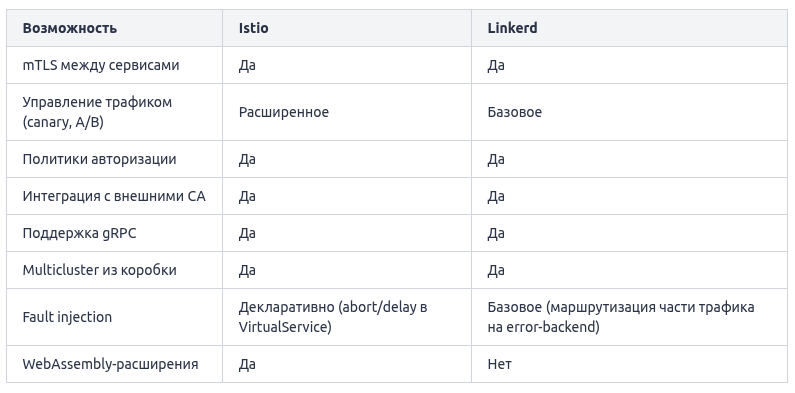

Когда приложение состоит из десятков микросервисов, каждый из них должен уметь безопасно общаться с остальными, повторять запросы при сбоях, собирать метрики и шифровать трафик. Если реализовывать всё это внутри каждого сервиса, код быстро превращается в смесь бизнес-логики и инфраструктурного «клея». Service Mesh (сервисная сетка) выносит эту инфраструктурную логику за пределы приложения.

Service Mesh — это выделенный инфраструктурный слой, который управляет взаимодействием между микросервисами. Он перехватывает весь входящий и исходящий трафик каждого сервиса, не требуя изменений в коде приложения.

Ключевая идея: вместо того чтобы каждый сервис сам управлял сетевой логикой, рядом с ним запускается лёгкий прокси-процесс, который делает это вместо него.

Sidecar-прокси — это дополнительный контейнер, который автоматически добавляется в каждый под Kubernetes рядом с контейнером приложения. Под с sidecar выглядит так:

```
Pod: payment-service
├── container: payment-app   (ваш код)
└── container: istio-proxy   (sidecar-прокси)
```

Оба контейнера разделяют одно сетевое пространство имён (network namespace). Правила iptables внутри пода перенаправляют весь трафик через прокси — приложение даже не знает, что его запросы проходят через посредника.

Sidecar в mesh всегда ограничивают по памяти.

Sidecar перехватывает трафик в обоих направлениях:
- Исходящий (egress): Прокси применяет политики маршрутизации, балансировки, retry
- Входящий (ingress): Прокси проверяет mTLS-сертификат отправителя, собирает метрики

Таким образом, когда сервис `orders` обращается к сервису `inventory`, реальная цепочка выглядит так:

```
orders-app --> orders-proxy --> inventory-proxy --> inventory-app
```

Каждый прокси фиксирует задержку, статус ответа и идентификатор запроса. Эти данные уходят в систему мониторинга без единой строки кода в приложении.

В Istio sidecar внедряется автоматически через механизм мутирующего вебхука (mutating admission webhook). Достаточно пометить namespace нужным лейблом: `kubectl label namespace production istio-injection=enabled`

После этого любой новый под в пространстве имён `production` получит sidecar-контейнер автоматически при создании. Существующие поды нужно пересоздать — вебхук срабатывает только в момент создания пода.

Типичная ошибка начинающих: поставить лейбл на namespace, но не перезапустить уже работающие поды. В результате часть трафика идёт через mesh, часть — напрямую, и метрики оказываются неполными.

**Data Plane vs Control Plane в Service Mesh: Envoy и istiod**
Service Mesh состоит из двух чётко разделённых уровней. Data plane обрабатывает реальный трафик, control plane управляет конфигурацией прокси.

`Data Plane: Envoy`
Envoy — это высокопроизводительный прокси-сервер (proxy), написанный на C++. В Istio он внедряется как sidecar-контейнер в каждый под и перехватывает весь входящий и исходящий трафик приложения.

Envoy работает прозрачно: приложение не знает, что его трафик проходит через прокси. Именно Envoy реализует всё, что делает Service Mesh полезным на практике:

- балансировку нагрузки между экземплярами сервиса;
- взаимную TLS-аутентификацию (mTLS) между подами;
- сбор метрик по каждому запросу (latency, error rate);
- применение правил маршрутизации — например, отправить 10% трафика на новую версию.

Envoy получает конфигурацию динамически через специальный API, не требуя перезапуска. Это ключевое отличие от статических конфигов nginx или haproxy.

`Control Plane: istiod`
istiod — единый управляющий компонент Istio, появившийся в версии 1.5. До этого его функции были разбиты по нескольким отдельным процессам (Pilot, Citadel, Galley), что усложняло эксплуатацию.

istiod выполняет три главные функции:
- Pilot: Транслирует правила маршрутизации в конфигурацию Envoy
- Citadel: Выпускает и ротирует TLS-сертификаты для mTLS
- Galley: Валидирует и обрабатывает конфигурационные ресурсы Kubernetes

Когда вы создаёте объект `VirtualService` в кластере, istiod замечает это изменение через Kubernetes API, транслирует его в формат, понятный Envoy, и рассылает обновлённую конфигурацию всем нужным прокси. Сам трафик через istiod не проходит — только конфигурация.

Как они взаимодействуют:
```
[Под A]                          [Под B]
  App --> Envoy sidecar  ------>  Envoy sidecar --> App
              ^                        ^
              |    xDS API             |
              +--------  istiod -------+
```

Протокол, по которому istiod общается с Envoy, называется **xDS** (x Discovery Service). Это набор API для динамической передачи конфигурации: списков эндпоинтов, правил маршрутизации, TLS-настроек. Envoy подписывается на обновления и применяет их без перезапуска.

Такое разделение даёт важное свойство: если istiod временно недоступен, уже работающие Envoy продолжают обрабатывать трафик по последней полученной конфигурации. Падение control plane не останавливает data plane.

**Istio: VirtualService и DestinationRule для маршрутизации трафика**
Istio управляет трафиком через два ключевых ресурса: VirtualService и DestinationRule. Они работают в паре и отвечают за то, куда и как направляется запрос внутри mesh-сети. Без понимания этих объектов настроить маршрутизацию в Istio не получится.

VirtualService (виртуальный сервис) — это правило маршрутизации, которое перехватывает входящие запросы к сервису и решает, куда их направить. Он не заменяет Kubernetes Service, а работает поверх него.

Главная идея: VirtualService позволяет разделить трафик по версиям, заголовкам, весовым коэффициентам или другим критериям. Например, направить 90% запросов на версию `v1` и 10% — на версию `v2` (canary-деплой).

```yaml
apiVersion: networking.istio.io/v1
kind: VirtualService
metadata:
  name: reviews-vs
spec:
  hosts:
    - reviews
  http:
    - route:
        - destination:
            host: reviews
            subset: v1
          weight: 90
        - destination:
            host: reviews
            subset: v2
          weight: 10
```

Здесь `hosts` указывает, для какого сервиса действует правило. Поле `subset` ссылается на группу подов — эти группы описываются в DestinationRule.

Ресурс `VirtualService` в Istio распределяет трафик между версиями сервиса через список `routes`, где у каждого назначения (`destination`) задан вес `weight` — процент запросов, который на него направляется. Это основа canary-деплоя: например, 90% трафика идёт на стабильную версию `v1`, а 10% — на новую `v2`, и по мере накопления уверенности вес `v2` постепенно увеличивают.

Правило Istio простое, но его легко нарушить руками: сумма весов всех назначений одного VirtualService обязана равняться 100. Типичная ошибка при постепенном увеличении доли canary-версии — увеличить один вес, забыв уменьшить другой. В результате сумма перестаёт быть равной 100, и поведение маршрутизации отличается от того, что задумывалось (либо конфигурация будет отклонена валидацией).

Сетевой API Istio (`networking.istio.io`) прошёл путь от `v1alpha3` через `v1beta1` до текущей стабильной версии `v1`, на которой основаны оба ресурса из этого урока. В старых репозиториях с примерами и в кластерах, не обновлявшихся давно, ещё встречаются манифесты с `v1alpha3` — за счёт обратной совместимости они продолжают применяться, но для новых манифестов используйте `v1`.

DestinationRule определяет, что именно скрывается за каждым `subset`. Именно здесь вы описываете, какие поды относятся к версии `v1`, а какие — к `v2`, используя метки (labels) подов.

```yaml
apiVersion: networking.istio.io/v1
kind: DestinationRule
metadata:
  name: reviews-dr
spec:
  host: reviews
  subsets:
    - name: v1
      labels:
        version: v1
    - name: v2
      labels:
        version: v2
```

Кроме разбивки на подмножества, DestinationRule управляет политиками соединения: балансировкой нагрузки (round-robin, least requests), настройками TLS между сервисами, таймаутами пула соединений.

**Как работают вместе**
Связка выглядит так: VirtualService получает запрос и говорит «направь 10% трафика в subset v2». DestinationRule расшифровывает, что `subset: v2` — это поды с меткой `version: v2`. Envoy-прокси в каждом поде применяет эти правила при каждом запросе.

Ловушка: создать VirtualService с `subset`, но забыть написать DestinationRule. В этом случае Envoy не найдёт кластер для несуществующего subset, и запросы начнут падать с ошибкой `503` (cluster not found). Команда `istioctl analyze` сразу укажет на ссылку на несуществующий subset — проверяйте ей конфигурацию и всегда создавайте оба ресурса вместе.

Ещё один практический момент: поле `hosts` в VirtualService должно совпадать с именем Kubernetes Service в том же неймспейсе, иначе правило просто не применится. Можно указывать короткое имя (`reviews`) или полное FQDN (`reviews.default.svc.cluster.local`) — оба варианта корректны.

В Istio типичная авария выглядит так: VirtualService направляет трафик в `subset: v2`, а подов с меткой `version: v2` в кластере нет — запросы падают с `503 no healthy upstream`. Ровно та же ошибка воспроизводится штатными средствами Kubernetes: селектор сервиса сужен до версии, которой ещё не существует.

**Linkerd vs Istio**
Выбор между Linkerd и Istio — один из первых практических вопросов при внедрении сервисной сетки (service mesh). Оба инструмента решают схожие задачи, но делают это по-разному, и разница ощутима уже на этапе установки.

`Архитектура и сложность`
Istio построен вокруг прокси Envoy и управляющего компонента istiod. Конфигурация выражается через собственные CRD (Custom Resource Definition, пользовательское определение ресурса): VirtualService, DestinationRule, Gateway и другие. Это мощно, но требует понимания абстракций и их взаимодействия. Новичку легко запутаться, когда правило маршрутизации не работает из-за конфликта между двумя ресурсами.

Linkerd использует собственный легковесный прокси, написанный на Rust, — linkerd2-proxy. Он специально разработан для service mesh и не несёт лишней функциональности. Конфигурация Linkerd значительно проще: большинство возможностей включается аннотациями на уровне Deployment или Namespace, а собственные CRD (Server, HTTPRoute, AuthorizationPolicy) нужны только для политик доступа и маршрутизации.

`Потребление ресурсов`
Разница в ресурсах существенная. Sidecar-контейнер Envoy в Istio потребляет в среднем 50–100 МБ памяти на под. В нагруженном кластере с сотнями подов это выливается в несколько гигабайт дополнительной памяти только на прокси. У Istio есть и режим ambient без sidecar-контейнеров, заметно снижающий накладные расходы, однако классическим и наиболее распространённым остаётся sidecar-режим.

Linkerd2-proxy значительно экономнее — порядка 10–20 МБ на под. Для кластеров с ограниченными ресурсами или для команд, которые платят за облачные ноды, это весомый аргумент.

`Функциональность`
Istio предоставляет более широкий набор возможностей:



Fault injection (намеренное внесение ошибок в трафик для тестирования устойчивости) поддерживают оба инструмента, разница — в глубине настройки. Istio задаёт abort (обрыв с заданным HTTP-кодом) и delay (задержку) декларативно прямо в VirtualService. В Linkerd специализированного API для внесения ошибок нет: похожего результата добиваются средствами маршрутизации, направляя часть трафика на сервис-источник ошибок. Это относится к chaos engineering, о котором подробнее говорится в модуле про администрирование продакшена.

`Когда что выбирать`
Linkerd подходит, если нужно быстро получить mTLS, базовые метрики и балансировку без глубокого погружения в конфигурацию. Начиная с версии 2.12 CRD вынесены в отдельный шаг установки — сначала устанавливают CRD, затем control plane:

```
linkerd install --crds | kubectl apply -f -
linkerd install | kubectl apply -f -
linkerd check
```

Istio выбирают, когда нужна тонкая маршрутизация, расширенные политики безопасности или интеграция с внешними системами. Установка через Helm или `istioctl` требует больше решений на старте: профиль установки, namespace injection, настройка egress.

Для небольших команд и стартапов Linkerd снижает операционную нагрузку. Для крупных платформ с десятками команд и сложными требованиями к трафику Istio оправдывает свою сложность.

Выбор между Linkerd и Istio — это всегда компромисс между простотой эксплуатации и глубиной контроля над трафиком в кластере.