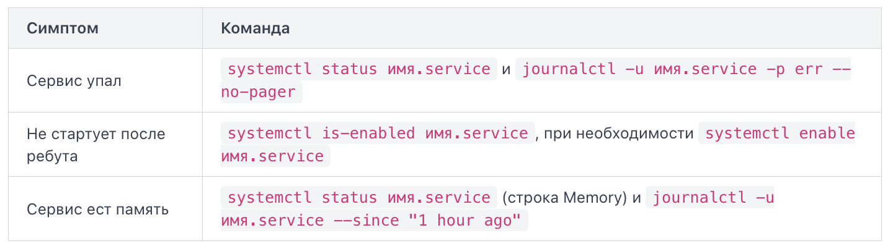

`systemctl status имя.service` показывает текущее состояние: активен ли процесс, его PID, последние строки логов и код выхода при падении. `systemctl start имя.service` запускает сервис прямо сейчас — разово, без сохранения на будущее. `systemctl enable имя.service`, напротив, ничего не запускает, а лишь создаёт симлинк, чтобы сервис стартовал автоматически при следующей загрузке системы. После правки unit-файла обязателен `systemctl daemon-reload` — он заставляет systemd перечитать конфигурацию с диска; без этой команды изменения не подхватятся, даже если сервис перезапущен.

`journalctl -u имя.service` выводит записи только этого сервиса. Флаг `-f` переключает в режим слежения (follow) — как `tail -f`, показывает новые строки по мере появления. `--since "10 min ago"` ограничивает вывод временным окном, а `-p err` фильтрует записи уровня error и выше. `--no-pager` печатает журнал целиком в терминал, а не через постраничный просмотрщик — удобно при перенаправлении вывода в файл или другую команду.

`enable` без `start` означает, что сервис запустится только при следующей перезагрузке, а прямо сейчас не работает; `start` без `enable` — сервис работает сейчас, но не переживёт перезагрузку. Для сервиса, который должен работать постоянно, нужны обе команды сразу.