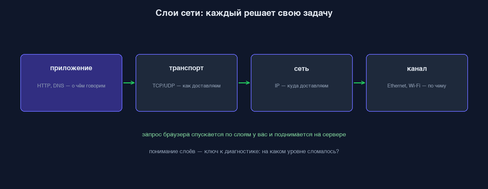
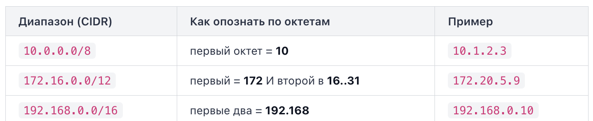
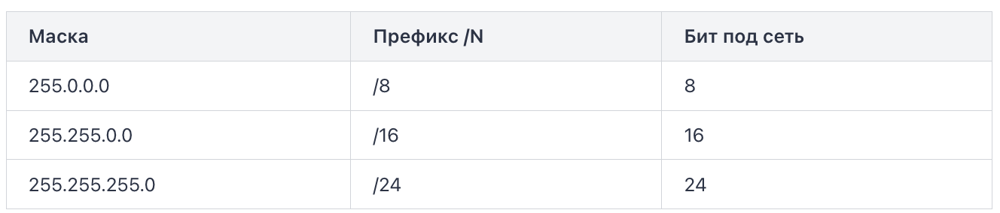

# Терминология
Хост — это любое устройство, подключенное к сети и имеющее собственный сетевой адрес (обычно IP-адрес), через который оно может обмениваться данными с другими участниками сети.

Протокол — общий язык обмена, стандартизированный набор правил по которым устройства обмениваются данными в компьютерной сети. Обе стороны обязаны говорить на одном протоколе, иначе не поймут друг друга. HTTP, TCP, DNS — всё это протоколы, каждый со своими правилами

Соединение — установленный канал между двумя сторонами, по которому идёт обмен. Это как открытая телефонная линия: пока «трубка снята», по каналу можно гонять данные туда-обратно; повесили трубку — соединение закрыто. Клиент устанавливает соединение (делает первый шаг), стороны по нему общаются, потом соединение закрывается.

# Путь одного запроса: от браузера до ответа
Вы набрали `https://example.com` и нажали Enter. Через долю секунды на экране страница. Между этими двумя моментами запрос проходит цепочку из нескольких шагов:
1. Разбор URL. Браузер вытаскивает из адреса имя хоста (`example.com`), схему (`https` → порт 443) и путь (`/`).
2. DNS переводит имя в IP (например `93.184.216.34`).
3. TCP: установка соединения. Браузер открывает надёжный канал к этому IP на нужный порт — «трубу», по которой можно слать байты в обе стороны.
4. HTTP: отправка запроса. По установленному каналу уходит текст запроса: `GET / HTTP/1.1`, заголовки, тело.
5. Сервер формирует ответ. Обрабатывает запрос и отдаёт статус, заголовки и тело (HTML, JSON, картинку).
6. Ответ едет обратно по тому же соединению.
7. Браузер рендерит полученный HTML в страницу.

**Ошибки**
`ENOTFOUND`, DNS-ошибка — слой имён. Домен не удалось перевести в IP. Соединение даже не начиналось — некуда было идти. Что чинить: опечатку в домене, запись в DNS, файл `hosts`, доступность резолвера. Порт и сервер тут ни при чём — мы про них ещё не спросили.

`ECONNREFUSED` — слой соединения (TCP). Имя перевелось в IP, происходит попытка установить соединение, но на этом порту никто не слушает. Хост жив и активно отвечает «соединение отвергнуто». Это не проблема имени — имя как раз отработало. Типичная причина: сервис не запущен, упал, или вы стучитесь не на тот порт (3000 вместо 8080).

Запомните разницу: `ENOTFOUND` = «не знаю, где это». `ECONNREFUSED` = «знаю где, но там закрыто и мне это прямо сказали».

`Таймаут (connect/read timeout).` Пакеты уходят, но ответа в срок нет. В отличие от `ECONNREFUSED`, где хост явно отвечает «закрыто», при таймауте — тишина. Причина коварнее: фаервол молча дропает пакеты (не отвечает вообще), сервер перегружен и не успевает, или адрес вообще не тот и по нему никто не живёт. «Отказ» — это ответ; «таймаут» — это молчание.

`502 Bad Gateway` — HTTP-слой, но чужой. Это код ответа, а значит DNS и TCP уже отработали: имя нашлось, соединение встало, диалог состоялся. Само наличие HTTP-кода — сигнал, что нижние слои живы. `502` означает: ваш прокси/шлюз (nginx, балансировщик) достучался до вас, но вышестоящий сервер за ним отдал мусор или лёг. Виноват не прокси — виноват апстрим за ним.

`CORS` — вообще не сетевой сбой. Запрос дошёл, и ответ пришёл полностью. Но браузер, по своей политике безопасности, запретил коду на странице прочитать этот ответ. Ключевое следствие: `curl` и бэкенд этой ошибки не видят — она живёт только в браузере. Если `curl` к API работает, а фронтенд ругается на CORS — сеть в порядке, чините заголовки ответа на сервере, а не соединение.


# Пакеты
Сеть не передаёт ответ одним куском. Данные режутся на множество пакетов. Пакет — это порция данных, которую сеть переносит по отдельности за один раз.

Почему так: линии связи и оборудование рассчитаны на порции ограниченного размера (обычно порядка полутора килобайт полезных данных в одном пакете). Большое сообщение просто не влезло бы «за раз».

Следствие: большой ответ едет многими пакетами. Каждый пакет летит самостоятельно, у каждого свой заголовок с адресами отправителя и получателя. На принимающей стороне TCP собирает их обратно в правильном порядке — и HTTP получает целый, склеенный ответ, будто он и был одним куском.

Разбиение на пакеты и их сборка — забота TCP-слоя. HTTP этого не видит: он оперирует целым сообщением.

# Латентность и RTT
Даже по идеально быстрому каналу запрос не может прийти мгновенно: сигналу нужно физически пройти расстояние до сервера и обратно.

Два ключевых понятия:
- Латентность (latency) — задержка, время, за которое данные добираются до цели. Измеряется в миллисекундах (мс).
- RTT (round-trip time) — время «туда-обратно»: сколько занимает путь запроса до сервера плюс путь ответа назад. Это то, что показывает `ping`.

Важно различать два разных свойства канала:
- Пропускная способность (bandwidth, ширина канала) — сколько данных влезает в секунду. Это «толщина трубы».
- Латентность — как быстро проскакивает первый байт. Это «длина трубы».

Свойства независимы.

# Почему первый запрос к новому домену медленнее
Что именно происходит только в первый раз:
1. Имя `example.com` впервые нужно перевести в IP — а это поход к DNS-резолверу (иногда с обходом цепочки серверов). Занимает свой RTT. Результат кэшируется на время TTL записи, поэтому во второй раз IP берётся из кэша мгновенно. TTL — это срок годности DNS-записи в кэше.
2. Открыть новый канал стоит как минимум одного round-trip на рукопожатие (для HTTPS добавляется ещё TLS-рукопожатие — ещё round-trip'ы). Уже открытое соединение часто переиспользуется для следующих запросов.

Итого первый запрос платит: DNS-резолв + установка TCP(+TLS) соединения — всё это ещё не закешировано и не переиспользовано. На повторных запросах и DNS уже в кэше, и соединение уже живо — остаётся только сам обмен HTTP.

# URL
URL — это адрес и инструкция в одной строке. Разберём URL на составляющие в общем виде:

```
 схема   ://   хост          : порт  / путь        ? запрос   # фрагмент
 https   ://   api.example.com : 8080  / v1/users     ? id=5     # top
```

Что значит каждая часть:
- схема (`https`) — какой протокол использовать для обмена. `http`, `https`, а бывают `ftp`, `ws` (websocket), `postgres` в строке подключения к БД.
- хост (`api.example.com`) — на какую машину идти. Имя, которое DNS переведёт в IP.
- порт (`8080`) — к какому приложению на этой машине стучаться (об этом весь урок ниже).
- путь (`/v1/users`) — какой конкретно ресурс на сервере нужен.
- запрос (`?id=5`) — параметры к пути, пары `ключ=значение` через `&`.
- фрагмент (`#top`) — якорь внутри страницы, его обрабатывает только браузер; на сервер он вообще не отправляется.

Понимать структуру URL — значит понимать, «куда именно пойдёт запрос».

Схема стоит первой не случайно: она задаёт правила игры для всего остального. `https` означает «шифрованный обмен», `http` — обычный текстовый. От схемы зависит и порт по умолчанию.

Хост приводит нас к нужной машине. Но на одной машине одновременно живёт много сетевых приложений: веб-сервер, база данных, кэш, ваш локальный dev-сервер. У всех у них один и тот же IP-адрес. Как запрос понимает, к какому именно приложению идти?

Порт это обязательное для сетевого соединения 16-битное число (0–65535), которое работает как номер двери в большом здании. Адрес здания — это IP (хост), а порт — конкретная дверь, за которой сидит нужное приложение.

Когда мы говорим «приложение слушает порт», это значит: приложение сказало операционной системе «все входящие соединения на этот порт отдавай мне». Пришёл запрос на `:5432` — ОС отдаёт его PostgreSQL; на `:80` — веб-серверу.

Два приложения не могут одновременно слушать один и тот же порт на одном адресе.

Для стандартных схем порт подставляется неявно:
- `http://` → порт 80
- `https://` → порт 443

Эти двое — часть большого набора хорошо известных портов (well-known, диапазон 0–1023), закреплённых за стандартными сетевыми службами и протоколами. Браузер, встретив `https://example.com`, сам достраивает адрес до `example.com:443`.

Явно указанный порт всегда главнее, чем правило по умолчанию.

Нестандарные/пользовательские порты (обычно 1024 и выше), не требуют прав администратора и не закреплены жёстко ни за кем.

# IPv4
Под капотом это одно 32-битное число, но людям его показывают в удобной записи — четыре октета через точку.

Октет — это 8 бит. Восемь бит дают `2^8 = 256` разных значений, поэтому каждый октет — это число **от 0 до 255** включительно. Отсюда весь диапазон адресов: от `0.0.0.0` до `255.255.255.255`.

Перемножим: `256 × 256 × 256 × 256 ≈ 4.3 млрд` адресов. Звучит много, но устройств в мире больше — именно эта нехватка породила IPv6 (128 бит вместо 32).

Не каждый IP «виден» из интернета. Адреса делятся на два больших мира:
- Публичные — маршрутизируются в интернете, уникальны глобально. Такой адрес у вашего домашнего роутера снаружи, у публичного DNS `8.8.8.8`, у любого сайта.
- Приватные — используются только внутри локальных сетей. В большой интернет они не маршрутизируются: наружу вы выходите через NAT, который подменяет приватный адрес на публичный адрес шлюза.

Приватные диапазоны закреплены стандартом RFC 1918 — их ровно три, и узнаются они по началу адреса:



Внимание к границам у `172`: приватны только `172.16.x.x` … `172.31.x.x`.

Помимо «приватный/публичный» есть ещё два диапазона со специальным смыслом.

Loopback — обращение к самому себе. Адрес `127.0.0.1` (тот самый localhost) означает «эта же машина». Пакет на loopback никуда не уходит по сети — он разворачивается внутри ядра ОС. Важно: loopback — это весь диапазон `127.0.0.0/8`, то есть любой адрес с первым октетом `127`.

Диапазон `169.254.0.0/16` (первые октеты `169.254`) — это `link-local`. Если ОС не смогла получить адрес от DHCP-сервера, она сама присваивает себе адрес из этого диапазона. Практический сигнал: увидели у интерфейса `169.254.x.x` — сеть настроена неправильно, DHCP не выдал адрес, интернета не будет. Это диагностический маркер, а не рабочий адрес.

DHCP (Dynamic Host Configuration Protocol) — это сетевой протокол, который автоматически выдаёт устройствам IP-адреса и другие сетевые настройки.

У IPv4-адреса есть внутренняя структура: часть его битов отвечает за сеть (в какой группе машин мы находимся), а оставшиеся — за хост (конкретная машина внутри этой группы). Сколько именно старших бит уходит под сеть, показывает маска подсети. Классическая запись маски — как обычный IPv4-адрес из единичных бит слева и нулевых справа:

```
255.255.255.0  = 11111111 11111111 11111111 00000000
                 └──────── 24 единицы ────────┘ └8 нулей┘
```

Единицы маски отмечают биты сети, нули — биты хоста. В примере выше 24 бита сети и 8 бит хоста.

Писать маску целиком долго, поэтому есть краткая форма `CIDR` — просто число единичных бит после слэша:



Не все адреса подсети можно раздать машинам. Два зарезервированы:
- адрес сети — все хостовые биты равны 0 (например `192.168.1.0` в `/24`). Это «имя» самой подсети, не хост.
- broadcast (широковещательный) — все хостовые биты равны 1 (`192.168.1.255` в `/24`). Пакет на него уходит всем в подсети сразу.

Поэтому пригодных для хостов адресов на два меньше: `пригодных = 2^(32 − N) − 2`.

На очень маленьких префиксах формула `−2` ломается (дала бы 0 или отрицательное), поэтому у них своё правило:

- /31 — `2^(32−31) = 2` адреса, и оба используются как концы двухточечного линка (broadcast там не нужен). Пригодных = 2.
- /32 — `2^0 = 1` адрес, одиночный хост (маршрут «ровно на эту машину»). Пригодных = 1.

# DNS
Сеть не умеет доставлять байты по имени `example.com`, только по числовому адресу — IP вида `93.184.216.34`. DNS (Domain Name System) — распределённая система, которая превращает имя в адрес.

Доменное имя — не плоская строка, а иерархия, и читается она справа налево, от самого общего к самому частному. Возьмём `api.shop.example.com`:

```
api   .   shop   .   example   .   com   .
 └─ поддомен      └─ SLD        └─ TLD  └─ корень (.)
```

Уровни, начиная с конца:
- Корень — невидимая точка `.` в самом конце. Вершина всей системы. Обычно её не пишут, но формально она есть.
- TLD (Top-Level Domain, домен верхнего уровня) — `com`, `org`, `ru`, `io`. То, что стоит сразу перед корнем.
- Домен второго уровня (SLD) — `example`. Это то, что обычно регистрируют и покупают.
- Поддомены — `shop`, `api`, `www`. Их владелец домена заводит сам, сколько угодно уровней.

FQDN (Fully Qualified Domain Name, полностью определённое имя) — это имя, записанное целиком, до корневой точки включительно: `api.shop.example.com.`. FQDN не зависит от контекста — он указывает на ровно одну позицию в дереве. Имя без завершающей точки система может «дополнить» вашим локальным суффиксом поиска, а FQDN — нет.

Практический смысл разбивки: каждый уровень имеет своего ответственного. За `com` отвечают одни серверы, за `example.com` — другие (владелец домена), а `api` внутри `example.com` заводит уже сам владелец. Иерархия имени — это иерархия ответственности.

Ни один сервер не знает адреса всех сайтов мира — это невозможно и небезопасно. Знание распределено по иерархии, ровно повторяя структуру имени. В разрешении участвуют три роли серверов.
1. Корневые серверы (root). Вершина. Сами адреса сайтов они НЕ хранят. Их задача — знать, кто отвечает за каждый TLD. Спросили про что-то на `.com` — корневой сервер говорит: «за `.com` отвечают вот эти серверы, иди к ним».
2. TLD-серверы. Отвечают за свою зону верхнего уровня (`.com`, `.ru`, `.org`). Тоже не хранят конечные адреса, но знают, кто авторитетен за конкретный домен внутри их зоны. Спросили `example.com` у сервера `.com` — он отвечает: «за `example.com` авторитетны вот эти серверы».
3. Авторитетный сервер (authoritative). Тот, кто хранит сами записи зоны `example.com` и даёт окончательный ответ: «`example.com` → `93.184.216.34`». Именно он — источник истины для этого домена. Его настраивает владелец домена.

Ваш компьютер сам не обходит цепочку «корень → TLD → авторитетный». Он задаёт один вопрос и ждёт один готовый ответ. Того, кому он задаёт вопрос, зовут рекурсивный резолвер (recursive resolver, или просто резолвер). Это обычно сервер вашего провайдера, либо публичный резолвер: Google `8.8.8.8`, Cloudflare `1.1.1.1`, Quad9 `9.9.9.9`. Именно его адрес прописан в сетевых настройках вашей машины как «DNS-сервер». Резолвер берёт на себя всю грязную работу — сам обходит иерархию за вас.

**Кэш**
Если бы каждый запрос имени гонял по всей цепочке от корня, DNS был бы медленным. Спасает кэш: и резолвер, и ваша операционная система запоминают полученные ответы на время, чтобы не ходить по иерархии заново.

Сколько хранить — задаёт сама запись: у каждой есть TTL (time to live, время жизни в секундах). Пример строки ответа: `example.com. 300 IN A 93.184.216.34`, резолвер имеет право отдавать его из кэша следующие 5 минут, не беспокоя авторитетный сервер. Поэтому смена IP у домена «расходится» по интернету не мгновенно, а по мере истечения TTL в чужих кэшах.

Теперь порядок, в котором клиент ищет ответ, — строго по шагам:
1. Кэш бразуера (опционально)
2. Собственный кэш ОС 
3. Файл hosts — локальная таблица ручных соответствий «имя → IP». ОС считывает все записи из hosts и помещает их в локальный кэш (второй шаг) с высшим приоритетом
4. Запрос к рекурсивному резолверу — и уже он (тоже сперва глянув свой кэш) при необходимости обходит иерархию.

Резолвер обходит иерархию и добирается до авторитетного сервера. Но что именно этот сервер хранит и отдаёт? Не просто «имя → IP». В зоне домена лежит набор записей разных типов. Запись — это строка вида «имя, тип, значение». Тип определяет, что лежит в значении и как его читать.

Два самых частых типа — адресные:

- A (address) — переводит имя в IPv4-адрес. Именно её ищет браузер, чтобы открыть TCP-соединение. Пример: `example.com → 93.184.216.34`.
- AAAA («quad-A») — то же самое, но **IPv6**. Четыре буквы A, потому что IPv6-адрес в 4 раза длиннее IPv4 (128 бит против 32). Пример: `example.com → 2606:2800:220:1:248:1893:25c8:1946`.

У одного имени может быть несколько A-записей сразу — так делают примитивную балансировку: резолвер вернёт список адресов, клиент пойдёт на один из них.

Разберём ещё четыре типа, которые встречаются каждый день:
- CNAME (canonical name) — это псевдоним запись указывает не на IP, а на другое имя Например `www.example.com → example.com`. Резолвер, получив CNAME, идёт разрешать уже каноническое имя (и там находит A/AAAA). Так один «настоящий» хост прячут за красивыми алиасами.
- MX (mail exchange) — почтовый сервер домена. У MX есть особое поле — приоритет: `10 mail1.example.com`, `20 mail2.example.com`. Правило: меньше число — выше приоритет, почту сначала пробуют доставить на MX с наименьшим числом, остальные — резерв.
- TXT — произвольный текст. Технически туда можно положить что угодно, но на практике это служебные строки: SPF (кто вправе слать почту от имени домена), DKIM (ключи подписи писем), а также подтверждение владения доменом («добавьте TXT со строкой X, чтобы доказать, что домен ваш»).
- NS (name server) — какие серверы имён авторитетны за зону. Именно они хранят все записи выше. NS-записи и связывают уровни иерархии.

**Отладка**
Рекурсивный резолвер. Ваш DNS-сервер может быть недоступен, медленным или отдавать устаревшее из своего кэша. Спросите имя явно у другого резолвера и сравните:

```
dig @8.8.8.8 example.com     # спросить именно Google
dig @1.1.1.1 example.com     # и Cloudflare
```

Если ни один резолвер не даёт адреса — источник истины пуст или недоступен: домен не настроен, запись удалена, у домена нет нужного типа записи (`NXDOMAIN` — «такого имени нет»).