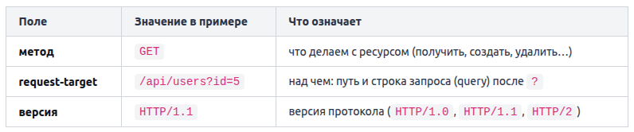
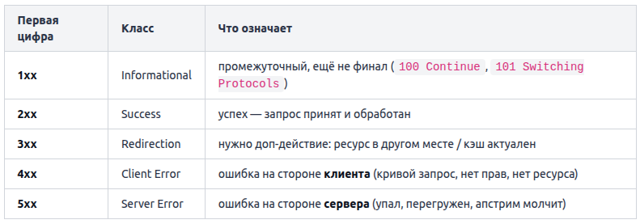

# Терминология
Хост — это любое устройство, подключенное к сети и имеющее собственный сетевой адрес (обычно IP-адрес), через который оно может обмениваться данными с другими участниками сети.

Протокол — общий язык обмена, стандартизированный набор правил по которым устройства обмениваются данными в компьютерной сети. Обе стороны обязаны говорить на одном протоколе, иначе не поймут друг друга. HTTP, TCP, DNS — всё это протоколы, каждый со своими правилами

Соединение — установленный канал между двумя сторонами, по которому идёт обмен. Это как открытая телефонная линия: пока «трубка снята», по каналу можно гонять данные туда-обратно; повесили трубку — соединение закрыто. Клиент устанавливает соединение (делает первый шаг), стороны по нему общаются, потом соединение закрывается.

# Путь одного запроса: от браузера до ответа
Вы набрали `https://example.com` и нажали Enter. Через долю секунды на экране страница. Между этими двумя моментами запрос проходит цепочку из нескольких шагов:
1. Разбор URL. Браузер вытаскивает из адреса имя хоста (`example.com`), схему (`https` → порт 443) и путь (`/`).
2. DNS переводит имя в IP (например `93.184.216.34`).
3. TCP: установка соединения. Браузер открывает надёжный канал к этому IP на нужный порт — «трубу», по которой можно слать байты в обе стороны.
4. HTTP: отправка запроса. По установленному каналу уходит текст запроса: `GET / HTTP/1.1`, заголовки, тело.
5. Сервер формирует ответ. Обрабатывает запрос и отдаёт статус, заголовки и тело (HTML, JSON, картинку).
6. Ответ едет обратно по тому же соединению.
7. Браузер рендерит полученный HTML в страницу.

**Ошибки**
`ENOTFOUND`, DNS-ошибка — слой имён. Домен не удалось перевести в IP. Соединение даже не начиналось — некуда было идти. Что чинить: опечатку в домене, запись в DNS, файл `hosts`, доступность резолвера. Порт и сервер тут ни при чём — мы про них ещё не спросили.

`ECONNREFUSED` — слой соединения (TCP). Имя перевелось в IP, происходит попытка установить соединение, но на этом порту никто не слушает. Хост жив и активно отвечает «соединение отвергнуто». Это не проблема имени — имя как раз отработало. Типичная причина: сервис не запущен, упал, или вы стучитесь не на тот порт (3000 вместо 8080).

Запомните разницу: `ENOTFOUND` = «не знаю, где это». `ECONNREFUSED` = «знаю где, но там закрыто и мне это прямо сказали».

`Таймаут (connect/read timeout).` Пакеты уходят, но ответа в срок нет. В отличие от `ECONNREFUSED`, где хост явно отвечает «закрыто», при таймауте — тишина. Причина коварнее: фаервол молча дропает пакеты (не отвечает вообще), сервер перегружен и не успевает, или адрес вообще не тот и по нему никто не живёт. «Отказ» — это ответ; «таймаут» — это молчание.

`502 Bad Gateway` — HTTP-слой, но чужой. Это код ответа, а значит DNS и TCP уже отработали: имя нашлось, соединение встало, диалог состоялся. Само наличие HTTP-кода — сигнал, что нижние слои живы. `502` означает: ваш прокси/шлюз (nginx, балансировщик) достучался до вас, но вышестоящий сервер за ним отдал мусор или лёг. Виноват не прокси — виноват апстрим за ним.

`CORS` — вообще не сетевой сбой. Запрос дошёл, и ответ пришёл полностью. Но браузер, по своей политике безопасности, запретил коду на странице прочитать этот ответ. Ключевое следствие: `curl` и бэкенд этой ошибки не видят — она живёт только в браузере. Если `curl` к API работает, а фронтенд ругается на CORS — сеть в порядке, чините заголовки ответа на сервере, а не соединение.


# Пакеты
Сеть не передаёт ответ одним куском. Данные режутся на множество пакетов. Пакет — это порция данных, которую сеть переносит по отдельности за один раз.

Почему так: линии связи и оборудование рассчитаны на порции ограниченного размера (обычно порядка полутора килобайт полезных данных в одном пакете). Большое сообщение просто не влезло бы «за раз».

Следствие: большой ответ едет многими пакетами. Каждый пакет летит самостоятельно, у каждого свой заголовок с адресами отправителя и получателя. На принимающей стороне TCP собирает их обратно в правильном порядке — и HTTP получает целый, склеенный ответ, будто он и был одним куском.

Разбиение на пакеты и их сборка — забота TCP-слоя. HTTP этого не видит: он оперирует целым сообщением.

# Латентность и RTT
Даже по идеально быстрому каналу запрос не может прийти мгновенно: сигналу нужно физически пройти расстояние до сервера и обратно.

Два ключевых понятия:
- Латентность (latency) — задержка, время, за которое данные добираются до цели. Измеряется в миллисекундах (мс).
- RTT (round-trip time) — время «туда-обратно»: сколько занимает путь запроса до сервера плюс путь ответа назад. Это то, что показывает `ping`.

Важно различать два разных свойства канала:
- Пропускная способность (bandwidth, ширина канала) — сколько данных влезает в секунду. Это «толщина трубы».
- Латентность — как быстро проскакивает первый байт. Это «длина трубы».

Свойства независимы.

# Почему первый запрос к новому домену медленнее
Что именно происходит только в первый раз:
1. Имя `example.com` впервые нужно перевести в IP — а это поход к DNS-резолверу (иногда с обходом цепочки серверов). Занимает свой RTT. Результат кэшируется на время TTL записи, поэтому во второй раз IP берётся из кэша мгновенно. TTL — это срок годности DNS-записи в кэше.
2. Открыть новый канал стоит как минимум одного round-trip на рукопожатие (для HTTPS добавляется ещё TLS-рукопожатие — ещё round-trip'ы). Уже открытое соединение часто переиспользуется для следующих запросов.

Итого первый запрос платит: DNS-резолв + установка TCP(+TLS) соединения — всё это ещё не закешировано и не переиспользовано. На повторных запросах и DNS уже в кэше, и соединение уже живо — остаётся только сам обмен HTTP.

# URL
URL — это адрес и инструкция в одной строке. Разберём URL на составляющие в общем виде:

```
 схема   ://   хост          : порт  / путь        ? запрос   # фрагмент
 https   ://   api.example.com : 8080  / v1/users     ? id=5     # top
```

Что значит каждая часть:
- схема (`https`) — какой протокол использовать для обмена. `http`, `https`, а бывают `ftp`, `ws` (websocket), `postgres` в строке подключения к БД.
- хост (`api.example.com`) — на какую машину идти. Имя, которое DNS переведёт в IP.
- порт (`8080`) — к какому приложению на этой машине стучаться (об этом весь урок ниже).
- путь (`/v1/users`) — какой конкретно ресурс на сервере нужен.
- запрос (`?id=5`) — параметры к пути, пары `ключ=значение` через `&`.
- фрагмент (`#top`) — якорь внутри страницы, его обрабатывает только браузер; на сервер он вообще не отправляется.

Понимать структуру URL — значит понимать, «куда именно пойдёт запрос».

Схема стоит первой не случайно: она задаёт правила игры для всего остального. `https` означает «шифрованный обмен», `http` — обычный текстовый. От схемы зависит и порт по умолчанию.

Хост приводит нас к нужной машине. Но на одной машине одновременно живёт много сетевых приложений: веб-сервер, база данных, кэш, ваш локальный dev-сервер. У всех у них один и тот же IP-адрес. Как запрос понимает, к какому именно приложению идти?

Порт это обязательное для сетевого соединения 16-битное число (0–65535), которое работает как номер двери в большом здании. Адрес здания — это IP (хост), а порт — конкретная дверь, за которой сидит нужное приложение.

Когда мы говорим «приложение слушает порт», это значит: приложение сказало операционной системе «все входящие соединения на этот порт отдавай мне». Пришёл запрос на `:5432` — ОС отдаёт его PostgreSQL; на `:80` — веб-серверу.

Два приложения не могут одновременно слушать один и тот же порт на одном адресе.

Для стандартных схем порт подставляется неявно:
- `http://` → порт 80
- `https://` → порт 443

Эти двое — часть большого набора хорошо известных портов (well-known, диапазон 0–1023), закреплённых за стандартными сетевыми службами и протоколами. Браузер, встретив `https://example.com`, сам достраивает адрес до `example.com:443`.

Явно указанный порт всегда главнее, чем правило по умолчанию.

Нестандарные/пользовательские порты (обычно 1024 и выше), не требуют прав администратора и не закреплены жёстко ни за кем.

# IPv4
Под капотом это одно 32-битное число, но людям его показывают в удобной записи — четыре октета через точку.

Октет — это 8 бит. Восемь бит дают `2^8 = 256` разных значений, поэтому каждый октет — это число **от 0 до 255** включительно. Отсюда весь диапазон адресов: от `0.0.0.0` до `255.255.255.255`.

Перемножим: `256 × 256 × 256 × 256 ≈ 4.3 млрд` адресов. Звучит много, но устройств в мире больше — именно эта нехватка породила IPv6 (128 бит вместо 32).

Не каждый IP «виден» из интернета. Адреса делятся на два больших мира:
- Публичные — маршрутизируются в интернете, уникальны глобально. Такой адрес у вашего домашнего роутера снаружи, у публичного DNS `8.8.8.8`, у любого сайта.
- Приватные — используются только внутри локальных сетей. В большой интернет они не маршрутизируются: наружу вы выходите через NAT, который подменяет приватный адрес на публичный адрес шлюза.

Приватные диапазоны закреплены стандартом RFC 1918 — их ровно три, и узнаются они по началу адреса:


Внимание к границам у `172`: приватны только `172.16.x.x` … `172.31.x.x`.

Помимо «приватный/публичный» есть ещё два диапазона со специальным смыслом.

Loopback — обращение к самому себе. Адрес `127.0.0.1` (тот самый localhost) означает «эта же машина». Пакет на loopback никуда не уходит по сети — он разворачивается внутри ядра ОС. Важно: loopback — это весь диапазон `127.0.0.0/8`, то есть любой адрес с первым октетом `127`.

Диапазон `169.254.0.0/16` (первые октеты `169.254`) — это `link-local`. Если ОС не смогла получить адрес от DHCP-сервера, она сама присваивает себе адрес из этого диапазона. Практический сигнал: увидели у интерфейса `169.254.x.x` — сеть настроена неправильно, DHCP не выдал адрес, интернета не будет. Это диагностический маркер, а не рабочий адрес.

DHCP (Dynamic Host Configuration Protocol) — это сетевой протокол, который автоматически выдаёт устройствам IP-адреса и другие сетевые настройки.

У IPv4-адреса есть внутренняя структура: часть его битов отвечает за сеть (в какой группе машин мы находимся), а оставшиеся — за хост (конкретная машина внутри этой группы). Сколько именно старших бит уходит под сеть, показывает маска подсети. Классическая запись маски — как обычный IPv4-адрес из единичных бит слева и нулевых справа:

```
255.255.255.0  = 11111111 11111111 11111111 00000000
                 └──────── 24 единицы ────────┘ └8 нулей┘
```

Единицы маски отмечают биты сети, нули — биты хоста. В примере выше 24 бита сети и 8 бит хоста.

Писать маску целиком долго, поэтому есть краткая форма `CIDR` — просто число единичных бит после слэша:


Не все адреса подсети можно раздать машинам. Два зарезервированы:
- адрес сети — все хостовые биты равны 0 (например `192.168.1.0` в `/24`). Это «имя» самой подсети, не хост.
- broadcast (широковещательный) — все хостовые биты равны 1 (`192.168.1.255` в `/24`). Пакет на него уходит всем в подсети сразу.

Поэтому пригодных для хостов адресов на два меньше: `пригодных = 2^(32 − N) − 2`.

На очень маленьких префиксах формула `−2` ломается (дала бы 0 или отрицательное), поэтому у них своё правило:

- /31 — `2^(32−31) = 2` адреса, и оба используются как концы двухточечного линка (broadcast там не нужен). Пригодных = 2.
- /32 — `2^0 = 1` адрес, одиночный хост (маршрут «ровно на эту машину»). Пригодных = 1.

# DNS
Сеть не умеет доставлять байты по имени `example.com`, только по числовому адресу — IP вида `93.184.216.34`. DNS (Domain Name System) — распределённая система, которая превращает имя в адрес.

Доменное имя — не плоская строка, а иерархия, и читается она справа налево, от самого общего к самому частному. Возьмём `api.shop.example.com`:

```
api   .   shop   .   example   .   com   .
 └─ поддомен      └─ SLD        └─ TLD  └─ корень (.)
```

Уровни, начиная с конца:
- Корень — невидимая точка `.` в самом конце. Вершина всей системы. Обычно её не пишут, но формально она есть.
- TLD (Top-Level Domain, домен верхнего уровня) — `com`, `org`, `ru`, `io`. То, что стоит сразу перед корнем.
- Домен второго уровня (SLD) — `example`. Это то, что обычно регистрируют и покупают.
- Поддомены — `shop`, `api`, `www`. Их владелец домена заводит сам, сколько угодно уровней.

FQDN (Fully Qualified Domain Name, полностью определённое имя) — это имя, записанное целиком, до корневой точки включительно: `api.shop.example.com.`. FQDN не зависит от контекста — он указывает на ровно одну позицию в дереве. Имя без завершающей точки система может «дополнить» вашим локальным суффиксом поиска, а FQDN — нет.

Практический смысл разбивки: каждый уровень имеет своего ответственного. За `com` отвечают одни серверы, за `example.com` — другие (владелец домена), а `api` внутри `example.com` заводит уже сам владелец. Иерархия имени — это иерархия ответственности.

Ни один сервер не знает адреса всех сайтов мира — это невозможно и небезопасно. Знание распределено по иерархии, ровно повторяя структуру имени. В разрешении участвуют три роли серверов.
1. Корневые серверы (root). Вершина. Сами адреса сайтов они НЕ хранят. Их задача — знать, кто отвечает за каждый TLD. Спросили про что-то на `.com` — корневой сервер говорит: «за `.com` отвечают вот эти серверы, иди к ним».
2. TLD-серверы. Отвечают за свою зону верхнего уровня (`.com`, `.ru`, `.org`). Тоже не хранят конечные адреса, но знают, кто авторитетен за конкретный домен внутри их зоны. Спросили `example.com` у сервера `.com` — он отвечает: «за `example.com` авторитетны вот эти серверы».
3. Авторитетный сервер (authoritative). Тот, кто хранит сами записи зоны `example.com` и даёт окончательный ответ: «`example.com` → `93.184.216.34`». Именно он — источник истины для этого домена. Его настраивает владелец домена.

Ваш компьютер сам не обходит цепочку «корень → TLD → авторитетный». Он задаёт один вопрос и ждёт один готовый ответ. Того, кому он задаёт вопрос, зовут рекурсивный резолвер (recursive resolver, или просто резолвер). Это обычно сервер вашего провайдера, либо публичный резолвер: Google `8.8.8.8`, Cloudflare `1.1.1.1`, Quad9 `9.9.9.9`. Именно его адрес прописан в сетевых настройках вашей машины как «DNS-сервер». Резолвер берёт на себя всю грязную работу — сам обходит иерархию за вас.

**Кэш**
Если бы каждый запрос имени гонял по всей цепочке от корня, DNS был бы медленным. Спасает кэш: и резолвер, и ваша операционная система запоминают полученные ответы на время, чтобы не ходить по иерархии заново.

Сколько хранить — задаёт сама запись: у каждой есть TTL (time to live, время жизни в секундах). Пример строки ответа: `example.com. 300 IN A 93.184.216.34`, резолвер имеет право отдавать его из кэша следующие 5 минут, не беспокоя авторитетный сервер. Поэтому смена IP у домена «расходится» по интернету не мгновенно, а по мере истечения TTL в чужих кэшах.

Теперь порядок, в котором клиент ищет ответ, — строго по шагам:
1. Кэш бразуера (опционально)
2. Собственный кэш ОС 
3. Файл hosts — локальная таблица ручных соответствий «имя → IP». ОС считывает все записи из hosts и помещает их в локальный кэш (второй шаг) с высшим приоритетом
4. Запрос к рекурсивному резолверу — и уже он (тоже сперва глянув свой кэш) при необходимости обходит иерархию.

Резолвер обходит иерархию и добирается до авторитетного сервера. Но что именно этот сервер хранит и отдаёт? Не просто «имя → IP». В зоне домена лежит набор записей разных типов. Запись — это строка вида «имя, тип, значение». Тип определяет, что лежит в значении и как его читать.

Два самых частых типа — адресные:

- A (address) — переводит имя в IPv4-адрес. Именно её ищет браузер, чтобы открыть TCP-соединение. Пример: `example.com → 93.184.216.34`.
- AAAA («quad-A») — то же самое, но **IPv6**. Четыре буквы A, потому что IPv6-адрес в 4 раза длиннее IPv4 (128 бит против 32). Пример: `example.com → 2606:2800:220:1:248:1893:25c8:1946`.

У одного имени может быть несколько A-записей сразу — так делают примитивную балансировку: резолвер вернёт список адресов, клиент пойдёт на один из них.

Разберём ещё четыре типа, которые встречаются каждый день:
- CNAME (canonical name) — это псевдоним запись указывает не на IP, а на другое имя Например `www.example.com → example.com`. Резолвер, получив CNAME, идёт разрешать уже каноническое имя (и там находит A/AAAA). Так один «настоящий» хост прячут за красивыми алиасами.
- MX (mail exchange) — почтовый сервер домена. У MX есть особое поле — приоритет: `10 mail1.example.com`, `20 mail2.example.com`. Правило: меньше число — выше приоритет, почту сначала пробуют доставить на MX с наименьшим числом, остальные — резерв.
- TXT — произвольный текст. Технически туда можно положить что угодно, но на практике это служебные строки: SPF (кто вправе слать почту от имени домена), DKIM (ключи подписи писем), а также подтверждение владения доменом («добавьте TXT со строкой X, чтобы доказать, что домен ваш»).
- NS (name server) — какие серверы имён авторитетны за зону. Именно они хранят все записи выше. NS-записи и связывают уровни иерархии.

**Отладка**
Рекурсивный резолвер. Ваш DNS-сервер может быть недоступен, медленным или отдавать устаревшее из своего кэша. Спросите имя явно у другого резолвера и сравните:

```
dig @8.8.8.8 example.com     # спросить именно Google
dig @1.1.1.1 example.com     # и Cloudflare
```

Если ни один резолвер не даёт адреса — источник истины пуст или недоступен: домен не настроен, запись удалена, у домена нет нужного типа записи (`NXDOMAIN` — «такого имени нет»).


# HTTP
HTTP — текстовый протокол. Запрос, который ваше приложение шлёт серверу, — это не какая-то бинарная магия, а обычные строки текста.

HTTP работает по схеме запрос → ответ поверх TCP. На один запрос — ровно один ответ.

**Запрос**
Любой HTTP-запрос, каким бы сложным он ни казался, состоит из четырёх частей, идущих строго в этом порядке:

1. Стартовая строка (request-line) — что делаем и над чем. Ровно одна строка.
2. Заголовки (headers) — метаданные запроса, по одному на строку.
3. Пустая строка-разделитель — обязательна, отделяет заголовки от тела.
4. Тело (body) — сами данные (есть не всегда).

Вот как выглядит настоящий GET-запрос целиком, «сырьём», как он уходит в сокет:
```
GET /api/users?id=5 HTTP/1.1
Host: api.example.com
Accept: application/json
User-Agent: curl/8.4.0

```

Первая строка — стартовая. Следующие три — заголовки. Затем пустая строка. Тела у этого GET нет — поэтому после пустой строки ничего.

По спецификации HTTP строки разделяются не одним символом `\n`, а парой CRLF — возврат каретки плюс перевод строки, то есть `\r\n`. Тогда «пустая строка-разделитель» — это `CRLF CRLF` (пустая строка = два подряд разделителя).

**Стартовая строка**
Стартовая строка несёт три поля, разделённых одним пробелом: `МЕТОД SP request-target SP версия CRLF`.

На примере: `GET /api/users?id=5 HTTP/1.1`



**Заголовки**
Имя заголовка регистронезависимо. Для сервера `Content-Type`, `content-type` и `CONTENT-TYPE` — это один и тот же заголовок. А вот значение регистр, как правило, сохраняет (`application/json` — как прислали).

Один заголовок особенный — `Host`. В HTTP/1.1 он обязателен. Причина: на одном сервере с одним IP-адресом часто живёт много сайтов: `shop.example.com`, `blog.example.com`, `api.example.com` — все резолвятся в один и тот же IP. Когда запрос приезжает на порт 443, сервер смотрит на заголовок `Host` и понимает: «этот запрос — для блога, а не для магазина», и отдаёт нужный сайт. Это называется виртуальный хостинг (name-based virtual hosting), и держится он именно на `Host`. Стартовая строка несёт только путь — по нему сервер не поймёт, какой из сайтов запрошен.

Если в HTTP/1.1-запросе `Host` не прислать — сервер вправе ответить `400 Bad Request`.

Заголовки бывают в запросе и в ответе. Часть — общие, но многие специфичны для своей стороны: `Host` и `User-Agent` осмысленны в запросе, `Set-Cookie` и `Server` — в ответе.

`Content-Type` — какого типа тело. Одни и те же байты можно трактовать как JSON, как HTML или как форму — `Content-Type` снимает эту неоднозначность.

`Content-Length` — сколько байт в теле. Получателю он нужен, чтобы понять, где кончается тело: прочитал ровно столько байт — значит, сообщение получено целиком.

`Accept` — что клиент хочет получить в ответ. Сервер может учесть `Accept` (это называется content negotiation), а может и проигнорировать.

`Authorization` — кто вы. Здесь клиент передаёт учётные данные. Значение начинается со схемы, затем данные:

```
Authorization: Basic YWxpY2U6c2VjcmV0
Authorization: Bearer eyJhbGciOi...
```

- Basic — это `base64(логин:пароль)`. Важно: base64 — это кодирование, а не шифрование. Кто угодно по пути декодирует его обратно в `логин:пароль`. Поэтому Basic безопасен только поверх HTTPS.
- Bearer — «предъявитель токена». Клиент шлёт токен (обычно из OAuth/JWT), сервер его проверяет. Держатель токена = владелец доступа, поэтому токен нельзя светить.

`User-Agent` — какой клиент пришёл. Строка, по которой сервер узнаёт клиента: браузер, `curl`, бот. `User-Agent: curl/8.4.0` или длинная строка браузера.

**Кэш**
Кэш решает ровно одну задачу: не качать повторно то, что не изменилось. Ответ, полученный один раз, сохраняется поближе к клиенту, и следующий запрос за тем же ресурсом отдаётся из сохранённой копии — мгновенно и без обращения к серверу.

Кэш бывает на нескольких уровнях:
* Кэш браузера — приватный, у одного пользователя. Хранит его картинки, стили, ответы API.
* Общий кэш (shared cache) — прокси, CDN, кэш обратного прокси перед вашим бэкендом. Один экземпляр обслуживает многих пользователей.

Отсюда сразу вопрос, который решает протокол: что вообще можно класть в кэш, на сколько и кому — только браузеру или ещё и общему CDN. Ответ на это даёт сервер, и передаёт он его заголовками ответа.

Есть два принципиально разных механизма:
* Срок жизни (freshness) — «эта копия свежая ещё N секунд, бери из кэша не спрашивая».
* Валидатор (validation) — «срок вышел, но давайте дёшево проверим у сервера: а точно поменялось?». Если нет — сервер отвечает коротким 304 Not Modified без тела, и клиент снова берёт из кэша.

`Cache-Control` — главный заголовок управления кэшем. Сервер кладёт его в ответ, а кэши (браузер, CDN) читают и подчиняются. Значение — это список директив через запятую: `Cache-Control: public, max-age=3600`.

Ключевые директивы:
- `max-age=N` — сколько секунд ответ считается свежим. Пока эти секунды не истекли, кэш отдаёт копию сразу, вообще не обращаясь к серверу. Если `max-age` в строке нет — считаем срок равным `0` (копия несвежая, нужна перепроверка).
- `no-cache` — вопреки названию, это НЕ «не кэшировать». Означает «кэшируй, но перед каждым использованием перепроверь на сервере, что копия ещё актуальна» (через условный запрос, о нём ниже). Копия хранится, но слепо не отдаётся.
- `no-store` — а вот это уже настоящее «не сохранять вообще». Ответ не пишется ни в какой кэш ни на секунду. Так помечают приватные и чувствительные данные: страницу с балансом счёта, ответ с токеном.

Кому разрешено держать копию задают директивы `public` и `private`:
- `public` — ответ разрешено кэшировать любому кэшу на пути, включая общие: CDN, обратный прокси, кэш провайдера. Так помечают то, что одинаково для всех: логотип, публичную статью, CSS.
- `private` — ответ предназначен одному пользователю и может лежать только в его личном (браузерном) кэше. Общему кэшу его хранить нельзя. Так помечают персонализированные страницы: «Личный кабинет», ленту, ответ с именем пользователя.

Почему это критично для безопасности: если персональную страницу Алисы отдать с `public`, CDN закэширует её и может показать Бобу. Директива `private` ровно это и предотвращает — «эта копия только для того браузера, что её запросил».

Если явной директивы области нет, поведение по умолчанию зависит от кода и других заголовков.

Срок жизни (`max-age`) отвечает на вопрос «свежа ли копия по часам». Но что делать, когда срок истёк? Качать весь ответ заново — расточительно, если он на самом деле не поменялся. Здесь включается второй механизм — валидация.

ETag (entity tag) — это «отпечаток версии» ресурса, который сервер кладёт в ответ:
```
HTTP/1.1 200 OK
ETag: "a1b2c3"
Cache-Control: max-age=60

<тело ответа>
```

Браузер сохраняет и тело, и этот `ETag`. Когда через минуту `max-age` истёк, браузер не качает всё заново вслепую, а задаёт условный запрос — «отдай, только если версия изменилась»:

```
GET /article HTTP/1.1
If-None-Match: "a1b2c3"
```

Дальше два исхода:
- Ничего не поменялось. Сервер сравнивает `ETag`, они совпадают и отвечает `304 Not Modified` — статус-строка и заголовки, без тела. Клиент понимает: «моя копия годная» и берёт её из кэша. По сети проехали сотни байт вместо мегабайта.
- Ресурс изменился. Сервер отдаёт обычный `200 OK` с новым телом и новым `ETag`.

Есть альтернатива по дате вместо отпечатка: сервер шлёт `Last-Modified: <дата>`, клиент возвращает `If-Modified-Since: <та же дата>`, и сервер так же отвечает `304`, если с тех пор ничего не менялось. `ETag` точнее (ловит любое изменение содержимого, а не только по секундам).

**Cookies**
HTTP —  stateless протокол: каждый запрос сервер обрабатывает как первый, он ничего не помнит о предыдущих. Отправили `POST /login` с логином и паролем, сервер проверил — и на следующем `GET /profile` уже не знает, кто вы. Как тогда работает «вы вошли в аккаунт»?

Ответ — `cookie`. Это маленький кусочек данных, который сервер просит браузер сохранить и присылать обратно в каждом следующем запросе.

Цикл всегда один и тот же, и в нём участвуют два разных заголовка:
* Сервер в ответе присылает заголовок `Set-Cookie` — «сохраните вот это»:
```
HTTP/1.1 200 OK
Set-Cookie: session=abc123; Path=/; HttpOnly
```
* Браузер сохраняет cookie и во всех следующих запросах к этому сайту сам подставляет заголовок Cookie:
```
GET /profile HTTP/1.1
Host: example.com
Cookie: session=abc123
```

Значение `Set-Cookie` устроено как список сегментов, разделённых `;` (точка с запятой и пробел). Самый первый сегмент — это сама cookie в виде `имя=значение`. Все последующие сегменты — атрибуты, которые управляют тем, куда и насколько долго cookie живёт:

```
Set-Cookie: session=abc123; Domain=example.com; Path=/; Max-Age=3600
            └── cookie ──┘  └──────── атрибуты ─────────────────┘
```

Здесь имя cookie — `session`, значение — `abc123`, остальное — атрибуты.

Атрибуты области и срока жизни:
- `Domain` — на какой домен браузер будет слать cookie. `Domain=example.com` покроет и поддомены (`api.example.com`). Без атрибута — только точный хост, который выдал cookie.
- `Path` — для каких путей слать. `Path=/api` — cookie уйдёт только на запросы, начинающиеся с `/api`. `Path=/` — на весь сайт.
- `Expires` — конкретная дата истечения в формате даты HTTP: `Expires=Wed, 09 Jun 2027 10:18:14 GMT`.
- `Max-Age` — срок жизни в секундах от текущего момента: `Max-Age=3600` — один час. Если заданы оба, `Max-Age` имеет приоритет.

От срока зависит важное различие:
- Сессионная cookie — у неё нет ни `Expires`, ни `Max-Age`. Живёт в памяти браузера и удаляется, когда вы закрываете браузер. Типично для «вы вошли до конца сеанса».
- Постоянная (persistent) cookie — задан `Expires` или `Max-Age`. Переживает перезапуск браузера и живёт до указанного срока. Это «запомнить меня на 30 дней».

Один ответ сервера может содержать несколько заголовков `Set-Cookie` — по одному на каждую cookie. Их нельзя объединить в один через запятую: каждая cookie — отдельная строка `Set-Cookie`.

Атрибуты безопасности:

- `Secure` — cookie отправляется только по HTTPS. По открытому HTTP браузер её не пришлёт, значит перехватчик в публичном Wi-Fi её не увидит. У этого атрибута нет значения — он либо есть, либо нет.
- `HttpOnly` — cookie недоступна из JavaScript (`document.cookie` её не видит). Это защита от кражи токена через XSS: даже если на страницу внедрили чужой скрипт, до `HttpOnly`-cookie он не дотянется. Тоже флаг без значения.
- `SameSite` — слать ли cookie при переходах с других сайтов (защита от CSRF). Значения: `Strict` (только в рамках своего сайта), `Lax` (разумный компромисс, по умолчанию в современных браузерах), `None` (слать всегда, но тогда обязателен `Secure`).

Правило: для cookie сессии почти всегда нужны и `HttpOnly`, и `Secure` вместе — первый прячет её от скриптов, второй от сети.

**Пустая строка и тело**
Тело есть не у каждого запроса — оно зависит от метода и смысла:

* GET, HEAD — тела обычно нет: они просто запрашивают ресурс, отправлять серверу нечего. Параметры GET едут в query-строке (`?id=5`), а не в теле.
* POST, PUT, PATCH — тело есть: именно в нём отправляемые данные (JSON, форма, файл).

Вот тот же ресурс, но через POST с JSON-телом:
```
POST /api/users HTTP/1.1
Host: api.example.com
Content-Type: application/json
Content-Length: 23

{"name":"Ada","age":36}
```

Заголовок `Content-Length: 23` говорит серверу, сколько байт тела читать после пустой строки (в теле ровно 23 байта), — иначе он не поймёт, где тело кончается.

**Методы**
Семь методов покрывают почти всю работу разработчика с API:
- GET: получить ресурс, ничего не меняя
- POST: создать ресурс или отправить данные на обработку
- PUT: заменить ресурс целиком по известному URI
- PATCH: частично изменить ресурс
- DELETE: удалить ресурс
- HEAD: как GET, но сервер вернёт только заголовки, без тела
- OPTIONS: спросить, какие методы и возможности поддерживает ресурс

`OPTIONS` вы редко пишете руками, но браузер сам шлёт его в так называемом CORS-preflight — спрашивает сервер «мне можно сюда POST-ить с этого домена?» — прежде чем отправить настоящий запрос.

Методы делят на группы по тому, как они влияют на состояние сервера. Первое свойство — безопасность (safe). Безопасный метод не меняет состояние сервера. Он предназначен только для чтения. Сколько бы раз вы его ни вызвали — на сервере ничего не создастся, не удалится и не изменится. К безопасным относятся ровно три метода: GET, HEAD, OPTIONS. Все остальные (`POST`, `PUT`, `PATCH`, `DELETE`) — небезопасные: они существуют именно затем, чтобы что-то поменять.

Зачем это разработчику на практике:
- Кэши и прокси свободно кэшируют ответы `GET`, потому что знают: запрос ничего не сломал. `POST` они по умолчанию не кэшируют.
- Поисковые роботы и превью-боты ходят по ссылкам методом `GET`. Отсюда классический баг: если сделать кнопку «Удалить» обычной ссылкой (`GET /delete?id=5`), робот, предзагрузчик браузера или антивирус пройдётся по ней и удалит данные. Удаление обязано ехать небезопасным методом (`POST`/`DELETE`), а не прятаться за `GET`.

Важно: «безопасный» — это про намерение и контракт, а не гарантия. Технически сервер может на `GET` что-то записать (например, в лог или счётчик). Но по спецификации `GET` не должен приводить к значимому изменению состояния, и весь мир (кэши, боты, браузеры) на это рассчитывает. Нарушите контракт — получите тонкие баги.

Второе свойство метода — идемпотентность. Слово пугает, идея простая.

Метод идемпотентен, если повторение одного и того же запроса приводит к тому же итоговому состоянию сервера, что и один запрос. Не «возвращает тот же ответ», а «оставляет сервер в том же состоянии». Один раз или пять раз подряд — результат на сервере одинаковый. Идемпотентные методы: `GET`, `HEAD`, `OPTIONS`, `PUT`, `DELETE`.

Теперь главное практическое следствие — ретраи. Сеть ненадёжна: запрос ушёл, а ответ не вернулся в срок. Клиент, прокси или очередь задач стоят перед вопросом: повторять или нет? Ответ диктует идемпотентность.

HTTP-клиенты, балансировщики и библиотеки ретраев по умолчанию автоматически повторяют идемпотентные методы, обычно с экспоненциальной задержкой (backoff).

Неидемпотентный запрос повторять опасно. Если `POST /payments` дошёл, деньги списались, но ответ потерялся — слепой повтор спишет второй раз. Поэтому `POST` автоматически не ретраят. Как всё-таки безопасно повторять `POST`, когда очень надо? Вводят ключ идемпотентности: клиент генерирует уникальный `Idempotency-Key` и шлёт его в заголовке. Сервер запоминает уже обработанные ключи и на повтор с тем же ключом не создаёт второй платёж, а возвращает прежний результат. Так работают платёжные API (Stripe и другие) — они превращают неидемпотентную по своей природе операцию в безопасную для повтора.

**Ответ**
Ответ сервера устроен точно так же как запрос — те же четыре части в том же порядке. Меняется только первая строка: у ответа это `status-line` (статус-строка).

```
HTTP/1.1 200 OK                      <- status-line
Content-Type: application/json       <- заголовки
Content-Length: 27
                                     <- пустая строка-разделитель
{"id":5,"name":"Ann"}               <- тело
```

Логика полностью симметрична запросу:

- status-line — итог обработки одной строкой;
- заголовки — метаданные ответа (`Content-Type`, `Content-Length`, `Set-Cookie`, `Location`…);
- пустая строка (`CRLF CRLF`) — обязательный разделитель между заголовками и телом;
- тело — сами данные (HTML, JSON) либо текст ошибки. Тело есть не всегда: у `204 No Content` и у ответа на `HEAD` его нет вовсе.

Статус-строка — это ровно три поля, разделённые одним пробелом (`SP`), и завершённые `CRLF`:

```
версия  SP  код  SP  reason-phrase  CRLF
HTTP/1.1    200     OK
```

Разберём поля слева направо:

1. Версия протокола — `HTTP/1.0`, `HTTP/1.1` или `HTTP/2`. Та же версия, что была в запросе.
2. Код состояния (status code) — ровно три цифры: `200`, `404`, `503`. Это главный, машиночитаемый сигнал: по нему клиент однозначно понимает исход.
3. reason-phrase — человекочитаемая расшифровка (`OK`, `Not Found`, `Service Unavailable`). Она необязательна и нужна только людям: клиент на неё не полагается, потому что текст может отличаться у разных серверов (`Not Found` против `File not found`) или отсутствовать. Ориентироваться на неё в коде — ошибка.

**Классы кодов**
Весь смысл трёхзначного кода начинается с первой цифры — она задаёт класс ответа. Достаточно взглянуть на неё, чтобы мгновенно понять исход, ещё не зная точного кода:



- `200 OK` — базовый успех с телом. `GET`, вернувший данные, отвечает `200`. В теле — то, что вы просили (JSON, HTML).
- `201 Created` — ресурс создан (типичный ответ на успешный `POST`). Вместе с ним сервер обычно шлёт заголовок `Location` с адресом нового ресурса.
- `204 No Content` — успех, но тело пустое Частый ответ на `DELETE` или на `PUT`, когда возвращать нечего: «сделано, показывать нечего». Клиенту не нужно читать тело.
- `301 Moved Permanently` — ресурс навсегда переехал; новый адрес — в заголовке `Location`. Браузеры и поисковики запоминают новый URL. Пример: редирект с `http://` на `https://` или со старого домена на новый.
- `304 Not Modified` — «ваша кэшированная копия ещё актуальна». Тело не передаётся — экономия трафика: клиент берёт данные из кэша. Сервер отвечает так на условный запрос, когда ресурс не менялся.
- `400 Bad Request` — сервер не смог разобрать запрос: сломанный JSON, не прошла валидация, не хватает обязательного поля.
- `401 Unauthorized` — вы не аутентифицированы: токена нет, он протух или неверный. Сервер не знает, кто вы.
- `403 Forbidden` — вы аутентифицированы (сервер знает, кто вы), но прав на это действие нет.
- `404 Not Found` — ресурса по этому URL нет. Опечатка в пути, удалённая запись, неправильный `id`.
- `429 Too Many Requests` — сработал rate-limit: вы шлёте слишком часто.
- `500 Internal Server Error` — на сервере вылетело необработанное исключение или баг в коде. Самый общий «что-то пошло не так внутри».

Следующие три кода почти всегда означают проблему за прокси/шлюзом, а не в самом прокси. Представьте схему: браузер → nginx (шлюз) → ваше приложение (апстрим). Nginx работает — а вот апстрим отвечает плохо:
- `502 Bad Gateway` — шлюз достучался до апстрима, но получил мусор или тот вообще лёг (приложение упало/не запущено). Сам факт 502 значит, что DNS и TCP отработали, шлюз жив — сломан апстрим.
- `503 Service Unavailable` — сервис временно недоступен перегружен или на плановом обслуживании. Часто приходит с заголовком `Retry-After`, подсказывающим, когда вернуться.
- `504 Gateway Timeout` — шлюз ждал ответа апстрима, но тот не ответил вовремя. Апстрим завис на тяжёлом запросе или не поднялся.

В отличие от 4xx (кроме 429), серверные ошибки часто временны, поэтому их имеет смысл повторить — но с backoff (нарастающей паузой между попытками), чтобы не добить перегруженный сервис.