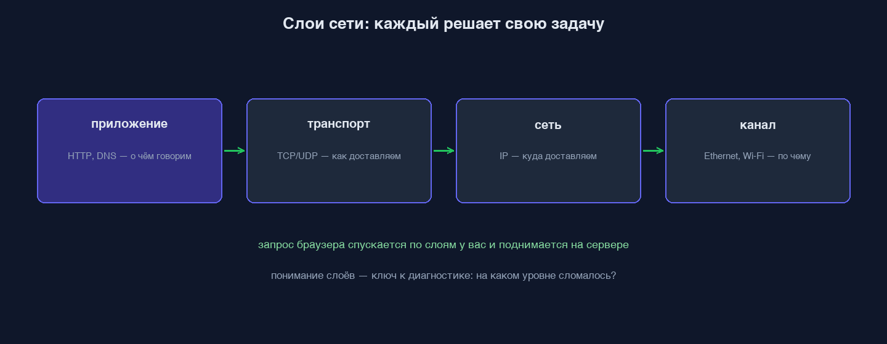

# Терминология
Хост — это любое устройство, подключенное к сети и имеющее собственный сетевой адрес (обычно IP-адрес), через который оно может обмениваться данными с другими участниками сети.

Протокол — общий язык обмена, стандартизированный набор правил по которым устройства обмениваются данными в компьютерной сети. Обе стороны обязаны говорить на одном протоколе, иначе не поймут друг друга. HTTP, TCP, DNS — всё это протоколы, каждый со своими правилами.

Соединение — установленный канал между двумя сторонами, по которому идёт обмен. Это как открытая телефонная линия: пока «трубка снята», по каналу можно гонять данные туда-обратно; повесили трубку — соединение закрыто. Клиент устанавливает соединение (делает первый шаг), стороны по нему общаются, потом соединение закрывается.

# Путь одного запроса: от браузера до ответа
Вы набрали `https://example.com` и нажали Enter. Через долю секунды на экране страница. Между этими двумя моментами запрос проходит цепочку из нескольких шагов:
1. Разбор URL. Браузер вытаскивает из адреса имя хоста (`example.com`), схему (`https` → порт 443) и путь (`/`).
2. DNS переводит имя в IP (например `93.184.216.34`).
3. TCP: установка соединения. Браузер открывает надёжный канал к этому IP на нужный порт — «трубу», по которой можно слать байты в обе стороны.
4. HTTP: отправка запроса. По установленному каналу уходит текст запроса: `GET / HTTP/1.1`, заголовки, тело.
5. Сервер формирует ответ. Обрабатывает запрос и отдаёт статус, заголовки и тело (HTML, JSON, картинку).
6. Ответ едет обратно по тому же соединению.
7. Браузер рендерит полученный HTML в страницу.

**Ошибки**
`ENOTFOUND`, DNS-ошибка — слой имён. Домен не удалось перевести в IP. Соединение даже не начиналось — некуда было идти. Что чинить: опечатку в домене, запись в DNS, файл `hosts`, доступность резолвера. Порт и сервер тут ни при чём — мы про них ещё не спросили.

`ECONNREFUSED` — слой соединения (TCP). Имя перевелось в IP, происходит попытка установить соединение, но на этом порту никто не слушает. Хост жив и активно отвечает «соединение отвергнуто». Это не проблема имени — имя как раз отработало. Типичная причина: сервис не запущен, упал, или вы стучитесь не на тот порт (3000 вместо 8080).

Запомните разницу: `ENOTFOUND` = «не знаю, где это». `ECONNREFUSED` = «знаю где, но там закрыто и мне это прямо сказали».

`Таймаут (connect/read timeout).` Пакеты уходят, но ответа в срок нет. В отличие от `ECONNREFUSED`, где хост явно отвечает «закрыто», при таймауте — тишина. Причина коварнее: фаервол молча дропает пакеты (не отвечает вообще), сервер перегружен и не успевает, или адрес вообще не тот и по нему никто не живёт. «Отказ» — это ответ; «таймаут» — это молчание.

`502 Bad Gateway` — HTTP-слой, но чужой. Это код ответа, а значит DNS и TCP уже отработали: имя нашлось, соединение встало, диалог состоялся. Само наличие HTTP-кода — сигнал, что нижние слои живы. `502` означает: ваш прокси/шлюз (nginx, балансировщик) достучался до вас, но вышестоящий сервер за ним отдал мусор или лёг. Виноват не прокси — виноват апстрим за ним.

`CORS` — вообще не сетевой сбой. Запрос дошёл, и ответ пришёл полностью. Но браузер, по своей политике безопасности, запретил коду на странице прочитать этот ответ. Ключевое следствие: `curl` и бэкенд этой ошибки не видят — она живёт только в браузере. Если `curl` к API работает, а фронтенд ругается на CORS — сеть в порядке, чините заголовки ответа на сервере, а не соединение.

# Почему первый запрос к новому домену медленнее
Что именно происходит только в первый раз:
1. Имя `example.com` впервые нужно перевести в IP — а это поход к DNS-резолверу (иногда с обходом цепочки серверов). Занимает свой RTT. Результат кэшируется на время TTL записи, поэтому во второй раз IP берётся из кэша мгновенно. TTL — это срок годности DNS-записи в кэше.
2. Открыть новый канал стоит как минимум одного round-trip на рукопожатие (для HTTPS добавляется ещё TLS-рукопожатие — ещё round-trip'ы). Уже открытое соединение часто переиспользуется для следующих запросов.

Итого первый запрос платит: DNS-резолв + установка TCP(+TLS) соединения — всё это ещё не закешировано и не переиспользовано. На повторных запросах и DNS уже в кэше, и соединение уже живо — остаётся только сам обмен HTTP.