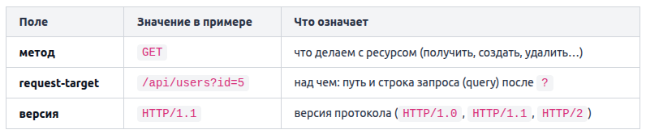

Любой HTTP-запрос, каким бы сложным он ни казался, состоит из четырёх частей, идущих строго в этом порядке:

1. Стартовая строка (request-line) — что делаем и над чем. Ровно одна строка.
2. Заголовки (headers) — метаданные запроса, по одному на строку.
3. Пустая строка-разделитель — обязательна, отделяет заголовки от тела.
4. Тело (body) — сами данные (есть не всегда).

Вот как выглядит настоящий GET-запрос целиком, «сырьём», как он уходит в сокет:
```
GET /api/users?id=5 HTTP/1.1
Host: api.example.com
Accept: application/json
User-Agent: curl/8.4.0

```

Первая строка — стартовая. Следующие три — заголовки. Затем пустая строка. Тела у этого GET нет — поэтому после пустой строки ничего.

**Стартовая строка**

Стартовая строка несёт три поля, разделённых одним пробелом: `МЕТОД SP request-target SP версия CRLF`.

На примере: `GET /api/users?id=5 HTTP/1.1`



Тело есть не у каждого запроса — оно зависит от метода и смысла:

* GET, HEAD — тела обычно нет: они просто запрашивают ресурс, отправлять серверу нечего. Параметры GET едут в query-строке (`?id=5`), а не в теле.
* POST, PUT, PATCH — тело есть: именно в нём отправляемые данные (JSON, форма, файл).

Вот тот же ресурс, но через POST с JSON-телом:
```
POST /api/users HTTP/1.1
Host: api.example.com
Content-Type: application/json
Content-Length: 23

{"name":"Ada","age":36}
```

# Методы
Семь методов покрывают почти всю работу разработчика с API:
- GET: получить ресурс, ничего не меняя
- POST: создать ресурс или отправить данные на обработку
- PUT: заменить ресурс целиком по известному URI
- PATCH: частично изменить ресурс
- DELETE: удалить ресурс
- HEAD: как GET, но сервер вернёт только заголовки, без тела
- OPTIONS: спросить, какие методы и возможности поддерживает ресурс

`OPTIONS` вы редко пишете руками, но браузер сам шлёт его в так называемом CORS-preflight — спрашивает сервер «мне можно сюда POST-ить с этого домена?» — прежде чем отправить настоящий запрос.

Методы делят на группы по тому, как они влияют на состояние сервера. Первое свойство — безопасность (safe). Безопасный метод не меняет состояние сервера. Он предназначен только для чтения. Сколько бы раз вы его ни вызвали — на сервере ничего не создастся, не удалится и не изменится. К безопасным относятся ровно три метода: GET, HEAD, OPTIONS. Все остальные (`POST`, `PUT`, `PATCH`, `DELETE`) — небезопасные: они существуют именно затем, чтобы что-то поменять.

Зачем это разработчику на практике:
- Кэши и прокси свободно кэшируют ответы `GET`, потому что знают: запрос ничего не сломал. `POST` они по умолчанию не кэшируют.
- Поисковые роботы и превью-боты ходят по ссылкам методом `GET`. Отсюда классический баг: если сделать кнопку «Удалить» обычной ссылкой (`GET /delete?id=5`), робот, предзагрузчик браузера или антивирус пройдётся по ней и удалит данные. Удаление обязано ехать небезопасным методом (`POST`/`DELETE`), а не прятаться за `GET`.

Важно: «безопасный» — это про намерение и контракт, а не гарантия. Технически сервер может на `GET` что-то записать (например, в лог или счётчик). Но по спецификации `GET` не должен приводить к значимому изменению состояния, и весь мир (кэши, боты, браузеры) на это рассчитывает. Нарушите контракт — получите тонкие баги.

Второе свойство метода — идемпотентность. Слово пугает, идея простая.

Метод идемпотентен, если повторение одного и того же запроса приводит к тому же итоговому состоянию сервера, что и один запрос. Не «возвращает тот же ответ», а «оставляет сервер в том же состоянии». Один раз или пять раз подряд — результат на сервере одинаковый. Идемпотентные методы: `GET`, `HEAD`, `OPTIONS`, `PUT`, `DELETE`.

Теперь главное практическое следствие — ретраи. Сеть ненадёжна: запрос ушёл, а ответ не вернулся в срок. Клиент, прокси или очередь задач стоят перед вопросом: повторять или нет? Ответ диктует идемпотентность.

HTTP-клиенты, балансировщики и библиотеки ретраев по умолчанию автоматически повторяют идемпотентные методы, обычно с экспоненциальной задержкой (backoff).

Неидемпотентный запрос повторять опасно. Если `POST /payments` дошёл, деньги списались, но ответ потерялся — слепой повтор спишет второй раз. Поэтому `POST` автоматически не ретраят. Как всё-таки безопасно повторять `POST`, когда очень надо? Вводят ключ идемпотентности: клиент генерирует уникальный `Idempotency-Key` и шлёт его в заголовке. Сервер запоминает уже обработанные ключи и на повтор с тем же ключом не создаёт второй платёж, а возвращает прежний результат. Так работают платёжные API (Stripe и другие) — они превращают неидемпотентную по своей природе операцию в безопасную для повтора.