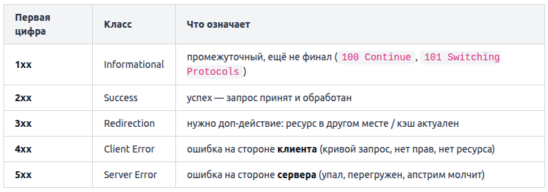

Ответ сервера устроен точно так же как запрос — те же четыре части в том же порядке. Меняется только первая строка: у ответа это `status-line` (статус-строка).

```
HTTP/1.1 200 OK                      <- status-line
Content-Type: application/json       <- заголовки
Content-Length: 27
                                     <- пустая строка-разделитель
{"id":5,"name":"Ann"}               <- тело
```

Логика полностью симметрична запросу:

- status-line — итог обработки одной строкой;
- заголовки — метаданные ответа (`Content-Type`, `Content-Length`, `Set-Cookie`, `Location`…);
- пустая строка (`CRLF CRLF`) — обязательный разделитель между заголовками и телом;
- тело — сами данные (HTML, JSON) либо текст ошибки. Тело есть не всегда: у `204 No Content` и у ответа на `HEAD` его нет вовсе.

Статус-строка — это ровно три поля, разделённые одним пробелом (`SP`), и завершённые `CRLF`:

```
версия  SP  код  SP  reason-phrase  CRLF
HTTP/1.1    200     OK
```

Разберём поля слева направо:

1. Версия протокола — `HTTP/1.0`, `HTTP/1.1` или `HTTP/2`. Та же версия, что была в запросе.
2. Код состояния (status code) — ровно три цифры: `200`, `404`, `503`. Это главный, машиночитаемый сигнал: по нему клиент однозначно понимает исход.
3. reason-phrase — человекочитаемая расшифровка (`OK`, `Not Found`, `Service Unavailable`). Она необязательна и нужна только людям: клиент на неё не полагается, потому что текст может отличаться у разных серверов (`Not Found` против `File not found`) или отсутствовать. Ориентироваться на неё в коде — ошибка.

# Классы кодов
Весь смысл трёхзначного кода начинается с первой цифры — она задаёт класс ответа. Достаточно взглянуть на неё, чтобы мгновенно понять исход, ещё не зная точного кода:



- `200 OK` — базовый успех с телом. `GET`, вернувший данные, отвечает `200`. В теле — то, что вы просили (JSON, HTML).
- `201 Created` — ресурс создан (типичный ответ на успешный `POST`). Вместе с ним сервер обычно шлёт заголовок `Location` с адресом нового ресурса.
- `204 No Content` — успех, но тело пустое Частый ответ на `DELETE` или на `PUT`, когда возвращать нечего: «сделано, показывать нечего». Клиенту не нужно читать тело.
- `301 Moved Permanently` — ресурс навсегда переехал; новый адрес — в заголовке `Location`. Браузеры и поисковики запоминают новый URL. Пример: редирект с `http://` на `https://` или со старого домена на новый.
- `304 Not Modified` — «ваша кэшированная копия ещё актуальна». Тело не передаётся — экономия трафика: клиент берёт данные из кэша. Сервер отвечает так на условный запрос, когда ресурс не менялся.
- `400 Bad Request` — сервер не смог разобрать запрос: сломанный JSON, не прошла валидация, не хватает обязательного поля.
- `401 Unauthorized` — вы не аутентифицированы: токена нет, он протух или неверный. Сервер не знает, кто вы.
- `403 Forbidden` — вы аутентифицированы (сервер знает, кто вы), но прав на это действие нет.
- `404 Not Found` — ресурса по этому URL нет. Опечатка в пути, удалённая запись, неправильный `id`.
- `429 Too Many Requests` — сработал rate-limit: вы шлёте слишком часто.
- `500 Internal Server Error` — на сервере вылетело необработанное исключение или баг в коде. Самый общий «что-то пошло не так внутри».

Следующие три кода почти всегда означают проблему за прокси/шлюзом, а не в самом прокси. Представьте схему: браузер → nginx (шлюз) → ваше приложение (апстрим). Nginx работает — а вот апстрим отвечает плохо:
- `502 Bad Gateway` — шлюз достучался до апстрима, но получил мусор или тот вообще лёг (приложение упало/не запущено). Сам факт 502 значит, что DNS и TCP отработали, шлюз жив — сломан апстрим.
- `503 Service Unavailable` — сервис временно недоступен перегружен или на плановом обслуживании. Часто приходит с заголовком `Retry-After`, подсказывающим, когда вернуться.
- `504 Gateway Timeout` — шлюз ждал ответа апстрима, но тот не ответил вовремя. Апстрим завис на тяжёлом запросе или не поднялся.

В отличие от 4xx (кроме 429), серверные ошибки часто временны, поэтому их имеет смысл повторить — но с backoff (нарастающей паузой между попытками), чтобы не добить перегруженный сервис.