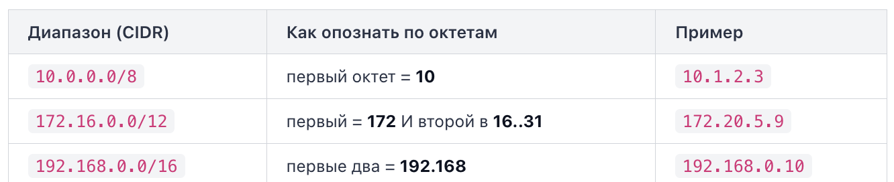
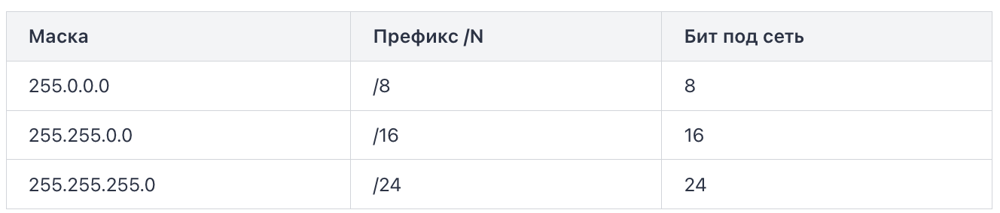

Под капотом это одно 32-битное число, но людям его показывают в удобной записи — четыре октета через точку.

Октет — это 8 бит. Восемь бит дают `2^8 = 256` разных значений, поэтому каждый октет — это число **от 0 до 255** включительно. Отсюда весь диапазон адресов: от `0.0.0.0` до `255.255.255.255`.

Перемножим: `256 × 256 × 256 × 256 ≈ 4.3 млрд` адресов. Звучит много, но устройств в мире больше — именно эта нехватка породила IPv6 (128 бит вместо 32).

Не каждый IP «виден» из интернета. Адреса делятся на два больших мира:
- Публичные — маршрутизируются в интернете, уникальны глобально. Такой адрес у вашего домашнего роутера снаружи, у публичного DNS `8.8.8.8`, у любого сайта.
- Приватные — используются только внутри локальных сетей. В большой интернет они не маршрутизируются: наружу вы выходите через NAT, который подменяет приватный адрес на публичный адрес шлюза.

Приватные диапазоны закреплены стандартом RFC 1918 — их ровно три, и узнаются они по началу адреса:



Внимание к границам у `172`: приватны только `172.16.x.x` … `172.31.x.x`.

Помимо «приватный/публичный» есть ещё два диапазона со специальным смыслом.

Loopback — обращение к самому себе. Адрес `127.0.0.1` (тот самый localhost) означает «эта же машина». Пакет на loopback никуда не уходит по сети — он разворачивается внутри ядра ОС. Важно: loopback — это весь диапазон `127.0.0.0/8`, то есть любой адрес с первым октетом `127`.

Диапазон `169.254.0.0/16` (первые октеты `169.254`) — это `link-local`. Если ОС не смогла получить адрес от DHCP-сервера, она сама присваивает себе адрес из этого диапазона. Практический сигнал: увидели у интерфейса `169.254.x.x` — сеть настроена неправильно, DHCP не выдал адрес, интернета не будет. Это диагностический маркер, а не рабочий адрес.

DHCP (Dynamic Host Configuration Protocol) — это сетевой протокол, который автоматически выдаёт устройствам IP-адреса и другие сетевые настройки.

У IPv4-адреса есть внутренняя структура: часть его битов отвечает за сеть (в какой группе машин мы находимся), а оставшиеся — за хост (конкретная машина внутри этой группы). Сколько именно старших бит уходит под сеть, показывает маска подсети. Классическая запись маски — как обычный IPv4-адрес из единичных бит слева и нулевых справа:

```
255.255.255.0  = 11111111 11111111 11111111 00000000
                 └──────── 24 единицы ────────┘ └8 нулей┘
```

Единицы маски отмечают биты сети, нули — биты хоста. В примере выше 24 бита сети и 8 бит хоста.

Писать маску целиком долго, поэтому есть краткая форма `CIDR` — просто число единичных бит после слэша:



Не все адреса подсети можно раздать машинам. Два зарезервированы:
- адрес сети — все хостовые биты равны 0 (например `192.168.1.0` в `/24`). Это «имя» самой подсети, не хост.
- broadcast (широковещательный) — все хостовые биты равны 1 (`192.168.1.255` в `/24`). Пакет на него уходит всем в подсети сразу.

Поэтому пригодных для хостов адресов на два меньше: `пригодных = 2^(32 − N) − 2`.

На очень маленьких префиксах формула `−2` ломается (дала бы 0 или отрицательное), поэтому у них своё правило:

- /31 — `2^(32−31) = 2` адреса, и оба используются как концы двухточечного линка (broadcast там не нужен). Пригодных = 2.
- /32 — `2^0 = 1` адрес, одиночный хост (маршрут «ровно на эту машину»). Пригодных = 1.