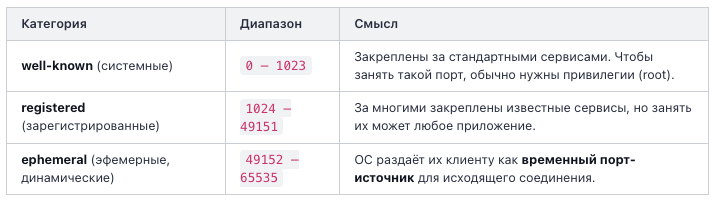

Порт это обязательное для сетевого соединения 16-битное число (0–65535), которое работает как номер двери в большом здании. Адрес здания — это IP (хост), а порт — конкретная дверь, за которой сидит нужное приложение.

Когда мы говорим «приложение слушает порт», это значит: приложение сказало операционной системе «все входящие соединения на этот порт отдавай мне». Пришёл запрос на `:5432` — ОС отдаёт его PostgreSQL; на `:80` — веб-серверу.

Два приложения не могут одновременно слушать один и тот же порт на одном адресе.

Для стандартных схем порт подставляется неявно:
- `http://` → порт 80
- `https://` → порт 443

Эти двое — часть большого набора хорошо известных портов (well-known, диапазон 0–1023), закреплённых за стандартными сетевыми службами и протоколами. Браузер, встретив `https://example.com`, сам достраивает адрес до `example.com:443`.

Явно указанный порт всегда главнее, чем правило по умолчанию.

Пространство портов поделено на три категории:

Нестандарные/пользовательские порты (обычно 1024 и выше), не требуют прав администратора и не закреплены жёстко ни за кем.