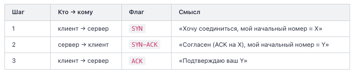
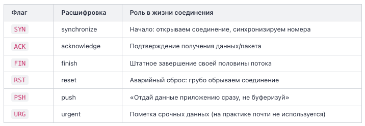

TCP не начинает передавать данные, пока обе стороны формально не договорятся, что соединение открыто. У любого TCP-соединения три фазы:
1. Установка — стороны согласуют начальные номера и убеждаются, что канал двусторонний.
2. Обмен данными — байты текут в обе стороны.
3. Закрытие — каждая сторона аккуратно сообщает, что закончила передавать.

**Тройное рукопожатие**
Установка занимает ровно три пакета. Разберём на примере: браузер (клиент) подключается к серверу на порт 443.

SYN — это synchronize (синхронизация номеров), ACK — acknowledge (подтверждение). После третьего пакета соединение в состоянии ESTABLISHED, и только теперь можно слать HTTP-запрос.

Почему именно три шага? Ответ — в двух задачах, которые handshake обязан решить одновременно.

Задача 1: синхронизировать номера в обе стороны. TCP нумерует каждый байт (sequence number), чтобы собирать поток в правильном порядке и понимать, что потерялось. Начальный номер выбирается случайно и у каждой стороны свой. Значит, синхронизировать нужно дважды:
- клиент сообщает свой начальный номер (пакет 1, `SYN`);
- сервер сообщает свой начальный номер (пакет 2, часть `SYN-ACK`).

Задача 2: убедиться, что канал двусторонний. Надёжность бессмысленна, если данные идут только в одну сторону. Handshake доказывает, что работают оба направления:
- пакет 1 (`SYN`) доказывает: клиент → сервер доставляет;
- пакет 2 (`SYN-ACK`) доказывает: сервер → клиент доставляет, и подтверждает получение SYN;
- пакет 3 (`ACK`) доказывает: клиент получил ответ сервера.

Пакеты 2 и 3 совмещают подтверждение чужого SYN и передачу/подтверждение своего. Именно поэтому средний пакет несёт сразу два флага — `SYN` и `ACK`. Убери любой из трёх шагов — и одна из сторон останется без гарантии, что её слышат. Три — это минимум, при котором обе стороны синхронизированы и уверены в двусторонней связи.

Цена: прежде чем уйдёт хоть один байт полезных данных, нужен полный round-trip (пакет 1 туда, пакет 2 обратно). Это добавляет задержку в один RTT к каждому новому соединению — плата за надёжность, которой у UDP нет.

Соединение установили, данные передали — теперь надо аккуратно закрыть. TCP закрывается не одним махом, а по половинкам: соединение двунаправленное, и каждая сторона закрывает своё направление отдельно.

Штатное закрытие через FIN. Флаг `FIN` (finish) означает «я закончил передавать данные». Вежливое завершение выглядит так:
1. Сторона A шлёт `FIN` — «данных от меня больше не будет».
2. Сторона B подтверждает: `ACK`.
3. Теперь сторона B шлёт свой `FIN` — «и от меня всё».
4. Сторона A подтверждает: `ACK`.

Обратите внимание: в закрытии участвуют `FIN` и `ACK` с обеих сторон — это отражает, что закрываются две независимые «половины» потока.

Полузакрытие (half-close). После того как A отправила `FIN`, она больше не шлёт данные, но всё ещё может их принимать от B, пока B не пришлёт свой `FIN`. Такое состояние называют полузакрытым. На практике это позволяет, например, клиенту сказать «я всё отправил», но дочитать ответ сервера до конца.

Состояние TIME-WAIT. Сторона, закрывшая соединение последней, ещё какое-то время держит его в состоянии `TIME-WAIT` — на случай, если последний `ACK` потеряется и придётся переслать. Поэтому только что освобождённый локальный порт нельзя мгновенно занять снова. Если при рестарте сервиса вы видите `Address already in use` — часто это как раз недавние сокеты в TIME-WAIT.

В заголовке каждого TCP-сегмента есть набор однобитных **флагов** — они говорят, что это за пакет и что с ним делать. В одном пакете может быть поднято сразу несколько флагов (мы уже видели `SYN-ACK` — это два бита вместе). Вот те, что стоит знать:

`PSH` и `URG` касаются самой передачи данных, а не открытия/закрытия. Ключевой новый флаг здесь — `RST`.

FIN против RST:
- `FIN` — это «до свидания»: сторона закончила, вторая подтверждает, буферы дочитываются. Порядок и целостность соблюдены.
- `RST` — это «связь оборвана»: собеседник немедленно выбрасывает соединение, недосланные данные теряются, никакого обмена подтверждениями. `RST` прилетает, когда продолжать разговор нельзя или бессмысленно — например, пакет пришёл на порт, который никто не слушает, или приложение аварийно закрыло сокет.

Что физически происходит при «connection refused»? Клиент шлёт первый пакет рукопожатия — `SYN` — на `хост:порт`. Дальше два исхода в зависимости от того, что вернётся:

- Порт слушают → сервер отвечает `SYN-ACK`, рукопожатие продолжается, соединение установится.
- На порту никто не слушает → операционная система хоста отвечает пакетом с флагом `RST`. Для клиента это мгновенное «`connection refused`»: хост жив и доступен, но нужного сервиса на этом порту нет (не запущен, упал или слушает другой порт).
- Ответа нет вообще (пакет молча дропнут фаерволом или ушёл в никуда) → клиент не получает ни `SYN-ACK`, ни `RST` и в итоге упирается в таймаут.

UDP не делает ничего из этого. Нет рукопожатия, нет `SYN`/`ACK`/`FIN`, нет состояния соединения. Отправитель просто шлёт датаграмму «в мир»: дойдёт — хорошо, не дойдёт — он даже не узнает.