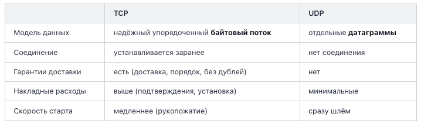

IP доставляет пакеты между хостами по адресам. Но IP сам по себе — «почтальон без гарантий»: он может потерять пакет, доставить дубликат или перепутать порядок. Поверх IP работают транспортные протоколы, которые решают, как именно приложения обмениваются данными. Их два: TCP и UDP.

Оба протокола используют одну и ту же идею портов — числовой «номер двери» приложения на хосте. И TCP, и UDP кладут в свой заголовок порт источника и порт назначения. На этом их сходство заканчивается.

TCP (Transmission Control Protocol) даёт приложению иллюзию непрерывного потока байтов: что вы записали на одном конце, то в том же порядке, целиком и без искажений прочитается на другом.

Как TCP добивается надёжности поверх ненадёжного IP — на пальцах, четыре механизма:
1. Нумерация байтов (sequence number). Каждому отправленному байту присвоен порядковый номер. Получатель по номерам понимает, в каком порядке собирать данные и не пришёл ли дубликат.
2. Подтверждения (ACK). Получатель сообщает отправителю: «байты до номера N я получил». Пока подтверждения нет — отправитель считает, что данные могли потеряться.
3. Повторная отправка (retransmission). Если ACK не пришёл за отведённое время, TCP отправляет потерянный кусок заново. Так теряющиеся пакеты «залечиваются» незаметно для приложения.
4. Контроль потока и перегрузки. TCP не заваливает получателя и сеть больше, чем они способны переварить: размер отправляемого «окна» подстраивается под то, как быстро приходят подтверждения.

Итог этих механизмов — три свойства потока, которые TCP гарантирует приложению:
- доставка — данные дойдут (или соединение будет разорвано с ошибкой, молчком не пропадёт);
- порядок — байты придут ровно в том порядке, в каком отправлены;
- без дублей — повторно доставленный сетью пакет получатель отбросит.

Плата за это — накладные расходы: заголовок TCP больше, идёт постоянный обмен подтверждениями, а перед передачей нужно установить соединение.

UDP (User Datagram Protocol) — это тонкая обёртка над IP: он добавляет к пакету всего лишь порты источника и назначения плюс простую контрольную сумму — и всё. Никакой установки соединения, нумерации, подтверждений и повторной отправки.

Что это значит на практике:
- Нет соединения (connectionless). Отправитель просто выстреливает датаграмму — самодостаточную порцию данных — в сторону адреса и порта. Никакого рукопожатия заранее.
- Нет гарантий доставки. Датаграмма может не дойти, и UDP об этом никак не сообщит. Хотите надёжности — реализуй её сам на уровне приложения.
- Нет гарантии порядка. Две датаграммы могут прийти в обратном порядке, и UDP их не переставит.
- Нет защиты от дублей. Если сеть доставит копию — получатель получит две.

Зачем такой «ненадёжный» протокол? Ради скорости и минимума задержек. Раз нет установки соединения — можно слать сразу, без раунда «туда-обратно». Раз нет подтверждений и повторов — нет ожидания и лишнего трафика. Заголовок UDP крошечный (8 байт против 20+ у TCP).

Где это выигрышно: там, где свежесть данных важнее полноты. В видеозвонке потерянный кадр не нужно переотправлять — пока он доедет, разговор уйдёт вперёд; лучше показать следующий кадр. В онлайн-игре важна текущая позиция игрока, а не устаревшая. DNS-запрос — это один маленький вопрос и один ответ: дешевле выстрелить датаграммой и при молчании спросить ещё раз, чем городить TCP-соединение ради пары пакетов.

Самое тонкое различие — что происходит с границами сообщений.

TCP — это поток байтов, границы сообщений НЕ сохраняются. TCP видит не «сообщения», а сплошную ленту байтов. Если приложение сделало два вызова отправки — `send("ABC")` и `send("DEF")` — на другом конце они могут слиться в одно чтение `recv() -> "ABCDEF"`, либо, наоборот, прийти по частям: `"AB"`, потом `"CDEF"`. TCP гарантирует лишь порядок и полноту байтов, но не то, что один `send` соответствует одному `recv`. Поэтому поверх TCP приложения сами договариваются, где кончается одно сообщение: в HTTP это заголовок `Content-Length` или пустая строка-разделитель, в других протоколах — префикс длины или спецсимвол-разделитель. Явление, когда несколько логических сообщений склеились в потоке, называют «слипанием» пакетов.

UDP — это датаграммы, границы сохраняются. Одна отправленная датаграмма — ровно одно принятое чтение. Отправили две датаграммы — получатель прочитает их как две отдельные порции, не больше и не меньше (или не получит вовсе, если потерялась). Границы каждого сообщения UDP сохраняет — это его сильная сторона для протоколов «вопрос-ответ» вроде DNS.

Отсюда и разные модели соединения:

- TCP — connection-oriented: перед передачей стороны устанавливают соединение, договариваются о начальных номерах, и только потом течёт поток. Соединение — это устойчивый двусторонний канал.
- UDP — connectionless: никакого «канала» нет, каждая датаграмма живёт сама по себе и адресуется независимо.

Запомните формулу: TCP — надёжный упорядоченный поток без границ сообщений; UDP — отдельные датаграммы с сохранением границ, но без гарантий доставки.

На TCP работают протоколы, где искажение или потеря данных недопустимы:
- HTTP / HTTPS — веб и API: страница или JSON должны прийти целиком, иначе они бессмысленны.
- SSH — удалённый терминал: пропущенный символ команды — катастрофа.
- SMTP — доставка почты: письмо не должно потерять кусок.
- Базы данных (например PostgreSQL на порту 5432) — запросы и результаты должны быть точными.

На UDP работают протоколы, где важна скорость и потеря одного пакета не ломает картину:
- DNS-запросы — маленький вопрос, маленький ответ; при потере просто спросим снова.
- VoIP и видеозвонки — свежесть кадра важнее его переотправки.
- Онлайн-игры — актуальная позиция важнее устаревшей.
- DHCP — получение IP-адреса при входе в сеть, когда своего адреса ещё нет.